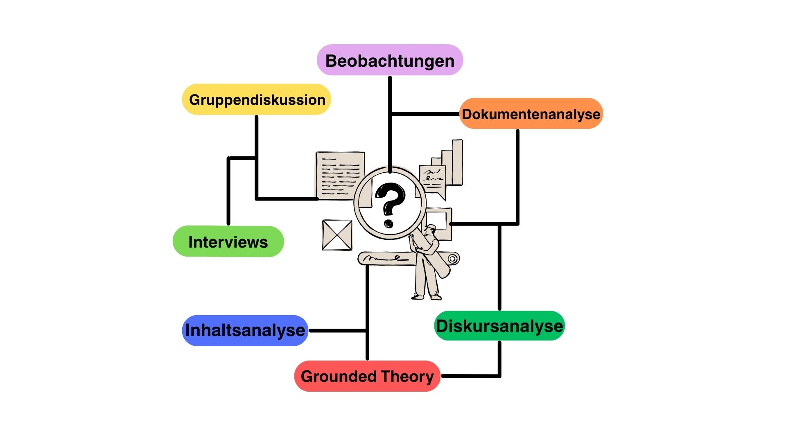
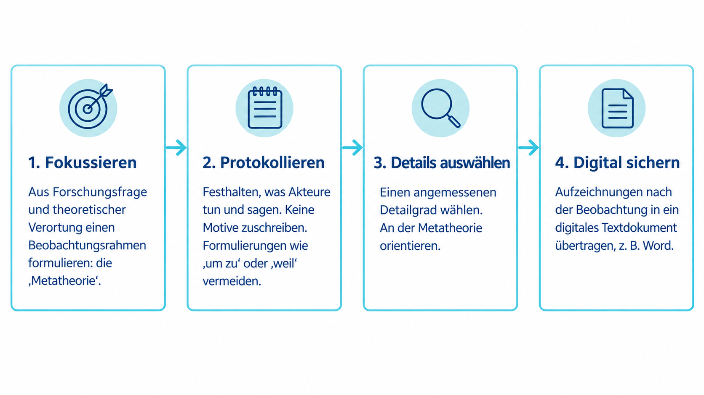
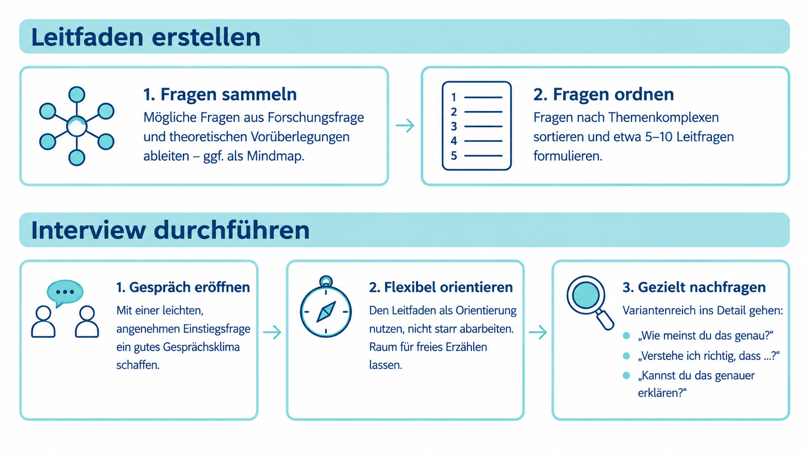

<!--
author: Tjari Klimpki, Tim Heemsoth, Melina Burmeister
email: tim.heemsoth@uni-flensburg.de
version: 1.0.0
language: de
narrator: Deutsch Female

import:  https://raw.githubusercontent.com/EUF-SpoWis/BA_PSW_Einfuehrung_Sportwissenschaft/refs/heads/main/config.md

link:   https://cdnjs.cloudflare.com/ajax/libs/animate.css/4.1.1/animate.min.css
        https://cdn.jsdelivr.net/gh/EUF-SpoWis/Wissenschaftliches-Arbeiten@main/Lia-Anpassungen/Ausblendungen.css

-->

# Grundlagen zum Qualitativen Forschen 


[](https://liascript.github.io/course/?https://raw.githubusercontent.com/EUF-SpoWis/BA_PSW_Einfuehrung_Sportwissenschaft/main/04_Qualitatives_Forschen.md#1)

| Parameter                | Kursinformationen                                                                               |
| ------------------------ | ----------------------------------------------------------------------------------------------- |
| **Veranstaltung:**       | @config.lecture                                                                                 |
| **Semester:**            | @config.semester                                                                                |
| **Hochschule:**          | `Europa-Universität Flensburg`                                                                  |
| **Inhalte:**             | `Unterscheidung zentraler Forschungsparadigmen; Qualitative Forschungsmethoden mit Schwepunkt auf Beobachutng und Interview`                  |
| **Link auf GitHub:**     | https://github.com/EUF-SpoWis/BA_PSW_Einfuehrung_Sportwissenschaft/blob/main/04_Qualitatives_Forschen.md      |
| **Autoren:**             | @author                                                                                         |

> (c) Alle Rechte vorbehalten. 

## Einstieg

>[!Note] Arbeitsauftrag
>Was macht ein gutes Gedicht aus?

{{1}}
*****
--{{1}}--
Schaue nun einen Ausschnitt aus der folgenden Szene des Films *Dead Poets Society* bis 2:28:

<div style="width: 100%;">
  <iframe
    src="https://www.youtube.com/embed/8x0COtH4Vrw?start=0&amp;end=148"
    title="Dead Poets Society – Reißt es raus, Ausschnitt bis 2:28"
    style="display: block; width: 100%; aspect-ratio: 16 / 9; border: 0;"
    allow="fullscreen; picture-in-picture"
    allowfullscreen>
  </iframe>
</div>

*****

<!--- John Keating (die Lehrkraft) widerspricht dem Lehrbuch, das sagt, dass die Qualität eines Gedichts numerisch messbar sei. 
Manche Gegenstände benötigen anders gelagerte Verfahren der Auseinandersetzung, um sie zu durchdringen. 
Auch derartige Forschungsgegenstände gibt es in der Sportwissenschaft. Sie benötigen Verfahren, die sich mit Details, Hintergründen und Bedeutungen auseinandersetzen.
--->

## Fahrplan 

1. Forschungsparadigen: Qualitativ - Quantitativ - Mixed-Methods 
2. Qualitatives Forschen: Was kennzeichnet qualitative Forschung – und für welche Fragen eignet sie sich?
3. Zentrale Methoden qualitativen Forschens
   - Beobachtung: Wie lässt sich durch Beobachten etwas ber Handlungen und soziale Zusammenhänge erfahren?
   - Interview: Wie erschließen wir Erfahrungen und Sichtweisen in Gesprächen?
4. Qualitative Inhaltsanalyse als zentrales Auswertungsverfahren 

## Qualitatives Forschen als Paradigma
<style>
.lia-effect__circle {
  display: none !important;
}
</style>

<!-- class="animate__animated animate__fadeIn" -->
In den empirischen Sozialwissenschaften unterscheiden wir im Wesentlichen zwischen drei **Forschungsparadigmen**

<!-- class="animate__animated animate__slideInLeft" -->
<div style="border: 2px solid #278f25; border-radius: 12px; padding: 0.8rem 1.3rem; margin: 0.8rem 0;">
  <b style="color: #278f25;">Quantitatives Paradigma</b> <br> Standardisiert, messend, prüft vorab formulierte Hypothesen (theorieprüfend).
</div>

<!-- class="animate__animated animate__slideInRight" -->
<div style="border: 2px solid #1a9f8d; border-radius: 12px; padding: 0.8rem 1.3rem; margin: 0.8rem 0;">
  <b style="color: #1a9f8d;">Qualitatives Paradigma</b> <br> Sinnverstehend, rekonstruktiv, offen für das Generieren neuer Hypothesen und Theorien (theoriegenerierend).
</div>

<!-- class="animate__animated animate__slideInLeft" -->
<div style="border: 2px solid #643d8d; border-radius: 12px; padding: 0.8rem 1.3rem; margin: 0.8rem 0;">
  <b style="color: #643d8d;">Mixed-Methods</b> <br> Die systematische Kombination qualitativer und quantitativer Ansätze.
</div>

<!--- Wichtige Abgrenzung
-	Qualitatives und quantitatives Forschen sind Paradigmen der empirischen Forschung (d. h. sie basieren auf der systematischen Erhebung und Analyse empirischer Daten). 
-	Nicht-empirische Paradigmen (z. B. Hermeneutik, geisteswissenschaftliche Textanalyse) arbeiten hingegen interpretatorisch oder begriffsanalytisch, ohne eigene empirische Daten zu erheben. --->

{{1-2}}
******
> **Nach Oswald (1997) ist der Einsatz qualitativer Zugänge besonders in folgenden Situationen angebracht**
>* **Erschließen neuer Felder**: Erkundung und Beschreibung bislang wenig erforschter oder fremder Lebenswelten.
>* **Theoriegenerierung**: Entdeckung neuer Phänomene und Entwicklung theoretischer Konzepte.
>* **Tiefe Exploration**: Verstehen von hochkomplexen Handlungszusammenhängen, subjektiven Wahrnehmungen und Alltagsinterpretationen.
****

{{2-3}}
>[!Note] **Welche Forschungsfrage gehört zu welchem Paradigma? Ordne die Forschungsfrage korrekt zu** <br>
>1. In welchem Zusammenhang stehen physiologische Stressmarker, Trainingspensum und das subjektive Beanspruchungserleben bei Athlet:innen in intensiven Trainingsphasen? [[ Quantitatives Paradigma | Qualitatives Paradigma | (Mixed-Methods) ]]
>2. Inwieweit ist ein High-Intensity-Training (HIT) effektiver für die VO2max-Steigerung als ein Grundlagentraining nach der norwegischen Methode? [[ (Quantitatives Paradigma) | Qualitatives Paradigma | Mixed-Methods ]]
>3. Wie erleben und verarbeiten Nachwuchsleistungssportler:innen den Übergang vom Breitensport in das Internat eines Nachwuchsleistungszentrums? [[ Quantitatives Paradigma | (Qualitatives Paradigma) | Mixed-Methods ]]

### Gegenstandsbereich

<div style="border-left: 6px solid #bd4e9cff; background: #f2f6fb; border-radius: 0 12px 12px 0; padding: 1rem 1.4rem; margin: 1rem 0;">
Der zentrale Forschungsauftrag der qualitativen Forschung ist die **Rekonstruktion von Sinn, subjektiven Sichtweisen, Alltagstheorien und Bedeutungskonstruktionen** (Helfferich, 2011).
</div>

{{1}}
******
**Zentrale Forschungsfragen sind**

<div style="border: 2px solid #4e66bd; border-radius: 12px; padding: 0.8rem 1.3rem; margin: 0.8rem 0;">
- **Warum** tun Menschen das, was sie tun? <!--- z. B. Warum stören einzelne Schüler*innen den Unterricht --->
- Welche **subjektive Bedeutung** schreiben Personen ihren Handlungen und Erfahrungen zu? <!--- z. B. Inwieweit erleben Trainer*innen ihr Handeln als wirksam? --->
- Welche **Sinnstrukturen** und **sozialen Wissensordnungen** steuern ihr Handeln? <!--- z. B. Warum dopen Athler*innen? --->
</div>
******

### Grundsätze qualitativen Denkens

<section>

<!-- class="animate__animated animate__fadeIn" -->

<div style="display: grid; grid-template-columns: repeat(3, minmax(0, 1fr)); gap: 15px; margin: 20px 0; text-align: center; font-size: 1.2em;">

  <div class="animate__animated animate__fadeInUp" style="background: #f8fafc; border: 1px solid #e2e8f0; padding: 15px; border-radius: 8px;">
    <div style="font-size: 1.5em; margin-bottom: 5px;">🧑</div>
    <strong style="display: block; margin-bottom: 5px;">1. Orientierung am Subjekt</strong>
    <span style="font-size: 0.85em; color: #4a5568;">Das konkrete Handeln, Denken und Erleben der Beforschten steht im Mittelpunkt.</span>
  </div>

  <div class="animate__animated animate__fadeInUp animate__delay-1s" style="background: #f8fafc; border: 1px solid #e2e8f0; padding: 15px; border-radius: 8px;">
    <div style="font-size: 1.5em; margin-bottom: 5px;">📝</div>
    <strong style="display: block; margin-bottom: 5px;">2. Deskription</strong>
    <span style="font-size: 0.85em; color: #4a5568;">Detaillierte, kontextualisierte Beschreibung des Phänomens vor jeder Bewertung oder Reduktion.</span>
  </div>

  <div class="animate__animated animate__fadeInUp animate__delay-2s" style="background: #f8fafc; border: 1px solid #e2e8f0; padding: 15px; border-radius: 8px;">
    <div style="font-size: 1.5em; margin-bottom: 5px;">🔍</div>
    <strong style="display: block; margin-bottom: 5px;">3. Interpretation</strong>
    <span style="font-size: 0.85em; color: #4a5568;">Die Daten werden durch Verstehen, Sinnrekonstruktion und Interpretation erschlossen.</span>
  </div>

  <div class="animate__animated animate__fadeInUp animate__delay-3s" style="background: #f8fafc; border: 1px solid #e2e8f0; padding: 15px; border-radius: 8px;">
    <div style="font-size: 1.5em; margin-bottom: 5px;">🏡</div>
    <strong style="display: block; margin-bottom: 5px;">4. Untersuchung im natürlichen Umfeld</strong>
    <span style="font-size: 0.85em; color: #4a5568;">Die Erhebung findet möglichst in der gewohnten Umgebung der Beteiligten statt (Feldorientierung).</span>
  </div>

  <div class="animate__animated animate__fadeInUp animate__delay-4s" style="background: #f8fafc; border: 1px solid #e2e8f0; padding: 15px; border-radius: 8px;">
    <div style="font-size: 1.5em; margin-bottom: 5px;">🧩</div>
    <strong style="display: block; margin-bottom: 5px; overflow-wrap: anywhere;">5. Verallgemeinerungsprozess</strong>
    <span style="font-size: 0.85em; color: #4a5568;">Generalisierung erfolgt schrittweise, begründet und typisierend, anstelle einer statistischen Repräsentativität.</span>
  </div>

  <div class="animate__animated animate__fadeInUp" style="animation-delay: 5s; background: #f8fafc; border: 1px solid #e2e8f0; padding: 15px; border-radius: 8px;">
    <div style="font-size: 1.5em; margin-bottom: 5px;">❓</div>
    <strong style="display: block; margin-bottom: 5px;">6. Forschungsfragen</strong>
    <span style="font-size: 0.85em; color: #4a5568;">Ausgangspunkt ist eine offene Frage bezogen auf ein Phänomen oder soziales Problem.</span>
  </div>

</div>

</section>

<div style="text-align: right; font-size: 0.85em; color: #4a5568;">
Mayring, 2002
</div>

<!---  Eine *Forschungsfrage* bestimmt das wissenschaftliche Erkenntnisziel und ist klar zu unterscheiden von etwa konkreten *Interviewfragen* (Konkretisierung im Erhebungsinstrument) sowie dem *globalen Forschungsthema*. --->

## Methoden im Überblick

### Methodenspektrum



<!--- Dabei sollte die Auswahl der Methoden stets von zwei DIngen geleitet werden: 
- Gegenstand der Untersuchung, Forschungsfrage und theoretischer Rahmen.
-  Verfügbare zeitliche, personelle und finanzielle Ressourcen.
--->

### Drei Phasen

<div style="position: relative; margin: 30px 0 60px 0;">

  <div style="display: flex; gap: 15px; justify-content: space-between; align-items: center; flex-wrap: wrap;">

    <div class="animate__animated animate__fadeInUp" style="flex: 1; min-width: 200px; background: #f0f4f8; border-left: 5px solid #2b6cb0; padding: 15px; border-radius: 8px; box-shadow: 0 2px 5px rgba(0,0,0,0.05);">
      <strong style="color: #2b6cb0; font-size: 1.1em; display: block; margin-bottom: 5px;">1. Datenerhebung</strong>
      <span style="font-size: 0.9em; color: #4a5568;">z. B. Leitfadeninterviews, teilnehmende/nicht-teilnehmende Beobachtungen</span>
    </div>

    <div class="animate__animated animate__fadeInUp animate__delay-1s" style="font-size: 1.5em; color: #a0aec0; font-weight: bold;">➔</div>

    <div class="animate__animated animate__fadeInUp animate__delay-1s" style="flex: 1; min-width: 200px; background: #f0f4f8; border-left: 5px solid #2b6cb0; padding: 15px; border-radius: 8px; box-shadow: 0 2px 5px rgba(0,0,0,0.05);">
      <strong style="color: #2b6cb0; font-size: 1.1em; display: block; margin-bottom: 5px;">2. Datenaufbereitung</strong>
      <span style="font-size: 0.9em; color: #4a5568;">z. B. Transkription, Anonymisierung, Erstellung des Feldporträts</span>
    </div>

    <div class="animate__animated animate__fadeInUp animate__delay-2s" style="font-size: 1.5em; color: #a0aec0; font-weight: bold;">➔</div>

    <div class="animate__animated animate__fadeInUp animate__delay-2s" style="flex: 1; min-width: 200px; background: #f0f4f8; border-left: 5px solid #2b6cb0; padding: 15px; border-radius: 8px; box-shadow: 0 2px 5px rgba(0,0,0,0.05);">
      <strong style="color: #2b6cb0; font-size: 1.1em; display: block; margin-bottom: 5px;">3. Analyse & Interpretation</strong>
      <span style="font-size: 0.9em; color: #4a5568;">z. B. Kodierung, Typenbildung</span>
    </div>

  </div>

  <div style="position: absolute; right: 5%; left: 5%; bottom: -35px; height: 30px;">
    <svg width="100%" height="100%" viewBox="0 0 500 40" fill="none" xmlns="http://www.w3.org/2000/svg" preserveAspectRatio="none">
      <path d="M 480 5 C 480 35, 20 35, 20 12" stroke="#2b6cb0" stroke-width="2" stroke-dasharray="4 3" fill="none" />
      <polygon points="15,14 20,4 25,14" fill="#2b6cb0" />
    </svg>
    <span style="position: absolute; bottom: -14px; left: 50%; transform: translateX(-50%); background: #ffffff; padding: 0 8px; font-size: 0.75em; color: #2b6cb0; font-weight: bold; border-radius: 4px;">
      evtl. zirkulärer Re-Analyseprozess
    </span>
  </div>

</div>

### Typische Verfahren zur Datenerhebung
<section>

| Methode | Ausprägungen & Methoden |
| :--- | :--- |
| **👁️ Beobachtung** | • Feldbeobachtung *(offen vs. verdeckt; teilnehmend vs. nicht-teilnehmend)*<br>• (Auto-)Ethnografie |
| **🗣️ Interview** | • Qualitative Interviews *(fokussiert, leitfadengestützt, narrativ, episodisch)*<br>• Gruppendiskussionen & Fokusgruppen<br>• Lautes Denken & Introspektion |
| **🧩 Weitere & Komplexe Verfahren** | • Qualitative Netzwerkanalyse, Rollenspiele, Dialog-Konsens-Methoden<br>• Biographische Methoden & Handlungsforschung<br>• Non-reaktive Verfahren *(z. B. Dokumenten- und Diskursanalysen)* |

<div style="text-align: right; font-size: 0.8em; color: #718096;">
<i>(nach Mey & Mruck, 2020; Flick et al., 1995)</i>
</div>
</section>

## Beobachtung

### Einstieg
<div style="width: 100%;">
  <iframe
    src="https://www.youtube.com/embed/IGQmdoK_ZfY?start=4&amp;end=38"
    title="Video zum Arbeitsauftrag"
    style="display: block; width: 100%; aspect-ratio: 16 / 9; border: 0;"
    allow="fullscreen; picture-in-picture"
    allowfullscreen>
  </iframe>
</div>

### Grundsätzliches
<!-- class="animate__animated animate__fadeIn" -->
<div style="border-left: 6px solid #4e66bd; background: #f2f6fb; border-radius: 0 12px 12px 0; padding: 1rem 1.4rem; margin: 1rem 0;">
Beobachtungen kommen dann zum Einsatz, wenn das reale Handeln im Zentrum steht und insbesondere sprachliche Auskünfte (z. B. in Interviews) an ihre Grenzen stoßen. Diese Grenzen sind etwa... 
</div>

{{1}}
**********************
<div style="display: grid; grid-template-columns: repeat(auto-fit, minmax(220px, 1fr)); gap: 15px; margin: 20px 0; text-align: center;">

  <div class="animate__animated animate__fadeIn" style="background: #f8fafc; border: 1px solid #e2e8f0; padding: 15px; border-radius: 8px;">
    <div style="font-size: 1.5em; margin-bottom: 5px;">👁️</div>
    <strong style="display: block; margin-bottom: 5px;">Verhalten unverfälscht abbilden</strong>
    <span style="font-size: 0.85em; color: #4a5568;">Sprachliches kann unbewusst verzerrt sein (soziale Erwünschtheit)</span>
  </div>

  <div class="animate__animated animate__fadeInUp animate__delay-1s" style="background: #f8fafc; border: 1px solid #e2e8f0; padding: 15px; border-radius: 8px;">
    <div style="font-size: 1.5em; margin-bottom: 5px;">🙋</div>
    <strong style="display: block; margin-bottom: 5px;">Nonverbale Signale berücksichtigen</strong>
    <span style="font-size: 0.85em; color: #4a5568;">Mimik, Gestik, Körpersprache und Bewegungen</span>
  </div>

  <div class="animate__animated animate__fadeInUp animate__delay-2s" style="background: #f8fafc; border: 1px solid #e2e8f0; padding: 15px; border-radius: 8px;">
    <div style="font-size: 1.5em; margin-bottom: 5px;">🔄</div>
    <strong style="display: block; margin-bottom: 5px;">Schwer Beschreibbares erkennen</strong>
    <span style="font-size: 0.85em; color: #4a5568;">Handlungsabläufe lassen sich kaum in Worte fassen</span>
  </div>

  <div class="animate__animated animate__fadeInUp animate__delay-3s" style="background: #f8fafc; border: 1px solid #e2e8f0; padding: 15px; border-radius: 8px;">
    <div style="font-size: 1.5em; margin-bottom: 5px;">👥</div>
    <strong style="display: block; margin-bottom: 5px;">Interaktionsmuster aufdecken</strong>
    <span style="font-size: 0.85em; color: #4a5568;">Gruppenstrukturen, Rollen und soziale Gefüge</span>
  </div>

  <div class="animate__animated animate__fadeInUp animate__delay-4s" style="background: #f8fafc; border: 1px solid #e2e8f0; padding: 15px; border-radius: 8px;">
    <div style="font-size: 1.5em; margin-bottom: 5px;">⏱️</div>
    <strong style="display: block; margin-bottom: 5px;">Dynamische Ereignisse berücksichtigen</strong>
    <span style="font-size: 0.85em; color: #4a5568;">Schnelle, komplexe Abläufe im Zusammenhang erfassen</span>
  </div>

  <div class="animate__animated animate__fadeInUp animate__delay-5s" style="background: #f8fafc; border: 1px solid #e2e8f0; padding: 15px; border-radius: 8px;">
    <div style="font-size: 1.5em; margin-bottom: 5px;">🧭</div>
    <strong style="display: block; margin-bottom: 5px;">Explorieren</strong>
    <span style="font-size: 0.85em; color: #4a5568;">Ein unbekanntes Feld zunächst kennenlernen</span>
  </div>

</div>

**********************

### Beobachtungstypen

| Typ | Dimension | Leitfrage |
| :-- | :-- | :-- |
| Teilnehmende vs. nicht teilnehmend Beobachtung| Distanz | Ist die forschende Person Teil des Geschehens? |
| Offene vs. halb- vs. vollstandardisiert Beobachtung| Strukturierungsgrad | Was steht vor der Beobachtung als zu Beobachtendes bereits fest? |

### Arbeitsschritte



<!--- Asketische Haltung --->

### Beispiel: Boxer werden

{{0-1}}
>[!TIP] „Zum Boxer wird, wer besonders hart und aggressiv ist.“
> - Ist das wirklich so?
> - Wie lernen Menschen, nicht einfach zuzuschlagen, sondern kontrolliert zu boxen?

{{1-9}}
********
> Wacquant, L. (2004). *Body & Soul: Notebooks of an Apprentice Boxer.* Oxford University Press.
********

{{2-5}}
********
<div style="border: 2px solid #278f25; border-radius: 12px; padding: 0.8rem 1.3rem; margin: 0.8rem 0;">
  <b style="color: #278f25;">Hintergrund</b><br>
  Wacquant untersucht den Trainingsalltag eines Boxclubs im Süden Chicagos. Im Mittelpunkt stehen nicht die spektakulären Kämpfe, sondern die alltäglichen Prozesse, durch die Menschen zu Boxern werden.
</div>
********


{{3-5}}
********
<div style="border: 2px solid #254f8f; border-radius: 12px; padding: 0.8rem 1.3rem; margin: 0.8rem 0;">
  <b style="color: #254f8f;">Theoretischer Blick: Habitus</b><br>
  Boxerisches Können umfasst mehr als erlernte Schlagtechniken: Auch Wahrnehmung, Reaktionen und der Umgang mit dem eigenen Körper werden durch gemeinsame Praxis eingeübt und zunehmend selbstverständlich.
</div>
********


{{4-5}}
********
<div style="border: 2px solid #8f2576; border-radius: 12px; padding: 0.8rem 1.3rem; margin: 0.8rem 0;">
  <b style="color: #8f2576;">Zentrale Fragestellung</b><br>
  Wie werden Menschen zu Boxern – und wie entstehen dabei körperliches Können, Selbstkontrolle und eine boxerische Lebensführung?
</div>
********


{{5-6}}
********
**Methodisches Vorgehen** <br>

<svg xmlns="http://www.w3.org/2000/svg"
     width="1100" height="510" viewBox="0 0 1100 510"
     style="max-width:100%; height:auto;"
     role="img" aria-labelledby="boxing-method-title boxing-method-desc">

  <title id="boxing-method-title">
    Ethnographische Untersuchung eines Boxclubs
  </title>

  <desc id="boxing-method-desc">
    Wacquant untersucht den Woodlawn Boys Club im Süden Chicagos.
    Er nimmt über mehrere Jahre selbst am Training und Sparring teil.
    Die Untersuchung verbindet teilnehmende Beobachtung,
    ethnographische Aufzeichnungen, Lebensgeschichten und Interviews.
  </desc>

  <defs>
    <marker id="boxing-method-arrow"
            markerWidth="9" markerHeight="9"
            refX="7" refY="4" orient="auto">
      <path d="M0 0L8 4L0 8Z" fill="#718096"/>
    </marker>
  </defs>

  <!-- Untersuchungsfeld -->
  <rect x="200" y="15" width="700" height="85" rx="14"
        fill="#f1f4f8" stroke="#cbd5e1" stroke-width="1.5"/>

  <text x="550" y="50" text-anchor="middle"
        font-family="Arial, sans-serif" font-size="25"
        font-weight="700" fill="#172538">
    Woodlawn Boys Club · Chicago
  </text>

  <text x="550" y="79" text-anchor="middle"
        font-family="Arial, sans-serif" font-size="19" fill="#526173">
    Trainingsalltag von Amateur- und Profiboxern
  </text>

  <!-- Zugang -->
  <rect x="25" y="135" width="320" height="155" rx="14"
        fill="#e8eef7" stroke="#c3cfe0" stroke-width="1.5"/>

  <text x="185" y="173" text-anchor="middle"
        font-family="Arial, sans-serif" font-size="24"
        font-weight="700" fill="#1f3a5f">
    Selbst mittrainieren
  </text>

  <text x="185" y="212" text-anchor="middle"
        font-family="Arial, sans-serif" font-size="20" fill="#172538">
    <tspan x="185">Über drei Jahre</tspan>
    <tspan x="185" dy="28">drei- bis sechsmal pro Woche</tspan>
    <tspan x="185" dy="28">Training und Sparring</tspan>
  </text>

  <path d="M355 212H382" fill="none" stroke="#718096"
        stroke-width="2.5" marker-end="url(#boxing-method-arrow)"/>

  <!-- Beobachtung -->
  <rect x="395" y="135" width="310" height="155" rx="14"
        fill="#e6f2ea" stroke="#b9d0c2" stroke-width="1.5"/>

  <text x="550" y="173" text-anchor="middle"
        font-family="Arial, sans-serif" font-size="24"
        font-weight="700" fill="#2f6b4f">
    Alltag beobachten
  </text>

  <text x="550" y="212" text-anchor="middle"
        font-family="Arial, sans-serif" font-size="20" fill="#172538">
    <tspan x="550">Trainingsroutinen</tspan>
    <tspan x="550" dy="28">Korrekturen und Interaktionen</tspan>
    <tspan x="550" dy="28">Eigene Lernprozesse</tspan>
  </text>

  <path d="M715 212H742" fill="none" stroke="#718096"
        stroke-width="2.5" marker-end="url(#boxing-method-arrow)"/>

  <!-- Dokumentation -->
  <rect x="755" y="135" width="320" height="155" rx="14"
        fill="#fbefdc" stroke="#ddc49f" stroke-width="1.5"/>

  <text x="915" y="173" text-anchor="middle"
        font-family="Arial, sans-serif" font-size="24"
        font-weight="700" fill="#89500e">
    Dokumentieren
  </text>

  <text x="915" y="212" text-anchor="middle"
        font-family="Arial, sans-serif" font-size="20" fill="#172538">
    <tspan x="915">Ethnographisches Tagebuch</tspan>
    <tspan x="915" dy="28">Etwa 2.300 Seiten Rohnotizen</tspan>
    <tspan x="915" dy="28">über dreieinhalb Jahre</tspan>
  </text>

  <!-- Ergänzungen -->
  <rect x="25" y="325" width="1050" height="85" rx="14"
        fill="#f1f4f8" stroke="#cbd5e1" stroke-width="1.5"/>

  <text x="550" y="360" text-anchor="middle"
        font-family="Arial, sans-serif" font-size="23"
        font-weight="700" fill="#172538">
    Ergänzend: Lebensgeschichten und vertiefende Interviews
  </text>

  <text x="550" y="389" text-anchor="middle"
        font-family="Arial, sans-serif" font-size="20" fill="#526173">
    Beobachtetes Handeln mit Erzählungen und eigenen Erfahrungen verbinden
  </text>

  <text x="550" y="455" text-anchor="middle"
        font-family="Arial, sans-serif" font-size="22"
        font-weight="700" fill="#172538">
    Ethnographischer Zugang: beobachten, mitmachen und nachfragen
  </text>

  <text x="550" y="488" text-anchor="middle"
        font-family="Arial, sans-serif" font-size="19" fill="#526173">
    Die Pfeile ordnen die Darstellung; im Feld greifen diese Tätigkeiten ineinander.
  </text>

</svg>
********


{{6-7}}
********
**Befunde** <br>

<svg xmlns="http://www.w3.org/2000/svg"
     width="1100" height="455" viewBox="0 0 1100 455"
     style="max-width:100%; height:auto;"
     role="img" aria-labelledby="boxing-results-title boxing-results-desc">

  <title id="boxing-results-title">
    Kontrolliertes Kämpfen wird gemeinschaftlich erlernt
  </title>

  <desc id="boxing-results-desc">
    Boxerisches Können beruht auf Selbstkontrolle und gemeinsamer
    Trainingspraxis. Die Ausbildung betrifft nicht nur Techniken,
    sondern auch die Lebensführung. Der untersuchte Boxclub
    begrenzt und reguliert Gewalt, statt sie bloß auszuleben.
  </desc>

  <!-- Selbstkontrolle -->
  <rect x="20" y="20" width="340" height="285" rx="15"
        fill="#e6f2ea" stroke="#b9d0c2" stroke-width="1.5"/>

  <text x="45" y="60"
        font-family="Arial, sans-serif" font-size="24"
        font-weight="700" fill="#2f6b4f">
    Kontrollieren lernen
  </text>

  <text x="45" y="108"
        font-family="Arial, sans-serif" font-size="21" fill="#172538">
    <tspan x="45">Gutes Boxen verlangt</tspan>
    <tspan x="45" dy="29">Geduld, Disziplin und</tspan>
    <tspan x="45" dy="29">kontrollierten Krafteinsatz.</tspan>
    <tspan x="45" dy="44">Nicht bloß Aggression,</tspan>
    <tspan x="45" dy="29">sondern deren Regulierung.</tspan>
  </text>

  <!-- Gemeinschaft -->
  <rect x="380" y="20" width="340" height="285" rx="15"
        fill="#e8eef7" stroke="#c3cfe0" stroke-width="1.5"/>

  <text x="405" y="60"
        font-family="Arial, sans-serif" font-size="24"
        font-weight="700" fill="#1f3a5f">
    Gemeinsam Können bilden
  </text>

  <text x="405" y="108"
        font-family="Arial, sans-serif" font-size="21" fill="#172538">
    <tspan x="405">Trainer und Trainingspartner</tspan>
    <tspan x="405" dy="29">vermitteln Können durch</tspan>
    <tspan x="405" dy="29">Vormachen und Korrigieren.</tspan>
    <tspan x="405" dy="44">Der Einzelkämpfer entsteht</tspan>
    <tspan x="405" dy="29">in gemeinsamer Praxis.</tspan>
  </text>

  <!-- Lebensführung -->
  <rect x="740" y="20" width="340" height="285" rx="15"
        fill="#fbefdc" stroke="#ddc49f" stroke-width="1.5"/>

  <text x="765" y="60"
        font-family="Arial, sans-serif" font-size="24"
        font-weight="700" fill="#89500e">
    Mehr als Technik lernen
  </text>

  <text x="765" y="108"
        font-family="Arial, sans-serif" font-size="21" fill="#172538">
    <tspan x="765">Das Training prägt auch</tspan>
    <tspan x="765" dy="29">Zeitgestaltung, Ernährung</tspan>
    <tspan x="765" dy="29">und Umgang mit dem Körper.</tspan>
    <tspan x="765" dy="44">Boxer werden heißt auch:</tspan>
    <tspan x="765" dy="29">eine Lebensweise einüben.</tspan>
  </text>

  <!-- Kernergebnis -->
  <rect x="20" y="330" width="1060" height="105" rx="14"
        fill="#f1f4f8" stroke="#cbd5e1" stroke-width="1.5"/>

  <text x="550" y="370" text-anchor="middle"
        font-family="Arial, sans-serif" font-size="24"
        font-weight="700" fill="#172538">
    Der Ort des Kämpfens ist zugleich ein Ort der Selbstkontrolle.
  </text>

  <text x="550" y="406" text-anchor="middle"
        font-family="Arial, sans-serif" font-size="20" fill="#526173">
    Im untersuchten Gym wird Gewalt regelgebunden eingehegt statt bloß ausgelebt.
  </text>
</svg>
********

{{7-8}}
********
>[!TIP] Zentrale Schlussfolgerungen
>* Boxerisches Können lässt sich nicht auf individuelle Härte oder Aggressivität reduzieren: Es entsteht durch soziale Anleitung, körperliche Übung und Selbstkontrolle.
>* Teilnehmende Beobachtung macht sichtbar, wie diese Fähigkeiten und Haltungen im unspektakulären Trainingsalltag entstehen.
>* Der Forscher lernt selbst mit: Dadurch wird auch körperliches, häufig unausgesprochenes Wissen zugänglich.

<!--- Grenze der Aussagekraft: Ethnographie eines bestimmten Boxclubs; kein allgemeiner Kausalnachweis, dass Boxen Gewalt verhindert. --->

********

### Übung: Klassenführung

<div style="border: 2px solid #4e66bd; border-radius: 12px; padding: 0.8rem 1.3rem;">
**Theoretischer Hintergrund** <br> 
Unter Klassenführung werden alle Maßnahmen einer Lehrkraft verstanden, die für einen reibungslosen Ablauf von Lehr-Lern-Prozessen sorgen und die aktive Lern- bzw. Bewegungszeit maximieren. Ziel ist es dabei, Störungen zu minimieren und eine aktive Beteiligung aller Schüler:innen am Lerngeschehen zu gewährleisten (s. etwa Helmke, 2022; Kounin, 2006; Kunter & Ewald, 2016).
</div>
<br>
{{1}}
****
>[!Note]Arbeitsauftrag
> 1. Beobachte die folgende Unterrichtssequenz und protokolliere das Gesehene.
> 2. Inwieweit zeigt sich im Verhalten der Lehkraft eine erfolgreiche Klassenführung?
> 3. Auf welchen Dimensionen läst sich deine Beobachtung einordnen? 
<br>
<div style="position: relative; width: 100%; height: 0; padding-bottom: 56.25%">
	<iframe src="https://uni-flensburg.cloud.panopto.eu/Panopto/Pages/Embed.aspx?id=df06b644-e136-41aa-8bc8-b4f601517c83&autoplay=false&offerviewer=true&showtitle=true&showbrand=true&captions=false&interactivity=all" style="border: 1px solid #464646; position: absolute; top: 0; left: 0; width: 100%; height: 100%; box-sizing: border-box;" allowfullscreen allow="autoplay" aria-label="In Panopto integrierter Videoplayer" aria-description="PSW4_Frisbee"></iframe>
</div>
****

### Herausforderungen

>[!Note]Arbeitsauftrag
> Betrachte im Film "Kitchen-Stories" den Ausschnit 20:00 bis 31:20. <br>
> 1. Inwieweit finden sich hier die [Grundsätze qualitativen Denkens](#grundsätze-qualitativen-denkens) wieder?
> 2. Inwieweit zeigen sich Herausforderungen/Probleme, mit denen qualitative Forschung auch im Grundsatz umzugehen hat?
>
> [▶️ Video auf YouTube ansehen](https://www.youtube.com/watch?v=hlaLvWHoD3k)

{{1}}
********
> Qualitative Beobachtungen stehen stets vor spezifischen methodischen Herausforderungen:
>
> - **Feldzugang vs. Einflussnahme:** Forschende müssen vertrauensvollen Zugang gewinnen, dürfen aber den natürlichen Ablauf der Ereignisse nicht verfälschen.
> - **Reaktivität:** Die bloße Anwesenheit von Beobachtenden kann das Verhalten der Akteur:innen verändern.
********


## Interview

### Einstieg
**Du triffst das Kind (14 Jahre) das erste Mal nach dem Training zum Interview. Welche Einstiegsfrage ist am geeignetsten?**

- [( )] Findest du dein Training eigentlich gut? 
- [( )] Bist du bereit für ein paar wissenschaftliche Fragen zum Themenkomplex?
- [(x)] Wie lange spielst du eigentlich schon Volleyball? Was gefällt dir daran? 
<script>
let input = Number("@input");

let audio = document.getElementById("Audio-Platzhalter-1");
let kommentarFeld = document.getElementById("Kommentar-Platzhalter-1");

let audios = [
  "https://raw.githubusercontent.com/EUF-SpoWis/Wissenschaftliches-Arbeiten/main/Audios/1A.mp3",
  "https://raw.githubusercontent.com/EUF-SpoWis/Wissenschaftliches-Arbeiten/main/Audios/1B.mp3",
  "https://raw.githubusercontent.com/EUF-SpoWis/Wissenschaftliches-Arbeiten/main/Audios/1C.mp3",
];

let kommentare = [
  "❌ Diese Frage könnte zu direkt und wertend für den Einstieg sein und das Kind unter Druck setzen, eine bestimmte Antwort zu geben.",
  "❌ Diese Frage ist nicht altersgerecht formuliert und könnte daher Distanz erzeuge und einschüchternd auf das Kind wirken.",
  "✅ Merke: Der Einstieg legt das Klima fest - Erst Vertrauen, dann Tiefe. Eine gute Einstiegfrage sollte „leicht zu beantworten sein und einen konkreten, für die Befragten möglichst angenehmen Gegenstand betreffen.“ (Krieger, 2008, S. 58)"
];

if (input >= 0 && input < audios.length) {
  if (audio) {
    audio.src = audios[input];
    audio.style.display = "block";
  }

  if (kommentarFeld) {
    kommentarFeld.innerHTML = kommentare[input];
    kommentarFeld.style.display = "block";
  }
}

input == 2;
</script>

<audio id="Audio-Platzhalter-1" src="" controls style="display:none;"></audio>

<p id="Kommentar-Platzhalter-1" style="display:none; margin-top:14px; padding:14px 18px; border-radius:6px; border-left:5px solid #4a90a4; background-color:#f0f4f6; font-size:1.1em; line-height:1.5;"></p>

**Du willst nun spezifische Situationen erfahren, in denen sich das Kind im Training kompetent fühlt. Welche Frage ist dafür am geeignetsten?**

- [(x)] Gibt es Übungen, bei denen du denkst: Das kann ich richtig gut? 
- [( )] Fühlst du dich manchmal über- oder unterfordert, oder eher so ein Mittelding?
- [( )] Inwiefern erlebst du dich im Trainingskontext als selbstwirksam?
<script>
let input = Number("@input");

let audio = document.getElementById("Audio-Platzhalter-2");
let kommentarFeld = document.getElementById("Kommentar-Platzhalter-2");

let audios = [
  "https://raw.githubusercontent.com/EUF-SpoWis/Wissenschaftliches-Arbeiten/main/Audios/2A.mp3",
  "https://raw.githubusercontent.com/EUF-SpoWis/Wissenschaftliches-Arbeiten/main/Audios/2B.mp3",
  "https://raw.githubusercontent.com/EUF-SpoWis/Wissenschaftliches-Arbeiten/main/Audios/2C.mp3",
];

let kommentare = [
  "✅ Merke: Sprich die Sprache deines Gegenübers, nicht deine eigene Fachsprache. Klare, altersgerechte Fragen verhindern Scheinverhältnisse und soziale Erwünschtheit. „Die Sprache des Befragten sollte als Verständigungsbasis genommen werden.“ (Krieger, 2008, S. 60)",
  "❌ Suggestivfrage und mehrdeutig! Das Kind muss sich durch die 'Mittelding'-Option nicht mehr überlegen, wie es seine Erfahrungen wirklich beschreiben würde, sondern wählt nur zwischen den vorgegebenen Antwortmöglichkeiten aus.",
  "❌ Dies ist keine altergerechte Sprache. Das Kind kann mit dieser Formulierung inhaltlich wenig anfangen, wodurch entweder Verwirrung entsteht oder es einfach etwas Beliebiges antwortet, um die Situation zu überbrücken. "
];

if (input >= 0 && input < audios.length) {
  if (audio) {
    audio.src = audios[input];
    audio.style.display = "block";
  }

  if (kommentarFeld) {
    kommentarFeld.innerHTML = kommentare[input];
    kommentarFeld.style.display = "block";
  }
}

input == 0;
</script>

<audio id="Audio-Platzhalter-2" src="" controls style="display:none;"></audio>

<p id="Kommentar-Platzhalter-2" style="display:none; margin-top:14px; padding:14px 18px; border-radius:6px; border-left:5px solid #4a90a4; background-color:#f0f4f6; font-size:1.1em; line-height:1.5;"></p>

**Du möchtest nun herausfinden, was spezielle Erfolgserlebnisse des Kindes im Training waren. Welche Frage liefert wohl das ergiebigste Material?**

- [( )] "Hattest du in dieser Woche schon ein Erfolgserlebnis?"
- [(x)] "Erzähl mir von einem Moment im Training, auf den du richtig stolz warst."
- [( )] "Warst du diese Woche schon mal so richtig zufrieden mit dir im Training?"
- [( )] "Findest du Erfolgserlebnisse eigentlich wichtig?"
<script>
let input = Number("@input");

let audio = document.getElementById("Audio-Platzhalter-7");
let kommentarFeld = document.getElementById("Kommentar-Platzhalter-7");

let audios = [
  "https://raw.githubusercontent.com/EUF-SpoWis/Wissenschaftliches-Arbeiten/main/Audios/7A.mp3",
  "https://raw.githubusercontent.com/EUF-SpoWis/Wissenschaftliches-Arbeiten/main/Audios/7B.mp3",
  "https://raw.githubusercontent.com/EUF-SpoWis/Wissenschaftliches-Arbeiten/main/Audios/7C.mp3",
  "https://raw.githubusercontent.com/EUF-SpoWis/Wissenschaftliches-Arbeiten/main/Audios/7D.mp3",
];

let kommentare = [
  "❌ Ja-Nein-Fragen gilt es zu vermeiden, da sie sich mit nur einem einzigen Wort beantworten lassen und dementsprechend die Gefahr bergen, kein inhaltliches Material zu erzeugen.",
  "✅ Merke: *'Erzähl mir davon'* schlägt *'Hast du...?'*. Erzählaufforderungen aktivieren sprachlich zugängliches Wissen, während Ja-Nein-Fragen die Gefahr bergen, nur ein Wort zu liefern. Es gehört „zu Grundkompetenzen für Interviewer, in einer Weise zu fragen, dass Befragte mit Narrationen antworten.“ (Richartz, 2008, S. 29) ", 
  "❌ Auch wenn diese Frage aktivierend wirken mag: Ja-Nein-Fragen gilt es zu vermeiden, da sie sich mit nur einem einzigen Wort beantworten lassen und dementsprechend die Gefahr bergen, kein inhaltliches Material zu erzeugen.",
  "❌  Ja-Nein-Fragen gilt es zu vermeiden, da sie sich mit nur einem einzigen Wort beantworten lassen und dementsprechend die Gefahr bergen, kein inhaltliches Material zu erzeugen."
];

if (input >= 0 && input < audios.length) {
  if (audio) {
    audio.src = audios[input];
    audio.style.display = "block";
  }

  if (kommentarFeld) {
    kommentarFeld.innerHTML = kommentare[input];
    kommentarFeld.style.display = "block";
  }
}

input == 1;
</script>

<audio id="Audio-Platzhalter-7" src="" controls style="display:none;"></audio>

<p id="Kommentar-Platzhalter-7" style="display:none; margin-top:14px; padding:14px 18px; border-radius:6px; border-left:5px solid #4a90a4; background-color:#f0f4f6; font-size:1.1em; line-height:1.5;"></p>

### Grundsätzliches
<!-- class="animate__animated animate__fadeIn" -->
<div style="border-left: 6px solid #4e66bd; background: #f2f6fb; border-radius: 0 12px 12px 0; padding: 1rem 1.4rem; margin: 1rem 0;">
Das Interview verfolgt das Ziel einer (ökonomischen) Rekonstruktion der affektiven, kognitiven und wertbezogenen Bedeutungen und Erlebensweisen der Befragten zu einem spezifischen Gegenstand vor dem Hintergrund des persönlichen und sozialen Kontextes (Krieger, 2008).
</div>

### Interviewtypen
<section>
**Die qualitative Befragung hält je nach Gegenstand und Forschungsinteresse unterschiedliche Interviewformen bereit**

<div style="position: relative; width: 100%; max-width: 680px; height: 360px; margin: 20px auto; font-family: sans-serif;">

  <div style="position: absolute; top: 50%; left: 50%; transform: translate(-50%, -50%); width: 120px; height: 120px; border-radius: 50%; background-color: #ffffff; border: 3px solid #cbd5e1; display: flex; flex-direction: column; align-items: center; justify-content: center; box-shadow: 0 8px 20px rgba(0,0,0,0.08); z-index: 10;">
    <span style="font-size: 34px;">🎙️</span>
    <strong style="font-size: 13px; color: #334155; margin-top: 2px;">Interviews</strong>
  </div>

  <div class="animate__animated animate__slideInLeft" style="position: absolute; top: 8%; left: 14%; width: 210px; height: 55px; background-color: #fef08a; color: #854d0e; font-weight: 600; border-radius: 28px; font-size: 12px; border: 1px solid #fde047; box-shadow: 0 4px 6px rgba(0,0,0,0.04); display: flex; align-items: center; justify-content: center; text-align: center; padding: 0 12px;">
    Leitfadengestütztes Interview
  </div>

  <div class="animate__animated animate__slideInRight" style="position: absolute; top: 8%; right: 14%; width: 210px; height: 55px; background-color: #e9d5ff; color: #6b21a8; font-weight: 600; border-radius: 28px; font-size: 12px; border: 1px solid #d8b4fe; box-shadow: 0 4px 6px rgba(0,0,0,0.04); display: flex; align-items: center; justify-content: center; text-align: center; padding: 0 12px;">
    Narratives Interview
  </div>

  <div class="animate__animated animate__slideInLeft" style="position: absolute; top: 50%; left: 2%; transform: translateY(-50%); width: 240px; height: 65px; background-color: #bbf7d0; color: #166534; font-weight: 600; border-radius: 30px; font-size: 12px; border: 1px solid #86efac; box-shadow: 0 4px 6px rgba(0,0,0,0.04); display: flex; align-items: center; justify-content: center; text-align: center; padding: 0 12px; line-height: 1.2;">
    Fokussiertes / Problemzentriertes Interview
  </div>

  <div class="animate__animated animate__slideInRight" style="position: absolute; top: 50%; right: 2%; transform: translateY(-50%); width: 210px; height: 55px; background-color: #fed7aa; color: #9a3412; font-weight: 600; border-radius: 28px; font-size: 12px; border: 1px solid #fdba74; box-shadow: 0 4px 6px rgba(0,0,0,0.04); display: flex; align-items: center; justify-content: center; text-align: center; padding: 0 12px;">
    Episodisches Interview
  </div>

  <div class="animate__animated animate__slideInLeft" style="position: absolute; bottom: 8%; left: 14%; width: 210px; height: 55px; background-color: #bfdbfe; color: #1e40af; font-weight: 600; border-radius: 28px; font-size: 12px; border: 1px solid #93c5fd; box-shadow: 0 4px 6px rgba(0,0,0,0.04); display: flex; align-items: center; justify-content: center; text-align: center; padding: 0 12px;">
    Expert:inneninterview
  </div>

  <div class="animate__animated animate__slideInRight" style="position: absolute; bottom: 8%; right: 14%; width: 210px; height: 55px; background-color: #fbcfe8; color: #9d174d; font-weight: 600; border-radius: 28px; font-size: 12px; border: 1px solid #f9a8d4; box-shadow: 0 4px 6px rgba(0,0,0,0.04); display: flex; align-items: center; justify-content: center; text-align: center; padding: 0 12px;">
    Gruppendiskussion / Fokusgruppe
  </div>

</div>

<p style="text-align: right; font-size: 0.8em; color: #718096; margin-top: 10px;">
  <i>(nach Flick, 2019; Helfferich, 2011)</i>
</p>

</section>

### Arbeitsschritte 



### Beispiel: Bewegtes Lernen 

{{0-1}}
>[!TIP] "Wenn Lehrkräfte Bewegung im Unterricht sinnvoll finden, setzen sie diese  um."
> - Ist das wirklich so? 
> - Wovon hängt es ab, dass Lehrkräfte Bewegung im Schullaltag integrieren? 

{{1-8}}
********
> Klimpki, T., Krieger, C., & Steinvoord, K. (2026). 
> Implementing physically active learning in secondary schools from teachers’ perspectives: Benefits, concerns, and conditions for success.
> *Frontiers in Education, 11*, 1805646.
> [https://doi.org/10.3389/feduc.2026.1805646](https://doi.org/10.3389/feduc.2026.1805646)
********

{{2-5}}
********
<div style="border: 2px solid #278f25; border-radius: 12px; padding: 0.8rem 1.3rem; margin: 0.8rem 0;">
  <b style="color: #278f25;">Hintergrund</b> <br> Bewegte Schule ist „jene Einrichtung, die Bewegung in den Unterrichtsfächern und im Schulalltag zum Prinzip des Lernens und des Lebens macht“ (Balz et al., 2001 S. 2).
</div>
******

{{3-5}}
******
<div style="border: 2px solid #254f8fff; border-radius: 12px; padding: 0.8rem 1.3rem; margin: 0.8rem 0;">
  <b style="color: #254f8fff;">Zwei Formen</b> <br> 
- **Lernen mit Bewegung**: Bewegung begleitet oder unterbricht das fachliche Lernen, z. B. eine Bewegungspause.
- **Lernen durch Bewegung**: Bewegung erschließt den Lerngegenstand, z. B. das "Koordinatensystem" wird druch das Laufen auf einem im Klassenraum eingezeichneten Kreuzgitter durchdrungen. 
</div>
******

{{4-5}}
******
<div style="border: 2px solid #8f2576ff; border-radius: 12px; padding: 0.8rem 1.3rem; margin: 0.8rem 0;">
  <b style="color: #8f2576ff;">Zentrale Fragestellung</b> <br> Welche Faktoren beeinflussen aus Sicht von Lehrkräften die Umsetzung bewegten Lernens in der Sekundarstufe – und wie schätzen sie ihre dafür erforderliche professionelle Kompetenz ein? 
</div>
******

{{5-6}}
********
**Methodisches Vorgehen** <br>

<svg xmlns="http://www.w3.org/2000/svg"
     width="1100" height="560" viewBox="0 0 1100 560"
     role="img" aria-labelledby="pal-method-title pal-method-desc">

  <title id="pal-method-title">Interviewstudie zur Umsetzung bewegten Lernens</title>
  <desc id="pal-method-desc">
    Nach einer zweieinhalbstündigen Fortbildung und sechs Unterrichtswochen
    wurden 13 freiwillig teilnehmende Lehrkräfte der Sekundarstufe interviewt.
    Die Interviews wurden transkribiert und mit einer inhaltlich
    strukturierenden qualitativen Inhaltsanalyse nach Kuckartz ausgewertet.
  </desc>

  <defs>
    <marker id="pal-method-arrow" markerWidth="9" markerHeight="9"
            refX="7" refY="4" orient="auto">
      <path d="M0 0L8 4L0 8Z" fill="#718096"/>
    </marker>
  </defs>

  <!-- Stichprobe -->
  <rect x="220" y="15" width="660" height="85" rx="14"
        fill="#f1f4f8" stroke="#cbd5e1" stroke-width="1.5"/>
  <text x="550" y="50" text-anchor="middle"
        font-family="Arial, sans-serif" font-size="25"
        font-weight="700" fill="#172538">
    13 Lehrkräfte der Sekundarstufe
  </text>
  <text x="550" y="79" text-anchor="middle"
        font-family="Arial, sans-serif" font-size="19" fill="#526173">
    Unterschiedliche Fächer · freiwillige Interviewteilnahme
  </text>

  <!-- Ablauf -->
  <rect x="25" y="130" width="320" height="140" rx="14"
        fill="#e8eef7" stroke="#c3cfe0" stroke-width="1.5"/>
  <text x="185" y="169" text-anchor="middle"
        font-family="Arial, sans-serif" font-size="24"
        font-weight="700" fill="#1f3a5f">Fortbildung</text>
  <text x="185" y="208" text-anchor="middle"
        font-family="Arial, sans-serif" font-size="20" fill="#172538">
    <tspan x="185">2,5 Stunden Einführung</tspan>
    <tspan x="185" dy="28">und praktische Aufgaben</tspan>
  </text>

  <path d="M355 200H382" fill="none" stroke="#718096"
        stroke-width="2.5" marker-end="url(#pal-method-arrow)"/>

  <rect x="395" y="130" width="310" height="140" rx="14"
        fill="#e6f2ea" stroke="#b9d0c2" stroke-width="1.5"/>
  <text x="550" y="169" text-anchor="middle"
        font-family="Arial, sans-serif" font-size="24"
        font-weight="700" fill="#2f6b4f">Erprobungsphase</text>
  <text x="550" y="208" text-anchor="middle"
        font-family="Arial, sans-serif" font-size="20" fill="#172538">
    <tspan x="550">Sechs Unterrichtswochen</tspan>
    <tspan x="550" dy="28">Gelegenheit zur Umsetzung</tspan>
  </text>

  <path d="M715 200H742" fill="none" stroke="#718096"
        stroke-width="2.5" marker-end="url(#pal-method-arrow)"/>

  <rect x="755" y="130" width="320" height="140" rx="14"
        fill="#fbefdc" stroke="#ddc49f" stroke-width="1.5"/>
  <text x="915" y="169" text-anchor="middle"
        font-family="Arial, sans-serif" font-size="24"
        font-weight="700" fill="#89500e">Leitfadeninterviews</text>
  <text x="915" y="208" text-anchor="middle"
        font-family="Arial, sans-serif" font-size="20" fill="#172538">
    <tspan x="915">Ø 43 Minuten</tspan>
    <tspan x="915" dy="28">Aufnahme und Transkription</tspan>
  </text>

  <!-- Analyse -->
  <rect x="25" y="305" width="1050" height="135" rx="14"
        fill="#f1f4f8" stroke="#cbd5e1" stroke-width="1.5"/>
  <text x="50" y="343"
        font-family="Arial, sans-serif" font-size="24"
        font-weight="700" fill="#172538">
    Inhaltlich strukturierende qualitative Inhaltsanalyse
  </text>
  <text x="50" y="381"
        font-family="Arial, sans-serif" font-size="20" fill="#172538">
    <tspan x="50">Deduktiv: Kategorien aus einem theoretischen Kompetenzmodell (z. B. professionelles Wissen).</tspan>
    <tspan x="50" dy="31">Induktiv: Neue Kategorien und Unterkategorien aus dem Material (z. B. Verlust der Kontrolle).</tspan>
  </text>

</svg>

********


{{6-7}}
********

**Befunde** <br>

<svg xmlns="http://www.w3.org/2000/svg"
     width="1100" height="450" viewBox="0 0 1100 450"
     role="img" aria-labelledby="pal-results-title pal-results-desc">

  <title id="pal-results-title">Chancen, Bedenken und Bedingungen bewegten Lernens</title>
  <desc id="pal-results-desc">
    Lehrkräfte berichten Vorteile für Aktivierung, Unterrichtsklima,
    Beziehungen und das Fachimage. Gleichzeitig nennen sie
    Vorbereitungsaufwand, Kontrollverlust und befürchtete Ablehnung.
    Als hilfreich beschreiben sie Vertrauen, Routinen und verbindliche Aufgaben.
    Lernen mit Bewegung wird häufiger eingesetzt als Lernen durch Bewegung.
  </desc>

  <!-- Chancen -->
  <rect x="20" y="20" width="340" height="280" rx="15"
        fill="#e6f2ea" stroke="#b9d0c2" stroke-width="1.5"/>
  <text x="45" y="60" font-family="Arial, sans-serif"
        font-size="25" font-weight="700" fill="#2f6b4f">
    Empfundene Chancen
  </text>
  <text x="45" y="105" font-family="Arial, sans-serif"
        font-size="21" fill="#172538">
    <tspan x="45">Aktivierung der Schüler:innen</tspan>
    <tspan x="45" dy="39">Positives Unterrichtsklima</tspan>
    <tspan x="45" dy="39">Gestärkte Beziehungen</tspan>
    <tspan x="45" dy="39">Positiveres Bild des Fachs</tspan>
  </text>

  <!-- Bedenken -->
  <rect x="380" y="20" width="340" height="280" rx="15"
        fill="#fbefdc" stroke="#ddc49f" stroke-width="1.5"/>
  <text x="405" y="60" font-family="Arial, sans-serif"
        font-size="25" font-weight="700" fill="#89500e">
    Bedenken und Hürden
  </text>
  <text x="405" y="105" font-family="Arial, sans-serif"
        font-size="21" fill="#172538">
    <tspan x="405">Hoher Vorbereitungsaufwand</tspan>
    <tspan x="405" dy="39">Sorge vor Kontrollverlust</tspan>
    <tspan x="405" dy="39">Befürchtete Ablehnung</tspan>
    <tspan x="405" dy="29">durch Schüler:innen</tspan>
  </text>

  <!-- Bedingungen -->
  <rect x="740" y="20" width="340" height="280" rx="15"
        fill="#e8eef7" stroke="#c3cfe0" stroke-width="1.5"/>
  <text x="765" y="60" font-family="Arial, sans-serif"
        font-size="25" font-weight="700" fill="#1f3a5f">
    Hilfreiche Bedingungen
  </text>
  <text x="765" y="105" font-family="Arial, sans-serif"
        font-size="21" fill="#172538">
    <tspan x="765">Vertrauen in die Lerngruppe</tspan>
    <tspan x="765" dy="39">Schrittweise Routinen bilden</tspan>
    <tspan x="765" dy="39">Verbindliche Aufgaben</tspan>
    <tspan x="765" dy="29">und Ergebnissicherung</tspan>
  </text>

  <!-- Kernergebnis -->
  <rect x="20" y="325" width="1060" height="105" rx="14"
        fill="#f1f4f8" stroke="#cbd5e1" stroke-width="1.5"/>
  <text x="550" y="365" text-anchor="middle"
        font-family="Arial, sans-serif" font-size="24"
        font-weight="700" fill="#172538">
    Bewegung als kurzer Impuls statt als fachliches Lernprinzip
  </text>
  <text x="550" y="400" text-anchor="middle"
        font-family="Arial, sans-serif" font-size="21" fill="#526173">
    Lernen mit Bewegung wurde häufiger berichtet als Lernen durch Bewegung.
  </text>

</svg>

********


{{7-8}}
********
>[!TIP] Zentrale Schlussfolgerungen
>* Eine positive Einstellung allein garantiert noch keine Umsetzung: Aus Sicht der Lehrkräfte sind auch Zeit, Routinen und Sicherheit im Umgang mit offenen Unterrichtsphasen entscheidend.
>* Fortbildungen sollten daher nicht nur Bewegungsideen vermitteln, sondern auch deren Erprobung, Klassenführung und Reflexion unterstützen.
<!--- Grenze der Aussagekraft: 13 freiwillig interviewte Fortbildungsteilnehmende; keine repräsentative Stichprobe und keine direkte Messung von Schüler:innenwirkungen. --->

********

### Übung: Determinatnen physischer Aktivität 

>[!TIP]**Theoretischer Hintergrund**
> Im Sinne des COM-B-Modells[^1] hängt regelmäßiges Sporttreiben im wesenltichen von drei Faktoren ab: den Fähigkeiten und Fertigkeiten, den Gelegenheiten sowie der Motivation (Michie et al., 2011).

```ascii
                     +----------------+
                     |   Capability   |
                     +----------------+
                             |
                             v
+----------------+   +----------------+   +----------------+
|  Opportunity   |-->|   Behaviour    |<--|   Motivation   |
+----------------+   +----------------+   +----------------+
```

[^1] C = Capability; O = Opportunity; M = Motivation; B = Behavior 


{{1}}
**********
>[!Note]Arbeitsauftrag
>1. Dein wissenschaftliches Ziel ist es, das COM-B Modell in Bezug auf eine spezifische Population zu differenzierem: (A) Ärtzt:innen an Krankenhäusern; (B) Softwareentwickler:innen.
>2. Vorbereitung:
> - Verteilt die beiden Rollen (A) und (B).
> - Überlegt euch 2-3 Fragen, die ihr stellen wollt. Notiert sie schriftlich. 
> - Lest die Rollenkarte eurer Rolle (A) oder (B). 
>3. Interview führen: 
> - Führt das Interview und notiert euch wesentliche Aussagen. 
> - Inwieweit lässt sich das Modell ausdifferenzieren? 
************

{{2}}
**********
<details>
<summary>Rollenkarte A: Ärzt:in im Krankenhaus</summary>

Du bist 34 Jahre alt und arbeitest als Ärzt:in in einem Krankenhaus. Früher hast du regelmäßig Handball gespielt, heute treibst du nur noch gelegentlich Sport. Du weißt, wie du trainieren könntest, und Bewegung tut dir eigentlich gut. Nach anstrengenden Diensten fühlst du dich aber oft erschöpft. Wechselnde Arbeitszeiten erschweren feste Termine; das Training im alten Verein hast du deshalb aufgegeben.

Du sagst zunächst: „Bei meinem Beruf fehlt mir einfach die Zeit.“ Wenn genauer nachgefragt wird, erzählst du: An manchen freien Tagen wäre Zeit vorhanden, aber dann möchtest du ausschlafen oder Freund:innen treffen. Eine Kollegin hat dich kürzlich nach dem Dienst zu einer kurzen Laufrunde mitgenommen. Das hat überraschend gut funktioniert.

Antworte aus deiner Rolle und mit konkreten Alltagssituationen. Du möchtest aktiver werden, aber keine zusätzlichen Verpflichtungen eingehen. Weitere passende Details darfst du erfinden.

</details>

<details>
<summary>Rollenkarte B: Softwareentwickler:in</summary>

Du bist 29 Jahre alt und arbeitest überwiegend im Homeoffice als Softwareentwickler:in. Deine Arbeitszeit ist relativ flexibel, ein Fitnessstudio liegt zehn Minuten entfernt. Trotzdem bewegst du dich wenig. Nach der Arbeit bleibst du häufig am Computer, spielst oder sprichst online mit Freund:innen. Dabei vergeht der Abend oft, ohne dass du bewusst entscheidest, auf Sport zu verzichten.

Du sagst zunächst: „Sport ist einfach nicht mein Ding.“ Wenn genauer nachgefragt wird, erzählst du: Im Fitnessstudio weißt du oft nicht, welche Übungen du machen sollst, und fühlst dich zwischen erfahrenen Trainierenden unwohl. Beim Wandern mit Freund:innen hast du dagegen Spaß und hältst auch längere Strecken durch. Eine tägliche Schritt-Challenge hat dich vorübergehend motiviert – bis die anderen aufgehört haben.

Antworte aus deiner Rolle und mit konkreten Alltagssituationen. Du möchtest nicht zum „Fitnessmenschen“ werden, kannst dir aber Bewegung vorstellen, die Spaß macht und zu deinem Alltag passt. Weitere passende Details darfst du erfinden.

</details>
*********

### Herausforderungen
Beim Interviewen gilt es, zentrale Herausforderungen zu meistern. Im Wesentlichen können dabei die folgenden unterschieden werden:

| | Herausforderung | Worauf solltest du achten? |
| :---: | :--- | :--- |
| 🤝 | Vertrauen aufbauen | Beginne mit einer leicht beantwortbaren, angenehmen Einstiegsfrage und schaffe eine wertschätzende Atmosphäre. |
| 🗣️ | Verständlich fragen | Passe deine Sprache an dein Gegenüber an und vermeide überfordernde Fachbegriffe. |
| ⏳ | Pausen aushalten | Lass Zeit zum Nachdenken, statt Fragen sofort umzuformulieren oder selbst Antworten anzubieten. |
| 💡 | Antworten nicht vorgeben | Vermeide Suggestivfragen und rhetorische Fragen. Formuliere mögliche Deutungen so, dass dein Gegenüber widersprechen kann. |
| ⚖️ | Wertschätzend und neutral bleiben | Nimm Aussagen ernst, ohne sie abzuwerten oder bestimmte Antworten als besonders erwünscht erscheinen zu lassen. |
| 📖 | Zum Erzählen anregen | Bitte um konkrete Erlebnisse und Beispiele: „Erzähl mir von einer Situation, in der …“ |
| 🧭 | Flexibel am Leitfaden orientieren | Greife wichtige Erzählungen auf, ohne die Forschungsfrage aus dem Blick zu verlieren. Der Leitfaden ist ein Kompass, keine Checkliste. |
| 🔍 | Grenzen wahrnehmen | Achte auf Unbehagen, verändertes Antwortverhalten oder Rückzug. Frage behutsam nach und respektiere, wenn jemand nicht weiterreden möchte. |


## Analyse mit der qualitativen Inhaltsanalyse

### Grundsätzliches

> **Ziel**: Interviewaussagen (oder Beobachtungsprotokolle) systematisch auswerten, um zu verstehen, welche Faktoren regelmäßige körperliche Aktivität ermöglichen oder erschweren.

{{1}}
******************************
| Arbeitsschritt | Was ist zu tun? |
| :--- | :--- |
| 1. Material erschließen | Texte aufmerksam lesen, relevante Stellen markieren und erste Gedanken notieren. |
| 2. Kategorien entwickeln | Hauptkategorien (z. B. aus dem COM-B-Modell) übernehmen (**deduktiv**) und durch Unterkategorien aus dem Material ausdifferenzieren (**induktiv**). |
| 3. Codieren | Relevante Textstellen den Kategorien zuordnen. Definitionen, Zuordnungsregeln und Beispielstellen festhalten. |
| 4. Prüfen und überarbeiten | Kategorien am Material erproben, präzisieren und bereits bearbeitete Textstellen erneut prüfen. |
| 5. Auswerten und interpretieren | Aussagen innerhalb und zwischen den Fällen vergleichen: Welche Gemeinsamkeiten, Unterschiede und Zusammenhänge zeigen sich? |

Vereinfacht nach Kuckartz & Rädiker (2024), *Qualitative Inhaltsanalyse*.
******************************

### Übung: Vom Interviewausschnitt zur Kategorie

{{0-5}}
> Forschungsfrage: Welche Bedeutung haben Fähigkeiten, Gelegenheiten und Motivation für die körperliche Aktivität von Krankenhausärzt:innen?

{{1-2}}
******************************
>[!NOTE] Deduktive Hauptkategorien
>- Capability: körperliche und psychische Fähigkeiten, die für die Aktivität erforderlich sind.
>- Opportunity: äußere Bedingungen, die Aktivität ermöglichen oder erschweren.
>- Motivation: bewusste Ziele und Bewertungen sowie Gefühle und Gewohnheiten, die das Verhalten lenken.

>[!TIP] Arbeitsauftrag
>1. Markiere in jeder Aussage eine oder mehrere für die Forschungsfrage relevante Textstellen.
>2. Ordne die markierten Stellen einer deduktiven Hauptkategorie zu.
>3. Formuliere eine materialnahe Unterkategorie, die den angesprochenen Einfluss genauer beschreibt.
>4. Vergleicht eure Zuordnungen: Wo sind unterschiedliche Interpretationen möglich? Welche Codierregel würde helfen?
******************************


{{2-4}}
******************************
>[!WARNING] A1 · Krankenhausarzt (fiktiv)
> „Dass Bewegung wichtig ist, muss mir niemand erklären. Ich würde auch gern wieder regelmäßig Handball spielen. Aber unser Training beginnt dienstags um halb acht, und da weiß ich oft erst kurzfristig, ob ich überhaupt aus der Klinik komme. Zweimal habe ich zugesagt und musste dann doch absagen. Inzwischen fragt die Mannschaft kaum noch nach. Allein laufen zu gehen wäre zeitlich flexibler, aber mir fehlt dabei das Zusammensein mit den anderen.“
******************************

{{3-4}}
******************************
>[!WARNING] A2 · Krankenhausarzt (fiktiv)
> „Nach einem Nachtdienst fühlt sich selbst ein kurzer Lauf manchmal zu viel an. Ich bin dann so müde, dass ich mir nicht zutraue, die Runde durchzuhalten. An einem ausgeschlafenen freien Tag ist dieselbe Strecke dagegen kein Problem. Neulich hat eine Kollegin vorgeschlagen, nur zwanzig Minuten spazieren zu gehen. Das ging gut. Ich merke, dass ich Bewegung bisher oft nur dann gelten lasse, wenn sie sich wie richtiges Training anfühlt.“
******************************

{{4-5}}
*****
**Dokumentiert eure Codierung**

| Aussage | Markierte Textstelle | Deduktive Hauptkategorie | Induktiv entwickelte Unterkategorie |
| :--- | :--- | :--- | :--- |
| A1 | … | … | … |
| A2 | … | … | … |
*****

{{5-6}}
*****
> Erkenntnisgewinn: Nicht nur feststellen, dass „Zeit“ oder „Motivation“ fehlen, sondern herausarbeiten, welche konkreten Bedingungen und Erfahrungen dahinterstehen.
*****

{{6}}
*****
<details>
<summary>Mögliche Zuordnungen – erst nach der eigenen Bearbeitung öffnen</summary>

Die Vorschläge sind keine einzig richtigen Lösungen. Entscheidend sind die gewählte Textstelle, die Begründung und einheitliche Codierregeln. Eine Aussage kann mehrere relevante Passagen enthalten.

| Aussage | Mögliche Textstelle | Deduktive Hauptkategorie | Mögliche induktive Unterkategorie |
| :--- | :--- | :--- | :--- |
| A1 | „… weiß ich oft erst kurzfristig, ob ich überhaupt aus der Klinik komme.“ | Opportunity | Unplanbare Dienstzeiten erschweren feste Sporttermine |
| A1 | „… mir fehlt dabei das Zusammensein mit den anderen.“ | Motivation | Gemeinschaft als Anreiz für Sport |
| A2 | „Ich bin dann so müde …“ | Capability | Vorübergehende Erschöpfung nach Nachtdiensten |
| A2 | „… Bewegung bisher oft nur dann gelten lasse, wenn sie sich wie richtiges Training anfühlt.“ | Motivation | Hoher eigener Anspruch an eine gültige Bewegungseinheit |

**Wo lohnt sich eine genauere Diskussion?**

- A1: Die unplanbaren Dienstzeiten betreffen äußere Gelegenheiten. Die Bedeutung des Zusammenseins verweist dagegen auf einen persönlichen Bewegungsanreiz.
- A2: Körperliche Müdigkeit und das fehlende Zutrauen, eine Runde durchzuhalten, lassen sich analytisch unterscheiden. Legt fest, welche Passagen ihr welcher Kategorie zuordnet und wann ihr mehrfach codiert.
- Zusammenhang: Eine niedrigschwellige Aktivität wäre möglicherweise auch nach einem anstrengenden Dienst umsetzbar. Der Anspruch, dass nur „richtiges Training“ zählt, kann diese Alternative jedoch abwerten.

</details>
*****

## Übungsfragen
{{1}} <section>

### Welche der folgenden Aussagen zur Abgrenzung von Forschungsparadigmen sind korrekt?

[[ ]] Die qualitative Forschung überprüft vorab festgelegte Hypothesen anhand repräsentativer Stichproben.
[[X]] Das qualitative Paradigma konzentriert sich auf die Sinnrekonstruktion und das Verstehen subjektiven Perspektiven.
[[ ]] Quantitatives Forschen unterscheidet sich von qualitativem dadurch, dass nur Ersteres empirisch arbeitet.
[[?]] **Erklärung:** Sowohl qualitative als auch quantitative Forschung sind empirisch, da beide auf der Erhebung realer Daten basieren. Geisteswissenschaftliche Textanalyse oder Hermeneutik ohne Felderhebungen gelten als nicht-empirisch.
</section>

---
{{2}} <section>

### Wähle die passenden Grundsätze nach Mayring (2002) aus:

* Die Erhebung im vertrauten Kontext der Beteiligten nennt man [[ (Untersuchung im natürlichen Umfeld) | Deskription | Orientierung am Subjekt ]].
* Eine schrittweise und begründete Abstraktion anstelle statistischer Repräsentativität entspricht dem [[ Interpretation | Forschungsauftrag | (Verallgemeinerungsprozess)]].
* Die Fokussierung auf das konkrete Handeln, Denken und Erleben der Beforschten gilt als [[ Marginalisierung des Forschungsgegenstands  | (Orientierung am Subjekt)  | Vereinfachung des Forschungsprozesses ]]
* Bei der Interpretation [[ fließt der subjektive Sinn der Forschenden mit ein | werden fiktive Hintergrundinformationen zur Ausgestaltung der Daten erstellt | (werden die Daten verstanden und ausschließlich anhand dieser Sinn interpretativ rekonstruiert) ]]
</section>

---
{{3}} <section>

### Welche Aussage unterscheidet eine qualitative Forschungsfrage von einer Interviewfrage?

[( )] Die Forschungsfrage wird den Teilnehmenden im Interview direkt vorgelesen.
[( )] Die Forschungsfrage muss immer hypothesenprüfend formuliert sein, während Interviewfragen offen bleiben.
[(X)] Die Forschungsfrage definiert das wissenschaftliche Erkenntnisziel; die Interviewfrage konkretisiert dieses für das Erhebungsinstrument.
</section>

---
{{4}} <section>

### Was ist das **primäre** Auswahlkriterium für den Einsatz einer bestimmten qualitativen Methode?

[( )] Die zur Verfügung stehenden Ressourcen (z.B. Zeit, finanzielle oder personale Mittel)
[( )] Die persönlichen Präferenzen der Beforschten
[(X)] Die Forschungsfrage, der Gegenstand und der theoretische Rahmen

</section>

---
{{5}} <section>

### Ordnung der Erhebungsmethoden und Einsatzszenarien:

* Gruppendiskussionen und Fokusgruppen gehören zu den [[ Beobachtungsverfahren | Non-reaktiven Verfahren | (Befragungsverfahren) ]].
* Wenn ein völlig unbekanntes Feld erkundet werden soll, nutzt man qualitative Methoden zur [[ Vorab-Hypothesenprüfung  | (Theoriegenerierung / Erschließung neuer Felder) | statistischen Repräsentativität]].
</section>

## Take-home Messages

1. Qualitative Forschungs tellt neben der quantitativen Forschung und Mixed-Methods Forschung ein zentrales empirisches Forschungsparadigma dar. 
2. Qualitative Forschung rekonstruiert, wie Menschen Situationen erleben, deuten und handelnd gestalten.
3. Beobachten erschließt gelebte Praxis: Routinen und unausgesprochene Regeln werden im Handeln sichtbar. Beschreibungen und eigene Deutungen müssen dabei unterscheidbar bleiben.
4. Interviewdaten entstehen im Gespräch: Fragen, Reaktionen und die Beziehung zum Gegenüber beeinflussen, was erzählt wird. Offenheit und gezieltes Nachfragen gehören zusammen.
5. Kategorien verbinden Theorie und Material: Deduktive Kategorien strukturieren die Analyse; induktive Ergänzungen machen neue Aspekte und Differenzierungen zugänglich.

> Qualitativ forschen heißt: offen für Unerwartetes sein und zugleich systematisch und nachvollziehbar vorgehen.

## Hausaufgabe

Zur Nachbreitung der Veranstaltung heute und oOrbereitung der nächsten Veranstaltung lies den folgenden Text (s. Moodle):

Grimminger-Seidensticker, E., & Krieger, C. (2022). Forschungsmethodische Zugänge. In E. Balz, S. Reuker, V. Scheid, & R. Sygusch (Hrsg.), Sportpädagogik: Eine Grundlegung (S. 154–168). Kohlhammer.

## Literatur

<div style="padding-left: 2em; text-indent: -2em;">

Balz, E., & Regensburger Projektgruppe. (2001). *Bewegte Schule - Anspruch und Wirklichkeit. Grundlagen, Untersuchungen, Empfehlungen*. Hofmann.

Flick, U., Kardorff, E., Keupp, H., von Rosenstiel, L., & Wolff, S. (1995). *Handbuch Qualitative Sozialforschung. Grundlagen, Konzepte, Methoden und Anwendungen* (2. Aufl.). Beltz.

Flick, U. (2020). Gütekriterien qualitativer Forschung. In *Handbuch Qualitative Forschung in der Psychologie: Band 2: Designs und Verfahren* (S. 247-263). Springer Fachmedien Wiesbaden.

Helfferich, C. (2011). *Die Qualität qualitativer Daten. Manual für die Durchführung qualitativer Interviews* (4. Aufl.). VS Verlag für Sozialwissenschaften.

Helmke, A. (2022). *Unterrichtsqualität und Lehrerprofessionalität. Diagnose, Evaluation und Verbesserung des Unterrichts*. Kallmeyersche Verlagbuchhandlung.

Klimpki, T., Krieger, C., & Steinvoord, K. (2026). Implementing physically active learning in secondary schools from teachers’ perspectives: Benefits, concerns, and conditions for success.*Frontiers in Education, 11*, 1805646. https://doi.org/10.3389/feduc.2026.1805646

Kunter, M., & Ewald, S. (2016). Bedingungen und Effekte von Unterricht: Aktuelle Forschungsperspektiven aus der pädagogischen Psychologie. In N. McElvany, W. Bos, H. G. Holtappels, M. M. Gebauer, & F. Schwabe (Hrsg.), *Bedingungen und Effekte guten Unterrichts*. (S. 9-31). Waxmann. http://www.ciando.com/ebook/bid-2098859

Kounin, J. S. (2006). *Techniken der Klassenführung*. Waxmann. 

Krieger, C. (2008). Leitfaden-Interviews. In W-D Miethling & M. Schierz (Hrsg), *Qualitative Forschungsmethoden in der Sportpädagogik* (Beiträge zur Lehre und Forschung im Sport 163, S. 45-63). Hofmann. 

Kuckartz, U., & Rädiker, S. (2024). Fokussierte Interviewanalyse mit MAXQDA: Schritt für Schritt. Springer Fachmedien Wiesbaden.

Lamnek, S., & Krell, C. (2016). *Qualitative Sozialforschung. Mit Online-Materialien* (6., überarbeitete Aufl.). Beltz.

Mayring, P. (2020). Qualitative Forschungsdesigns. In G. Mey, & K. Mruck (Hrsg.), *Handbuch Qualitative Forschung in der Psychologie* (2. Aufl., S. 3-17). Springer.

Mey, G., & Mruck, K. (2020). *Handbuch Qualitative Forschung in der Psychologie* (2. Aufl.). Springer.

Michie, S., van Stralen, M. M., & West, R. (2011). The behaviour change wheel: a new method for characterising and designing behaviour change interventions. *Implementation Science, 6*, Article 42. https://doi.org/10.1186/1748-5908-6-42

Oswald, H. (1997). Was heißt qualitativ forschen? Eine Einführung in Zugänge und Verfahren. In B. Friebertshäuser (Hrsg.), *Handbuch qualitative Forschungsmethoden in der Erziehungswissenschaft* (S. 71-87). Juventa.

Richartz, A. (2008). Wie man bekommt, was man verdient. Faustregeln zum Führen qualitativer Interviews. In W-D Miethling & M. Schierz (Hrsg), *Qualitative Forschungsmethoden in der Sportpädagogik* (Beiträge zur Lehre und Forschung im Sport 163, S. 15-43). Hofmann.

Vogd, W. (2006). Teilnehmende Beobachtung. In S.-U. Schmitz & K. Schubert (Hrsg.), *Einführung in die Politische Theorie und Methodenlehre* (S. 89–109). Budrich.

Wacquant, L. (2004). *Body & Soul: Notebooks of an Apprentice Boxer.* Oxford University Press.

</div>

## Medien- und Abbildungsnachweise

**Videos**

| Medium | Verwendung im Kurs | Quelle |
| :--- | :--- | :--- |
| *Dead Poets Society* – Filmausschnitt | Einstieg: „Was macht ein gutes Gedicht aus?“; Ausschnitt bis 02:28 | [YouTube](https://www.youtube.com/watch?v=8x0COtH4Vrw) |
| Video zum Beobachtungseinstieg | Einstieg in die Methode Beobachtung; Ausschnitt 00:04–00:38 | [YouTube](https://www.youtube.com/watch?v=IGQmdoK_ZfY) |
| Unterrichtsvideo „PSW4_Frisbee“ | Beobachtungsübung zur Klassenführung | [Panopto, Europa-Universität Flensburg](https://uni-flensburg.cloud.panopto.eu/Panopto/Pages/Viewer.aspx?id=df06b644-e136-41aa-8bc8-b4f601517c83) |
| *Kitchen Stories* – Filmausschnitt | Reflexion methodischer Herausforderungen der Beobachtung; Ausschnitt 20:00–31:20 | [YouTube](https://www.youtube.com/watch?v=hlaLvWHoD3k) |

Hinweis: Die Links verweisen auf die im Kurs verwendeten Fundstellen. Angaben zu Urheber:innen, bereitstellenden Kanälen und Nutzungsrechten sind gegebenenfalls zu ergänzen. Die Verlinkung bedeutet nicht, dass die Medien frei nachnutzbar sind.