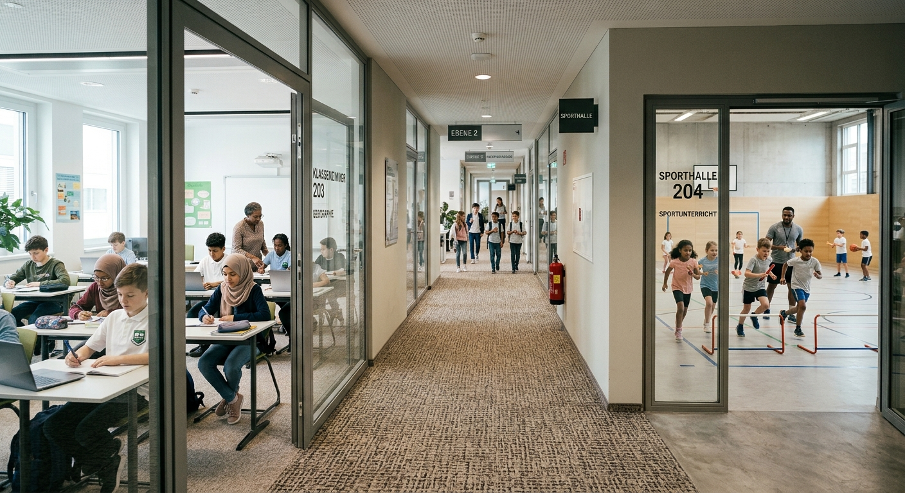
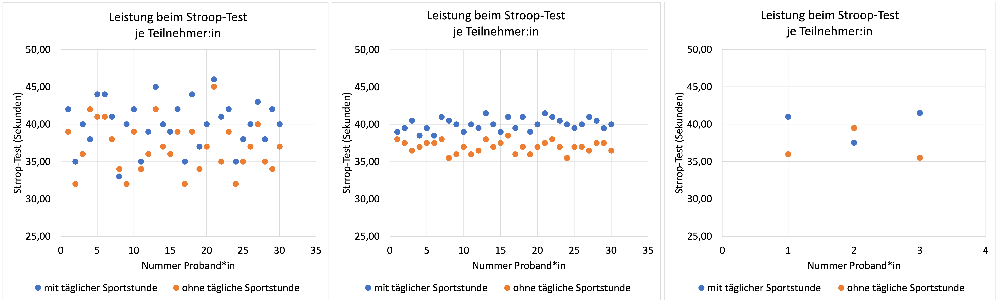

<!--
author: Tim Heemsoth, Swantje Brandt
email: tim.heemsoth@uni-flensburg.de
version: 0.0.1
language: de
narrator: Deutsch Female

import:  https://raw.githubusercontent.com/EUF-SpoWis/BA_PSW_Einfuehrung_Sportwissenschaft/refs/heads/main/config.md
import: https://raw.githubusercontent.com/liaTemplates/PyScript/main/README.md

link:   https://cdnjs.cloudflare.com/ajax/libs/animate.css/4.1.1/animate.min.css
        https://cdn.jsdelivr.net/gh/EUF-SpoWis/Wissenschaftliches-Arbeiten@main/Lia-Anpassungen/Ausblendungen.css

-->

# Grundlagen zum Quantitativen Forschen

| Parameter                | Kursinformationen                                                                               |
| ------------------------ | ----------------------------------------------------------------------------------------------- |
| **Veranstaltung:**       | @config.lecture                                                                                 |
| **Semester:**            | @config.semester                                                                                |
| **Hochschule:**          | `Europa-Universität Flensburg`                                                                  |
| **Inhalte:**             | `Grundlegende sportwissenschaftliche Methoden mit Fokus auf quantitative Forschungsmethoden`    |
| **Link auf GitHub:**     | https://github.com/EUF-SpoWis/BA_PSW_Einfuehrung_Sportwissenschaft/blob/main/05_Quantitatives_Forschen.md      |
| **Autoren:**             | @author                                                                                       |

> (c) Alle Rechte vorbehalten. 

## Motivierung

>[!WARNING]Aufgabe Stroop-Test
> **Proband:in**: Benenne alle Farben der angezeigten Wörter der Reihe nach.  
> **Testleiter:in**: Stoppe die Zeit. Bei einem Fehler rufe "Fehler" und lass die Farbe korrekt wiederholen.

<iframe
  src="img/stroop.html"
  title="Stroop-Test"
  width="100%"
  height="540"
  style="border: none;">
</iframe>

## Fahrplan
1. Grundlagen: Ziele und Merkmale
2. Ausgangspunkt: Von der Forschungsfrage zur Hypothese
3. Untersuchungsplanung: von der Hypothese zum Design
4. Datenerhebung: vom Design zur Datenerhebung
5. Statistische Analysen: von den Daten zur Analyse
6. Befunde präsentieren: von den Befunden zur Publikation

## Grundlagen

### Ziele
{{0}}
******************
> [!TIP] ✅ Bestehende Theorien prüfen
> Eine aus der Theorie abgeleitete Hypothese soll durch Daten gestützt werden.  
> z. B. "Je älter die Schüler:innen sind, desto weniger erleben sie Freude im Sportunterricht."
******************

{{1}}
******************
> [!CAUTION] ✴️ Wirksamkeit nachweisen
> Die angenommene Wirkungen einer Intervention soll im Vergleich zu einer Kontrollgruppe überprüft werden. 
> z. B. "Die neue Trainingsmethode A ist der konventionellen Traininsgmethode B überlegen."
******************

{{2}}
******************
> [!NOTE] 🌀 Generalisierungen ermöglichen
> Es sollen allgemeingültige Aussagen gepürft werden, die über den Einzelfall hinausgehen. 
> z. B. "Sporttreiben hilft gegen Depressionen."
******************

### Merkmale

{{0}}
******************
>[!TIP] 📏 1. Standardisierung
> Erhebungsbedingungen, Instrumente und Ablauf sind für alle Untersuchten einheitlich. 
> z. B. "Alle Proband:innen absolvieren den gleichen Lauftest auf derselben Bahn und zur gleichen Tageszeit".
******************

{{1}}
******************
>[!TIP] 🔢 2. Operationalisierung
> Theoretische Konstrukte werden in konkret messbare Variablen überführt. 
> z. B. "Die Ausdauerleistung wird durch die gelaufene Strecke in zwölf Minuten erfasst, gemessen in Metern."
******************

{{2}}
******************
>[!TIP] 🔍 3. Hypothesenprüfung
> Aus der Theorie abgeleitete Annahmen werden gezielt anhand der Daten geprüft (deduktives Vorgehen). 
> z. B. "Geprüft wird die Hypothese, dass es einen Zusammenhang zwischen Zugehörigkeitsgefühl und Motivation gibt."
******************

{{3}}
******************
>[!TIP] ⚖️ 4. Distanz zum Gegenstand
> Die forschende Person vermeidet eine Beeinflussung der Messung und der Antworten. 
> z. B. "Die Testleitung folgt einem festen Skript, feuert niemanden an und misst die Strecke nach einem festgelegten Verfahren."
******************

{{4}}
******************
>[!TIP] 👥 5. Generalisierung durch Repräsentativität
> Angestrebt wird die Übertragung der Ergebnisse auf eine größere Zielgruppe. Dafür ist entscheidend, wie gut die Stichprobe diese Zielgruppe abbildet. 
> z. B. "Um Aussagen für 20-30 jährige Personen treffen zu können,  wird die Stichprobe entsprechend ausgewählt."

📚 Zum Nachlesen: Döring & Bortz (2016)

******************

## Forschungskreislauf 

<iframe
  src="img/Forschungskreislauf.html"
  title="Kreislauf quantitativer Forschung"
  width="100%"
  height="620"
  style="border: none;"
></iframe>

## Einstiegsbeispiel

"Wer sich viel bewegt, kann sich auch besser konzentrieren!"

## Fragestellung und Hypothesen 

--{{0}}--

💡 Alles beginnt mit einer Fragestellung....

<iframe
  src="img/Forschungskreislauf.html"
  title="Kreislauf quantitativer Forschung"
  width="100%"
  height="620"
  style="border: none;"
></iframe>

### Forschungsfrage

{{0-1}}
******************

📝

<b>Ausgangspunkt</b>

... ist eine Theorie oder ein Modell, aus dem sich prüfbare Hypothesen ableiten lassen – <b>nicht</b> bei einem offenen Phänomen.

🔍

<b>Präzision</b>

Fragestellung und Hypothesen sind so formuliert, dass sich daraus unmittelbar messbare Variablen ableiten lassen.

➖

<b>Reduktion</b>

Die Reduktion von Komplexität erfolgt  <b>vor</b> der Erhebung im Rahmen der Operationalisierung und nicht erst im Analyseprozess.

📚 Zum Nachlesen: Döring & Bortz (2016)

******************

{{1}}
*****

**"Wer sich viel bewegt, kann sich auch besser konzentrieren!"**  

**Ausgangspunkt**  
- Kognitiv-psychologisch: Anspruchsvolle Sportaktivitäten könnten durch wiederholte kognitive Anforderungen die Aufmerksamkeitskontrolle trainieren (Singh et al., 2025).
- Regenerativ: Bewegung kann besseren Schlaf und damit günstigere Aufmerksamkeitsbedingungen unterstützen (Xie et al., 2024).
- Emotionspsychologisch: Bewegung könnte durch weniger Stress und Grübeln gedankliche Ablenkungen reduzieren (White et al., 2024).

**Präzision und Reduktion**  
Aus "Wer sich viel bewegt, kann sich auch besser konzentrieren!" wird die Forschungsfrage:  

"Kann regelmäßige sportliche Aktivität die Aufmerksamkeitskontrolle von Kindern steigern?"

*****

### Hypothese

{{0-2}}
*****

Eine Hypothese ist eine vorläufige Vermutung oder eine unbewiesene Annahme über einen Sachverhalt oder einen Zusammenhang. Sie wird in der Wissenschaft vor einer Untersuchung aufgestellt und anschließend durch Daten, Experimente oder Beobachtungen überprüft, um zu sehen, ob sie stimmt oder falsch ist.

*****

{{1-2}}
*****

🕒

<b>Vorläufig</b>

Sie ist noch nicht bewiesen.

🔬

<b>Überprüfbar</b>

Sie lässt sich durch Tests oder Messungen widerlegen oder bestätigen.

🔗

<b>Bezug</b>

Sie beschreibt, wie zwei Gegenstände, auch *Variablen* genannt, zusammenhängen.

🧑‍🤝‍🧑

<b>Immer im Paar</b>

Zu einer Hypothese gibt es  immer eine entgegengesetzte Nullhypothese.

*****

{{2-3}}
*****

**Hypothese (H1)**   Sie benennt den angenommenen Effekt, Unterschied oder Zusammenhang.   
**Nullhypothese (H0)**   Sie geht davon aus, dass es keinen Effekt, keinen Unterschied oder keinen Zusammenhang gibt.   

⚠️ In der Wissenschaft darf eine Innovation (die H1) erst dann gestützt werden, wenn die Nullhypothese (die H0) durch Daten mit hoher Wahrscheinlichkeit widerlegt ist. 

<!--- Es ist wie vor Gericht: Ein Angeklagter ist so lange unschuldig, bis seine Schuld bewiesen ist. --->

📚 Zum Nachlesen: Döring & Bortz (2016) und Eid, Gollwitzer & Schmitt (2017)

*****

{{3}}
*****

**"Wer sich viel bewegt, kann sich auch besser konzentrieren!"**  

**Hypothese (H1)**   Die Aufmerksamkeitskontrollle von Kindern, die regelmäßiger sportliche Aktivität nachgehen, unterscheidet sich von Kindern, die keiner regelmäßigen sportlichen Aktivität nachgehen. 

**Nullhypothese (H0)**   Kinder, die einer regelmäßigen sportliche Aktivität nachgehen und Kinder, die die keiner regelmäßigen sportlichen Aktivität nachgehen zeigen die gleiche Aufmerksamkeitskontrollle.

*****

### Hypothesenarten

|Hypothesenart|Beispiel|
| :-- | :-- |
|**Zusammenhangshypothese**| Je höher das Selbstvertrauen, um so höher die Sprungleistung.|
|**Unterschiedshypothese** | Jungen und Mädchen unterscheiden sich in ihrer Balancierfähigkeit.|
|**Veränderungshypothese** | Nach einem 4-wöchingen selbstgesteuerten Training erhöht sich die Leistung beim Jonglieren.|

📚 Zum Nachlesen: Döring & Bortz (2016) und Eid, Gollwitzer & Schmitt (2017)

## Untersuchung planen

<iframe
  src="img/Forschungskreislauf.html"
  title="Kreislauf quantitativer Forschung"
  width="100%"
  height="620"
  style="border: none;"
></iframe>

### Design und Stichprobe festlegen

{{0-1}}
******************************
> [!TIP] ⏱️ **Wann?** 
>Zu welchen Zeitpunkten wird erhoben? 
>
>|Design|Beschreibung|Beispiel|
>| :-- | :-- |  :-- |
>|Querschnittstudie| Einmalige Messung zu einem Zeitpunkt bei mehreren Personen.| Zu Beginn des neues Schuljahres wird einmlaig das Wohlbefinden der Schüler*innen erfragt.|
>|Längsschnittstudie| Wiederholte Messung derselben Personen über mehrere Zeitpunkte.| Über mehrere Jahre hinweg wird das Wohlbefinden der identischen Schüler*innen erfragt.|
******************************

{{1-2}}
******************************
> [!CAUTION] 📍 **Wo?** 
> An welchem Ort wird erhoben? 
>
> |Design|Beschreibung|Beispiel|
>| :-- | :-- |  :-- |
>|Feldstudie| Messung in natürlicher, realer Umgebung.| Die Studie wird in der Sporthalle durchgeführt, in der auch regelmäßig trainiert wird.|
>|Laborstudie| Kontrollierte, künstliche Umgebung.| Die Studie wird in einem Labor unter sehr kontrollierbaren Bedingungen durchgeführt.|
******************************

{{2-3}}
******************************
> [!NOTE] 🎛️ **Wie?** 
> Wie stark wird eingegriffen?
>
>|Design|Beschreibung|Beispiel|
>| :-- | :-- |  :-- |
>|Experiment| Personen werden zufällig Gruppen zugeordnet, die unterschiedliche Treatments erhalten.| Personen werden per Los in die Gruppen A oder B zugeordnet, wo sie nach Programm A oder Programm B trainieren.|
>|Quasi-Experiment| Personen befinden sich in Gruppen, die unterschiedliche Treatments erhalten. Die Gruppenzuordnung ist nicht streng zufällig. | Wie beim Experiment, die Personen werden aber Klassenweise (z. B. in Schulklassen) einem Trainingsprogramm zugeordnet|
>|Koorelative Studie |Es gibt keine Intervention, es werden nur bestehende Merkmale gemessen.| Es werden Alter und Interesse, um den Zusammenhang dieser Variablen zu bestimmen.|
******************************

{{3-4}}
******************************
> [!WARNING] 👥👥 **Wer?** 
> Welche Personen werden untersucht?  
> z. B. "Es nehmen Erwachsene Personen im Alter von 30-59 teil."
******************************

{{4-5}}
******************************
> [!IMPORTANT] 🎯 **Was?**
> Was genau wird untersucht und ggf. manipuliert?   
> z. B. "Vor und nach einer Intervention wird das **Belastungsempfinden** gemessen. Währen der Intervention hören die Teilnehmer:innen unterschiedliche Musik. 

📚 Zum Nachlesen: Döring & Bortz (2016)

******************************

{{5}}
*****

**"Wer sich viel bewegt, kann sich auch besser konzentrieren!"**  

**Design und Stichprobe** 

1. Quasi-experimentelle Studie mit einem Messzeitpunkt nach einer Intervention [Wie, Wann ✓]
2. Schüler*innen der Klassenstufen 5, 6 und 7 [Wer ✓]
3. Messung der Aufmerksamkeitskontrolle [Was ✓]
3. 50 % der Kinder erhalten "täglichen Sportstunde"; 50 % erhalten "nur" regulären Sportunterricht [Was ✓]

*****

### Exkurs: Experiment als Goldstandard

{{0-2}}
*****

Ein Experiment ist ein planmäßig ausgelöster und wiederholbarer Vorgang, bei dem beobachtet wird, in welcher Weise sich unter Konstanthaltung anderer Bedingungen mindestens eine abhängige Variable ändert, nachdem mindestens eine unabhängige Variable geändert worden ist. Wesentliche Merkmale des Experiments sind demnach:  
1. Planmäßigkeit  
2. Wiederholbarkeit und  
3. systematische Variation bzw. Konstanthaltung von Bedingungen.
 
Im Experiment lassen sich immer ein Zustand vorher, eine Änderungsphase (Treatment) und ein Zustand nachher unterscheiden. 

*****

{{1-2}}
*****

UV

<b>Unabhängige Variable</b>

Beschreibt das, was verändert wird.   z. B. Training: ja vs. nein. 

Stufung

<b>Ausprägung der UV</b>

Beschreibt die Anzahl der Variationen einer UV.   z. B. UV "Training: ja vs. nein" hat zwei Stufen. 

AV

<b>Abhängige Variable</b>

Beschreibt die gemessene Variable.   z. B. Ausdauerleistung.

📌 <b>Merke:</b> Die Faustregel lautet: <i>Die UV geht rein, die AV kommt raus.</i> Man <b>manipuliert</b> die UV, um zu sehen, wie sich die AV <b>verändert</b>.

📚 Zum Nachlesen: Döring & Bortz (2016)

******************

<!--- Das Experiment ist die einzige Methode, um Bedingungszusammenhänge oder gar Kausaleinflüsse nachzuweisen. ---> 

{{2}}
*****

**"Wer sich viel bewegt, kann sich auch besser konzentrieren!"**  

- AV: Aufmerksamkeitskontrolle  
- UV: Regelmäßige sportliche Aktivität  
- Stufung: 2-stufig 
   - Stufe 1: mit täglicher Sportstunde
   - Stufe 2: ohne tägliche Sportstunde  

*****

### Variablen operationalisieren 

{{0-2}}
*****

 Nachdem das Design der Studie festgelegt wurde, gilt es die in der Studie relevanten Variablen zu operationalisieren, d. h. messbar zu machen. 

*****

{{1-2}}
*****

**"Wer sich viel bewegt, kann sich auch besser konzentrieren!"**  

- AV: Aufmerksamkeitskontrolle wird durch den **Stroop Test** gemessen 
- UV: Regelmäßige sportliche Aktivität wird variiert mit 
  - "mit täglicher Sportstunde über 6 Wochen" vs. 
  - "ohne tägliche Sportstunde".

*****

{{2}}
*****
>[!WARNING]Aufgabe Stroop-Test
> **Proband:in**: Benenne alle Farben der angezeigten Wörter der Reihe nach.  
> **Testleiter:in**: Stoppe die Zeit. Bei einem Fehler rufe "Fehler" und lass die Farbe korrekt wiederholen.

<iframe
  src="img/stroop.html"
  title="Stroop-Test"
  width="100%"
  height="540"
  style="border: none;">
</iframe>
*****

## Datenerhebung

<iframe
  src="img/Forschungskreislauf.html"
  title="Kreislauf quantitativer Forschung"
  width="100%"
  height="620"
  style="border: none;"
></iframe>

### Standardisiert erheben

<b>Welches Verfahren passt am besten zur Forschungsfrage?</b>

📋

<b>Befragung</b>

„Was sagen die Teilnehmenden?“

Standardisierte Fragebögen mit geschlossenen Antwortformaten. 

👀

<b>Beobachtung</b>

„Was tun die Teilnehmenden?“

Systematische Verhaltensbeobachtung mit Kategoriensystem

⏱️

<b>Testen und Messen</b>

„Was leisten oder zeigen sie?“

Motorische, physiologische, kognitive Leistungstests

(nach Döring & Bortz, 2016)

### Gütekriterien

<b>Zur Beurteilung der Güte quantitativer Erhebungsverfahren werden drei zentrale Kriterien herangezogen</b>

⚖️

<b>Objektivität</b>

"Kommen unterschiedliche Testleiter:inen unter gleichen Bedingungen zu gleichen Ergebnissen?"

<ul style="font-size: 0.85em; margin: 8px 0 0 0; padding-left: 18px;">
<li><b>Durchführungsobjektivität:</b> gleiche Anweisung für alle</li>
<li><b>Auswertungsobjektivität:</b> festes Verfahren zum Messen</li>
<li><b>Interpretationobjektivität:</b> gleiche Einordnung der Werte</li>
</ul>

🔁

<b>Reliabilität</b>

"Misst das Verfahren das Merkmal genau?"

<ul style="font-size: 0.85em; margin: 8px 0 0 0; padding-left: 18px;">
<li><b>Paralleltest:</b> zwei verschiedene Tests kommen zu identischen Befunden </li>
<li><b>Wiederholung:</b> zwei Messdurchläufe kommen zu identischen Befunden</li>
</ul>

🎯

<b>Validität</b>

„Misst das Verfahren wirklich das, was es messen soll?“

Das Verfahren hällt einer inhaltlichen Prüfung (z. B. anhand der Literaturlage ider durch Expert:innen) stand.

📌 <b>Merke:</b> <b>O</b>bjektiv = unabhängig von der Person · <b>R</b>eliabel = wiederholbar · <b>V</b>alide = misst das Richtige.

📚 Zum Nachlesen: Moosbrugger & Kelava (2020) und Döring & Bortz (2016)

### Beispiele: Befragung

#### Soziodemographische Daten 

{{0-1}}
*****
**Welchem Geschlecht ordnest du dich zu?**
- [ ] Weiblich
- [ ] Männlich
- [ ] Divers
*****

{{1-2}}
*****
**Wie alt bist du? Bitte gib dein Alter in vollen Jahren an.**

[[___]]
*****

{{2-3}}
*****
**In welche Klasse gehst du?**

- [ ] 6. Klasse
- [ ] 7. Klasse
- [ ] 8. Klasse
*****

{{3-4}}
*****
**Aus welchem Bundesland kommst du?**

- [ ] Schleswig-Holstein
- [ ] Niedersachsen
- [ ] Hamburg
- [ ] anderes
*****

{{4-5}}
*****
**Wie viele Bücher gibt es bei dir zuhause ungefähr?**

Auf einen Meter Bücherregal passen ungefähr 40 Bücher.  
Zähle Zeitschriften, Zeitungen und deine Schulbücher nicht mit.

- [ ] 0–10 Bücher
- [ ] 11–25 Bücher
- [ ] 26–100 Bücher
- [ ] 101–200 Bücher
- [ ] 201–500 Bücher
- [ ] Mehr als 500 Bücher
*****

#### Psychometrische Daten

{{0-1}}
*****
In der Regel: Fragebögen mit Likert-Skalen

"Eine Likert-Skala („likert scale“) ist eine psychometrische Skala, die aus mehreren (z. B. 10–20) Aussagen besteht, die alle dasselbe Merkmal messen und auf Ratingskalen hinsichtlich des Grades der Zustimmung einzuschätzen sind. [...] Der Skalenwert der Likert- Skala berechnet sich als Summen- oder Durchschnittsscore der einzelnen Ratings" ([Springer Lehrbuch Pssychologie](https://www.lehrbuch-psychologie.springernature.com/glossar/likert-skala-1).  

**Wichtige Begriffe**

| Begriff | Bedeutung |
| ------- | --------- |
| **Item** | einzelne Aussage, die bewertet wird |
| **Antwortskala** | geordnete Stufen, z. B. 4-stufig: 0 = trifft nicht zu, 1 = trifft eher nicht zu, 2 = trifft eher zu, 3 = trifft zu |
| **Negativ gepolt** | Item, bei dem eine ohe Zustimmung einen niedrigen Merkmalswert bedeutet |
| **Skalenwert** | Mittelwert oder Summe der Items, die dasselbe Merkmal messen |

<!--- In der Regel geht es um Einstellungen, Meinungen, Zustimmungen usw. --->
*****

{{1-2}}
*****
**Beispiel einer Likert Skala zum Belastungsempfinden**

Die Läufer:innen füllen nach dem 12-Minuten-Lauf vier Aussagen aus. Pro Zeile wird **eine** Stufe von 0 (trifft gar nicht zu) bis 3 (trifft zu) angekreuzt.

 this.querySelector('input[name=' + name + ']:checked'));
const ausgabe = this.querySelector('[data-ergebnis]');
if (antworten.some(antwort => antwort === null)) {
  ausgabe.textContent = 'Bitte beantworte alle vier Aussagen.';
} else {
  const werte = antworten.map(antwort => Number(antwort.value));
  const item4Umgepolt = 3 - werte[3];
  const mittelwert = (werte[0] + werte[1] + werte[2] + item4Umgepolt) / 4;
  ausgabe.textContent = 'Dein Skalenwert: ' + mittelwert.toLocaleString('de-DE', {minimumFractionDigits: 2, maximumFractionDigits: 2}) + ' (Wertebereich: 0 bis 3).';
}
">

Inwieweit treffen die folgenden Aussagen auf dich zu? Bitte wähle pro Zeile eine Antwort.

<table style="display: table; width: 100%; min-width: 700px; table-layout: fixed; border-collapse: collapse; font-size: 0.9em; line-height: 1.4; text-align: center;">
<colgroup>
<col style="width: 52%;">
<col style="width: 12%;">
<col style="width: 12%;">
<col style="width: 12%;">
<col style="width: 12%;">
</colgroup>
<thead>
<tr style="background: #f2f6fb;">
<th scope="col" style="padding: 12px; text-align: left; white-space: normal;">Aussage</th>
<th scope="col" style="padding: 10px 4px; white-space: normal;">trifft gar nicht zu</th>
<th scope="col" style="padding: 10px 4px; white-space: normal;">trifft eher nicht zu</th>
<th scope="col" style="padding: 10px 4px; white-space: normal;">trifft eher zu</th>
<th scope="col" style="padding: 10px 4px; white-space: normal;">trifft völlig zu</th>
</tr>
</thead>
<tbody>
<tr style="border-bottom: 1px solid #d5dbe3;">
<th scope="row" style="padding: 14px 12px; text-align: left; font-weight: normal; white-space: normal;">1. Der 12-Minuten-Lauf hat mir Spaß gemacht.</th>
<td><input type="radio" name="laufscore1" value="0" aria-label="Aussage 1: trifft gar nicht zu"></td>
<td><input type="radio" name="laufscore1" value="1" aria-label="Aussage 1: trifft eher nicht zu"></td>
<td><input type="radio" name="laufscore1" value="2" aria-label="Aussage 1: trifft eher zu"></td>
<td><input type="radio" name="laufscore1" value="3" aria-label="Aussage 1: trifft völlig zu"></td>
</tr>
<tr style="border-bottom: 1px solid #d5dbe3;">
<th scope="row" style="padding: 14px 12px; text-align: left; font-weight: normal; white-space: normal;">2. Ich bin mit meiner Laufleistung zufrieden.</th>
<td><input type="radio" name="laufscore2" value="0" aria-label="Aussage 2: trifft gar nicht zu"></td>
<td><input type="radio" name="laufscore2" value="1" aria-label="Aussage 2: trifft eher nicht zu"></td>
<td><input type="radio" name="laufscore2" value="2" aria-label="Aussage 2: trifft eher zu"></td>
<td><input type="radio" name="laufscore2" value="3" aria-label="Aussage 2: trifft völlig zu"></td>
</tr>
<tr style="border-bottom: 1px solid #d5dbe3;">
<th scope="row" style="padding: 14px 12px; text-align: left; font-weight: normal; white-space: normal;">3. Ich habe mich beim Lauf angestrengt.</th>
<td><input type="radio" name="laufscore3" value="0" aria-label="Aussage 3: trifft gar nicht zu"></td>
<td><input type="radio" name="laufscore3" value="1" aria-label="Aussage 3: trifft eher nicht zu"></td>
<td><input type="radio" name="laufscore3" value="2" aria-label="Aussage 3: trifft eher zu"></td>
<td><input type="radio" name="laufscore3" value="3" aria-label="Aussage 3: trifft völlig zu"></td>
</tr>
<tr style="border-bottom: 1px solid #d5dbe3;">
<th scope="row" style="padding: 14px 12px; text-align: left; font-weight: normal; white-space: normal;">4. Ich habe mich beim Laufen unter Druck gefühlt.</th>
<td><input type="radio" name="laufscore4" value="0" aria-label="Aussage 4: trifft gar nicht zu"></td>
<td><input type="radio" name="laufscore4" value="1" aria-label="Aussage 4: trifft eher nicht zu"></td>
<td><input type="radio" name="laufscore4" value="2" aria-label="Aussage 4: trifft eher zu"></td>
<td><input type="radio" name="laufscore4" value="3" aria-label="Aussage 4: trifft völlig zu"></td>
</tr>
</tbody>
</table>

Bitte beantworte alle vier Aussagen.

So wird der Skalenwert berechnet

1. Item 4 ist **negativ gepolt**: Hohe Zustimmung bedeutet hier eine stärkere wahrgenommene Druckbelastung. Bei einer Codierung von 0 bis 3 wird es deshalb **umgepolt**:
   - 0 → 3
   - 1 → 2
   - 2 → 1
   - 3 → 0

2. Danach wird der **Mittelwert** gebildet:

   (Wert Item 1 + Wert Item 2 + Wert Item 3 + umgepolter Wert Item 4) : 4

*****

{{2}}
*****

Seltener: Fragebögen mit einem Item

>[!WARNING] Die Borg-Skala 
>Sie erfasst direkt nach dem Lauf mit **einer einzigen Zahl**, wie anstrengend die Belastung empfunden wurde. Die Werte 6 bis 20 sind so gewählt, dass die Zahl mal 10 ungefähr dem Puls eines gesunden Erwachsenen entspricht (13 ➜ ca. 130 Schläge pro Minute). (Borg, 1982) 

<b style="display:inline-block; min-width:2em;">20</b> maximale Anstrengung

<b style="display:inline-block; min-width:2em;">19</b> extrem anstrengend

<b style="display:inline-block; min-width:2em;">18</b> 

<b style="display:inline-block; min-width:2em;">17</b> sehr anstrengend

<b style="display:inline-block; min-width:2em;">16</b> 

<b style="display:inline-block; min-width:2em;">15</b> anstrengend

<b style="display:inline-block; min-width:2em;">14</b> 

<b style="display:inline-block; min-width:2em;">13</b> etwas anstrengend

<b style="display:inline-block; min-width:2em;">12</b> 

<b style="display:inline-block; min-width:2em;">11</b> leicht

<b style="display:inline-block; min-width:2em;">10</b> 

<b style="display:inline-block; min-width:2em;">9</b> sehr leicht

<b style="display:inline-block; min-width:2em;">8</b> 

<b style="display:inline-block; min-width:2em;">7</b> extrem leicht

<b style="display:inline-block; min-width:2em;">6</b> überhaupt keine Anstrengung

*****

#### Wissensfragen 

**Beispiel eines Schüler:innen-Wissenstest zum Spiel Kinball** 

In welchen Situationen wird gegen die Kinball-Regeln verstoßen? Mehrere Antworten sind möglich.

[[ ]] Genau drei Spieler halten den Ball, eine vierte Spielerin schlägt.
[[X]] Die schlagende Spielerin ruft „Rot“ und schlägt den Ball.
[[ ]] Der schlagende Spieler stößt den Ball mit zwei Fäusten weg.
[[X]] Drei Personen sichern den Ball und laufen über das Spielfeld.

### Beispiel: Beobachtung

--{{0}}--

💡 <b>Lehrbuch Hinweis:</b> Bei der quantitativen Beobachtung wird Verhalten nicht frei beschrieben, sondern nach vorab festgelegten Regeln erfasst, gezählt oder gemessen. Sie eignet sich immer dann, wenn nicht gefragt werden soll, was Personen <i>sagen</i>, sondern was sie <i>tun</i>.

**Was macht eine Beobachtung „quantitativ“?** 
 
>[!TIP]📑 Kategorien
>Vorab ist eindeutig festgelegt, welches Verhalten erfasst wird. 
>z. B. „Positives Feedback“ = Es wird notiert immer dann, wenn ein:e Trainer:in positive Rückmeldungen formuliert.

>[!NOTE]⏲️ Zeitplan
> Es ist festgelegt, wann und wie lange beobachtet wird. 
> z. B. die Beobachtung erfolgt im Rahmen einer Trainingseinheit im Hockey

>[!WARNING]🔢 Zahlen
>Das Verhalten wird gezählt oder gemessen und statistisch verglichen. 
>z. B. Anzahl des Lobes pro Training

📚 Zum Nachlesen: Döring & Bortz (2016)

### Beispiel: Leistungstests

<!--- --{{0}}--

💡 <b>Lehrbuch Hinweis:</b> Neben Befragungen und Beobachtungen kann man auch direkte Leistungswerte messen. Das passiert häufig mit Hilfe von <b>motorischen und physiologischen Leistungstests</b>. Die Person soll dabei eine Aufgabe möglichst gut lösen, und gemessen wird das Ergebnis (z. B. Strecke, Zeit, Anzahl, Kraft).

 --->

<b>Welche Fähigkeit will ich messen?</b>

<!-- class="animate__animated animate__fadeInUp" -->

🫁

<b>Ausdauer</b>

Cooper-Test (12 min), 6-Minuten-Lauf, Shuttle-Run (Pieptest), Laktat-Stufentest

Maß: Strecke, Stufe, Laktat, Herzfrequenz

<!-- class="animate__animated animate__fadeInUp animate__delay-1s" -->

💪

<b>Kraft</b>

Handkraftmessung, Standweitsprung, Liegestütz, Sit-ups

Maß: Kilogramm, Zentimeter, Wiederholungen

<!-- class="animate__animated animate__fadeInUp animate__delay-2s" -->

⚡

<b>Schnelligkeit</b>

20-Meter-Sprint mit Lichtschranke, Reaktionstest

Maß: Sekunden

<!-- class="animate__animated animate__fadeInUp animate__delay-3s" -->

🤸

<b>Beweglichkeit</b>

Rumpfbeuge im Sitzen (Sit-and-Reach)

Maß: Zentimeter

<!-- class="animate__animated animate__fadeInUp animate__delay-4s" -->

⚖️

<b>Koordination</b>

Balancieren rückwärts, seitliches Hin- und Herspringen

Maß: Schritte, Sprünge in einer Zeit

<!-- class="animate__animated animate__fadeInUp animate__delay-5s" -->

🧠

<b>Kognition</b>

Stroop-Test, Trail Making Test, d2-Test (Aufmerksamkeit und Konzentration)

Maß: Sekunden, Fehler, Anzahl bearbeiteter Items

<b>👉 Klicke hier, um die Tests genauer zu sehen.</b>

| Fähigkeit | Test | So läuft er ab | Ergebnis |
| :-------- | :--- | :------------- | :------- |
| 🫁 **Ausdauer** | Cooper-Test | 12 Minuten lang so weit wie möglich laufen | Strecke in Metern |
| | 6-Minuten-Lauf | wie der Cooper-Test, aber nur 6 Minuten | Strecke in Metern |
| | Shuttle-Run (Pieptest) | 20 m hin und her laufen im Takt von Signaltönen, das Tempo steigt stufenweise | erreichte Stufe bzw. Bahnen |
| | Laktat-Stufentest | Belastung in Stufen mit steigender Intensität, am Ende jeder Stufe wird Blut abgenommen | Laktatwert je Stufe |
| 💪 **Kraft** | Handkraftmessung | Dynamometer so fest wie möglich zusammendrücken | Kraft in kg |
| | Standweitsprung | beidbeiniger Sprung aus dem Stand so weit wie möglich | Weite in cm |
| | Liegestütz, Sit-ups | möglichst viele saubere Wiederholungen in einer festgelegten Zeit | Anzahl |
| ⚡ **Schnelligkeit** | 20-m-Sprint | so schnell wie möglich 20 m sprinten, Zeitmessung per Lichtschranke | Zeit in Sekunden |
| | Reaktionstest | auf einen Reiz (Licht oder Ton) so schnell wie möglich reagieren | Zeit in Millisekunden |
| 🤸 **Beweglichkeit** | Rumpfbeuge im Sitzen | im Sitzen mit gestreckten Beinen so weit wie möglich nach vorn greifen | Weite in cm |
| ⚖️ **Koordination** | Balancieren rückwärts | rückwärts über einen schmalen Balken gehen | Anzahl der Schritte |
| | Seitliches Hin- und Herspringen | in einer festgelegten Zeit beidbeinig über eine Linie hin und her springen | Anzahl der Sprünge |
| 🧠 **Kognition** | Stroop-Test | die Schriftfarbe eines Farbworts nennen, obwohl das Wort eine andere Farbe bezeichnet | Zeit und Fehler |
| | Trail Making Test | Zahlen (und Buchstaben) so schnell wie möglich in der richtigen Reihenfolge verbinden | Zeit in Sekunden |
| | d2-Test | aus vielen ähnlichen Zeichen bestimmte durchstreichen | bearbeitete Zeichen und Fehler |

📚 Zum Nachlesen: Bös et al. (2009); Cooper (1968); Léger et al. (1988); Döring & Bortz (2016)

### Herausforderung

<!--- --{{0}}--

💡 <b>Lehrbuch Hinweis:</b>Standardisierte Testungen stehen vor spezifischen methodischen Herausforderungen. Drei davon begegnen dir besonders oft:

 --->

🧑‍🏫

<b>Testleiter-Effekte</b>

„Beeinflusst die testende Person das Ergebnis?“

z. B. Die Testleitung kennt die Hypothese „Musik verbessert die Leistung“ und ruft der Musikgruppe unbewusst öfter Ermutigungen zu.

↕️

<b>Decken- und Bodeneffekte</b>

„Ist der Test zu leicht oder zu schwer?“

z. B. Ein Test ist für trainierte Personen so leicht, dass alle die Höchstleistung erreichen (Deckeneffekt).

🌦️

<b>Störvariablen</b>

„Wirkt etwas mit, das nicht zur Forschung gehört?“

z. B. Tagesform, Motivation oder Umgebungsbedingungen wie Wetter beinflussen die Messung.

## Statistische Analyse

<iframe
  src="img/Forschungskreislauf.html"
  title="Kreislauf quantitativer Forschung"
  width="100%"
  height="620"
  style="border: none;"
></iframe>

### Skalenniveau

Das Skalenniveau beschreibt, **wie viel Information** in den Zahlen oder Kategorien einer Variable steckt.

| Skalenniveau |  Rangordnung | Gleiche Abstände | Natürlicher Nullpunkt | Sinnvolle Kennwerte | Beispiel |
| :--- | :---: | :---: | :---: | :--- | :--- |
| Nominalskala | ✗ | ✗ | ✗ | Häufigkeiten, Modus | Blutgruppe |
| Ordinalskala | ✓ | ✗ | ✗ | Median, Quartile, Modus | Schulnote |
| Intervallskala | ✓ | ✓ | ✗ | Mittelwert, Standardabweichung | Temperatur in °C |
| Verhältnisskala | ✓ | ✓ | ✓ | Mittelwert, Standardabweichung | Masse eines Pakets in kg |

✓ = ja · ✗ = nein

<b>👉 Vertiefung</b>

>[!TIP] Nominalskala
> Die Werte sind **Namen oder Kategorien**. Man kann sie nur unterscheiden und zählen.
> - Beispiel: Die Variable *Bedingung* hat die Ausprägungen „ohne tägliche Sportstunde" und mit täglicher Sportstunde“.
> - Ein Zahlencode (0 = ohne, 1 = mit) ändert nichts daran: Die Zahlen sind nur Etiketten.

>[!TIP] Ordinalskala
> Die Werte lassen sich **ordnen**, aber die Abstände zwischen ihnen sind nicht gleich groß.
> - Beispiel: Platz 1, 2 und 3 bei einem Lauf. Der Abstand von Platz 1 zu 2 kann 5 m betragen, der von Platz 2 zu 3 aber 80 m.
> - Auch Antworten auf Ratingskalen (0 = trifft  nicht zu, ... 3 = trifft  zu) sind streng genommen ordinal. In der Praxis werden sie aber oft wie intervallskalierte Daten behandelt.

>[!TIP] Intervallskala
> Die Abstände zwischen den Werten sind **gleich groß**, der Nullpunkt ist aber willkürlich festgelegt.
> - Beispiel: Von 20 °C zu 10 °C leigt ein Unterschied von 10 Grad vor, genauso von 30 °C zu 20 °C.
> - Aber: 20 °C ist **nicht** „doppelt so warm“ wie 10 °C, denn 0 °C bedeutet nicht „keine Temperatur“.

>[!TIP] Verhältnisskala
> Es gibt einen **echten Nullpunkt**, deshalb sind auch Verhältnisse sinnvoll.
> - Beispiel: 3000 m ist doppelt so weit wie 1500 m. 0 m bedeutet „keine Strecke gelaufen“.

📚 Zum Nachlesen: Stevens (1946)

{{1}}
*****

**"Wer sich viel bewegt, kann sich auch besser konzentrieren!"**  
Durch die Zeitmessung beim Stroop-Test liegt eine *Verhältnisskala* vor.

*****

### Deskriptive Statistik

| Kennwert | Bedeutung | Skala mindestens | Abkürzung |
| :--- | :--- | :--- | :--- |
| **Mittelwert** | Summe aller Werte geteilt durch die Anzahl der Werte | Intervallskala | *M* |
| **Median** | Zentraler Wert bzw. zentrale Kategorie der sortierten Daten; teilt die Verteilung in zwei Hälften | Ordinalskala | *Mdn* |
| **Modus** | Am häufigsten vorkommender Wert bzw. am häufigsten vorkommende Kategorie | Nominalskala | *Mo* |
| **Spannweite** | Differenz zwischen dem größten und dem kleinsten Wert | Intervallskala | *R* |
| **Varianz** | Maß für die Streuung: Summe der quadrierten Abweichungen vom Mittelwert, geteilt durch n | **Intervallskala** | *$s^2$* |
| **Standardabweichung** | Quadratwurzel der Varianz; beschreibt die Streuung in der ursprünglichen Einheit der Daten | Intervallskala | *SD* |

📌 <b>Merke:</b> Streng genommen dürfen für ordinale Daten kein Mittelwert und keine Standardabweichung berechnet werden. In der Praxis werden jedoch häufig auch bei ordinalen Daten <b>Mittelwert und Standardabweichung</b> angegeben.

### Beispiel: Bewegung und Aufmerksamkeitskontrolle

"Wer sich viel bewegt, kann sich auch besser konzentrieren!"

<iframe
  src="widgets/stroop-widget.html"
  title="Stroop-Test: simulierte Daten und interaktive Auswertung"
  style="display: block; width: 100%; height: 1250px; border: 0;"
  loading="lazy">
</iframe>

### Zur Entscheidung über Hypothesen

{{0-1}}
*****

 Bei einer Entscheidung für oder gegen eine Hypothese können zwei Arten von Fehlern auftreten:  

- α-Fehler: H0 wird fälschlicherweise verworfen - H1 fälschlicherweise angenommen.  
- β-Fehler: H0 wird fälschlicherweise beibehalten - H1 fälschlicherweise abgelehnt.

*****

{{1-2}}
*****

**Hypothese (H1)**   Die Aufmerksamkeitskontrollle von Kindern, die regelmäßiger sportliche Aktivität nachgehen, unterscheidet sich von Kindern, die keiner regelmäßigen sportlichen Aktivität nachgehen. 

**Nullhypothese (H0)**   Kinder, die einer regelmäßigen sportliche Aktivität nachgehen und Kinder, die die keiner regelmäßigen sportlichen Aktivität nachgehen zeigen die gleiche Aufmerksamkeitskontrollle.

**Ein α-Fehler liegt vor...**  
... wenn die Wirksamkeit einer täglichen Sportstunde angenommen wird, obwohl sie es nicht ist. 

**Ein β-Fehler liegt vor...**  
...wenn eine tägliche Sportstunde wirksam ist, jedoch H0 beibehalten wird.

*****

{{2-3}}
*****

 **Signifikanzniveau und p-Wert**  

- Vor der Auswertung wird ein Signifikanzniveau festgelegt, häufig α = 0,05.
- α begrenzt das Risiko, eine tatsächlich gültige Nullhypothese fälschlicherweise zu verwerfen.
- Aus den Daten wird der p-Wert berechnet. Je kleiner der p-Wert ist, desto ungewöhnlicher wäre unser Testergebnis, wenn es tatsächlich keinen Unterschied zwischen den Gruppen gäbe. Ein kleiner p-Wert spricht deshalb gegen
die Nullhypothese.
- Ist p < α, wird das Ergebnis als statistisch signifikant eingeordnet und die Nullhypothese verworfen.
- Der p-Wert gibt nicht an, mit welcher Wahrscheinlichkeit eine Hypothese wahr oder falsch ist.
*****

### Inferenzstatistische Prüfung

{{0-1}}
*****

**Hintergrund**  
Immer dann, wenn eine Hypothese empirisch geprüft werden solll, müssen Messergebnisse anhand vereinbarter Kriterien eingeordnet werden. 

*****

{{1-2}}
*****

Es ist davon auszugehen, dass bei zwei Gruppen niemals exakt die gleichen Ergebnisse vorliegen. In unserem Fall könnte es sein, dass 
- M("mit täglicher Sportstunde") = 40,62 s und 
- M("ohne tägliche Sportstunde") = 43,38 s. 

**Aber ist der Unterschied von 2,76 s ein bedeutsamer Unterschied oder eher zufällig?**

*****

{{2-3}}
*****

**Hintergrund**  
Um Unterschiede bewerten zu können, reichen die Informationen allein über den Mittelwert nicht aus, was an folgenden Beispielen mit zwei Gruppen aufgezeigt wird (s. Abbildungen).

Wir brauchen also weitere Informationen 
- Wie viele Personen haben an der Studie teilgenommen?
- Wie groß ist die Streuung der Ergebnisse um den Mittelwert innerhalb der Gruppen?
*****

{{3-4}}
*****
Mit diesen Informationen können wir den standardisierten Mittelwertunterschied "**t**" berechnen. Je nachdem wir hoch t ausfällt, lässt sich der Unterschied als "statistisch signifikant" oder "statistisch nicht signifikant" einordnen. 

$$
\boxed{
\begin{aligned}
t &=
\frac{M_1-M_2}
{SD_{1,2}\cdot\sqrt{\frac{1}{n_1}+\frac{1}{n_2}}}
\\[2em]
SD_{1,2} &=
\sqrt{
\frac{
(n_1-1)\cdot SD_1^2+(n_2-1)\cdot SD_2^2
}{
(n_1-1)+(n_2-1)
}
}
\end{aligned}
}
$$

*****

### t-Rechner

<iframe
src="widgets/student-t-rechner.html"
title="Student-t-Test aus deskriptiven Kennwerten"
style="display: block; width: 100%; height: 1300px; border: 0;"
loading="lazy">
</iframe>

### Ausblick
Die genauen Hintergründe und weitere Verfahren der Datenanalyse werdet ihr im Modul **Research Methods** im 5. Semester detailliert bearbeiten. 

## Take-home Messages
1. Quantitative Forschung leitet aus theoretisch begründeten Fragen präzise Hypothesen ab und prüft sie anhand systematisch erhobener Daten.
2. Untersuchungsdesign, Stichprobe und Operationalisierung müssen zur Forschungsfrage passen.
3. Gute Messungen sind objektiv, reliabel und valide.
4. Mittelwerte allein reichen nicht: Streuung, Stichprobengröße und Skalenniveau müssen berücksichtigt werden.
5. Deskriptive Statistik beschreibt Daten, Inferenzstatistik prüft Hypothesen. Signifikanz ist kein endgültiger Beweis.

## Übungsfragen 

### Grundlagen und Untersuchung plenen

**Frage 1:** Du möchtest überprüfen, ob die Annahme aus einer Theorie, dass Musik die Ausdauerleistung steigert, durch Daten gestützt wird. Welches Ziel quantitativer Forschung liegt vor?

- [(X)] Prüfen bestehender Theorien
- [( )] Wirksamkeitsnachweis
- [( )] Generalisierung
- [( )] Offenes Erkunden eines unbekannten Phänomens

<b>👉 Erklärung</b>

Beim Prüfen bestehender Theorien wird getestet, ob eine aus der Theorie abgeleitete Hypothese durch Daten gestützt wird.

**Frage 2:** Du willst nachweisen, dass ein Trainingsprogramm im Vergleich zu einer Kontrollgruppe die Laufleistung verbessert. Was liegt vor?

- [( )] Prüfen bestehender Theorien
- [(X)] Wirksamkeitsnachweis
- [( )] Generalisierung
- [( )] Normierung

[[?]] Es geht um den Nachweis kausaler Effekte einer Intervention.

<b>👉 Erklärung</b>

Bei einem Wirksamkeitsnachweis geht es um kausale Effekte einer Intervention im Vergleich zu einer Kontrollgruppe.

**Frage 3:** Du fragst dich, ob Befunde aus deiner Stichprobe auch für eine größere Population gelten (z. B. "Laufen alle mit Musik weiter?"). Was beschreibt das?

- [( )] Prüfen bestehender Theorien
- [( )] Wirksamkeitsnachweis
- [(X)] Generalisierung
- [( )] Operationalisierung

<b>👉 Erklärung</b>

Bei der Generalisierung sollen Aussagen über den Einzelfall hinaus für eine größere Population gelten.

**Frage 4:** Alle Teilnehmenden laufen den Cooper-Test auf derselben Bahn, zur gleichen Tageszeit und mit derselben Anweisung. Welcher Grundsatz wird hier umgesetzt?

- [(X)] Standardisierung
- [( )] Operationalisierung
- [( )] Hypothesenprüfung
- [( )] Distanz zum Gegenstand

<b>👉 Erklärung</b>

Standardisierung bedeutet, dass Erhebungsbedingungen, Instrumente und Ablauf für alle Untersuchten identisch sind.

**Frage 5:** Das Konstrukt "Ausdauer" wird als "in 12 Minuten gelaufene Strecke in Metern" festgelegt. Welcher Grundsatz ist das?

- [( )] Standardisierung
- [(X)] Operationalisierung
- [( )] Generalisierung durch Repräsentativität
- [( )] Distanz zum Gegenstand

[[?]] Ein theoretisches Konstrukt wird in eine konkret messbare Variable überführt.

<b>👉 Erklärung</b>

Bei der Operationalisierung werden theoretische Konstrukte vorab in messbare Variablen überführt.

**Frage 6:** Die Testleitung folgt einem festen Skript, feuert niemanden an und misst die Leistung nach einem festem Verfahren. Welcher Grundsatz steht im Vordergrund?

- [( )] Standardisierung
- [( )] Operationalisierung
- [( )] Hypothesenprüfung
- [(X)] Distanz zum Gegenstand

<b>👉 Erklärung</b>

Die forschende Person greift möglichst nicht in das Messgeschehen ein, um die Objektivität zu wahren.

**Frage 7:** Welche Aussagen zu den Grundsätzen quantitativer Forschung sind richtig? (Mehrfachauswahl)

- [[X]] Aus der Theorie abgeleitete Annahmen werden gezielt anhand der Daten geprüft.
- [[X]] Verallgemeinert wird über statistische Kennwerte und möglichst repräsentative Stichproben.
- [[ ]] Verallgemeinert wird über die Typisierung einzelner Fälle.
- [[ ]] Die forschende Person soll das Messgeschehen möglichst stark beeinflussen.

<b>👉 Erklärung</b>

Quantitative Forschung arbeitet deduktiv und verallgemeinert über Kennwerte und Stichproben, nicht über Einzelfalltypisierung. Die forschende Person greift möglichst nicht ein.

**Frage 8:** Ergänze: Das Vorgehen, aus einer Theorie Annahmen abzuleiten und diese anhand von Daten zu prüfen, nennt man [[deduktiv]].

[[?]] Gegenteil von induktiv: vom Allgemeinen (Theorie) zum Besonderen (Daten).

**Design**

**Frage 9:** Dieselben Personen laufen den Cooper-Test vor und nach acht Wochen Ausdauertraining. Welches Design liegt in Bezug auf die Messzeitpunkte vor?

- [( )] Querschnittstudie
- [(X)] Längsschnittstudie
- [( )] Feldstudie
- [( )] Laborstudie

<b>👉 Erklärung</b>

Wiederholte Messung derselben Personen über mehrere Zeitpunkte (z. B. Prä-Post-Design) ist eine Längsschnittstudie.

**Frage 10:** Du vergleichst zwei bereits bestehende Schulklassen, eine läuft mit Musik, die andere ohne. Die Kinder wurden nicht zufällig zugeteilt. Welches Design ist das?

- [( )] Experiment
- [(X)] Quasi-Experiment
- [( )] Nicht-Experiment / Korrelative Studie

[[?]] Wird ein Faktor manipuliert? Gibt es eine zufällige Zuteilung?

<b>👉 Erklärung</b>

Ein Faktor wird manipuliert bzw. Gruppen werden verglichen, aber ohne Randomisierung. Das ist ein Quasi-Experiment.

**Frage 11:** Welche Aussagen zu Feld- und Laborstudien sind richtig? (Mehrfachauswahl)

- [[X]] Feldstudien haben eine hohe Alltagsnähe.
- [[X]] In Laborstudien lassen sich Bedingungen gut kontrollieren.
- [[ ]] In Feldstudien sind Störfaktoren wie das Wetter leicht zu kontrollieren.
- [[ ]] Laborergebnisse lassen sich ohne Einschränkung auf den Alltag übertragen.

<b>👉 Erklärung</b>

Feld: realitätsnah, aber Störfaktoren schwer kontrollierbar. Labor: gut kontrollierbar, aber die Übertragbarkeit auf den Alltag ist eingeschränkt.

**Forschungsfrage**

**Frage 12:** Wo beginnt quantitative Forschung typischerweise?

- [( )] Bei einem offenen Phänomen ohne Vorannahmen
- [(X)] Bei einer Theorie oder einem Modell, aus dem sich prüfbare Hypothesen ableiten lassen
- [( )] Bei der statistischen Analyse
- [( )] Bei der Auswahl des Auswertungsprogramms

<b>👉 Erklärung</b>

Quantitative Forschung startet bei einer Theorie oder einem Modell, nicht bei einem offenen Phänomen.

**Frage 13:** Wann erfolgt die Reduktion von Komplexität in der quantitativen Forschung?

- [( )] Erst im Analyseprozess
- [(X)] Bereits vor der Erhebung im Rahmen der Operationalisierung
- [( )] Erst bei der Interpretation der Ergebnisse
- [( )] Gar nicht

<b>👉 Erklärung</b>

Die Komplexität wird schon vor der Erhebung reduziert, nicht erst bei der Analyse.

**Frage 14:** Welche Forschungsfrage ist am präzisesten formuliert?

- [( )] Ist Musik gut für den Sport?
- [( )] Wie wirkt sich Musik irgendwie auf Menschen aus?
- [(X)] Welchen Einfluss hat Rockmusik mit 140 BPM auf die Ausdauerleistung von Sportstudierenden?
- [( )] Warum hören manche Menschen gerne Musik?

[[?]] Aus der Frage sollten sich direkt messbare Variablen und Hypothesen ableiten lassen.

<b>👉 Erklärung</b>

Die dritte Frage benennt Einflussfaktor (Rockmusik, 140 BPM), Variable (Ausdauerleistung) und Zielgruppe (Sportstudierende).

**Hypothesen**

**Frage 15:** Welche Aussage ist eine passende Nullhypothese (H0) zur Forschungsfrage nach dem Einfluss von Musik auf die gelaufene Distanz?

- [(X)] Musik hat keinen Einfluss auf die gelaufene Distanz.
- [( )] Mit Musik laufen Sportstudierende weiter als ohne.
- [( )] Musik verbessert die Ausdauerleistung deutlich.
- [( )] Ohne Musik laufen Sportstudierende weiter als mit.

<b>👉 Erklärung</b>

Die H0 geht davon aus, dass es keinen Effekt, keinen Unterschied oder keinen Zusammenhang gibt. Alle anderen Aussagen sind Alternativhypothesen.

**Frage 16:** "Mit Musik laufen Sportstudierende weiter als ohne." Was für eine Hypothese ist das?

- [(X)] Unterschiedshypothese
- [( )] Veränderungshyothese
- [( )] Zusammenhangshypothese
- [( )] Nullhypothese

[[?]] Die Aussage sagt voraus, dass es Unterschiede gibt.

<b>👉 Erklärung</b>

Es wird ein Unterschied zwischen zwei Bedingungen vorhergesagt. Das ist eine Unterschiedshypothese.

**Frage 17:** Welche Merkmale hat eine Hypothese? (Mehrfachauswahl)

- [[X]] Sie ist vorläufig, also noch nicht bewiesen.
- [[X]] Sie ist überprüfbar und lässt sich durch Daten bestätigen oder widerlegen.
- [[X]] Sie beschreibt, wie zwei oder mehr Variablen zusammenhängen.
- [[ ]] Sie ist von Anfang an bewiesen.

<b>👉 Erklärung</b>

Eine Hypothese ist vorläufig, überprüfbar und bezieht sich auf den Zusammenhang von Variablen.

**Frage 18:** Ordne zu: "Gelaufene Distanz in Metern in 12 Minuten" ist ...

- [( )] das globale Forschungsthema
- [( )] die Forschungshypothese
- [(X)] die Messvariable
- [( )] die Nullhypothese

<b>👉 Erklärung</b>

Die Messvariable ist die Konkretisierung im Erhebungsinstrument. Die Forschungshypothese ("Musik erhöht die Ausdauerfähigkeit") und das globale Forschungsthema ("Einfluss von Musik auf die Ausdauerfähigkeit") sind davon zu unterscheiden.

### Datenerhebung

**Frage 1:** Welches Verfahren der Datenerhebung liegt vor, wenn Teilnehmende nach dem Lauf Aussagen auf einer Skala von 1 bis 5 bewerten?

- [( )] Beobachtungsverfahren
- [(X)] Befragungsverfahren
- [( )] Physiologisches Messverfahren
- [( )] Experimentelles Verfahren

<b>👉 Erklärung</b>

Standardisierte Fragebögen mit geschlossenen Antwortformaten (z. B. Likert-Skalen) gehören zu den Befragungsverfahren.

**Frage 2:** Ordne zu: Der **Cooper-Test** (12-Minuten-Lauf) ist ein ...

- [( )] Befragungsverfahren
- [( )] Beobachtungsverfahren
- [(X)] Leistungstest
- [( )] Quasi-Experiment

[[?]] Es wird eine Leistung gemessen, nämlich die gelaufene Strecke.

<b>👉 Erklärung</b>

Der Cooper-Test ist ein motorischer Leistungstest.

**Frage 3:** Eine Forscherin beobachtet während eines 5-km-Wettkampfs, wer mit und wer ohne Musik läuft, und protokolliert das Verhalten mit einem festen Kategoriensystem. Welches Verfahren ist das?

- [(X)] Beobachtungsverfahren
- [( )] Befragungsverfahren
- [( )] Psychometrisches Testverfahren
- [( )] Laktat-Test

<b>👉 Erklärung</b>

Eine systematische Verhaltensbeobachtung mit Kategoriensystem ist ein Beobachtungsverfahren.

**Frage 4:** Welche Aussagen zu standardisierten Fragebögen sind richtig? (Mehrfachauswahl)

- [[X]] Sie erfassen z. B. Einstellungen, Motive und Erleben.
- [[X]] Sie arbeiten mit vorformulierten, geschlossenen Items.
- [[ ]] Die Antworten sind frei formuliert und werden nicht verglichen.
- [[X]] Sie erlauben einen systematischen Vergleich zwischen Personen und Gruppen.

<b>👉 Erklärung</b>

Standardisierte Fragebögen nutzen vorformulierte Items mit geschlossenen Antwortformaten. Genau das macht den Vergleich möglich.

**Frage 5:** Ein Test liefert bei derselben Person am nächsten Tag unter gleichen Bedingungen stark abweichende Werte. Welches Gütekriterium ist verletzt?

- [( )] Objektivität
- [(X)] Reliabilität
- [( )] Validität

[[?]] Es geht um die Wiederholbarkeit der Messung.

<b>👉 Erklärung</b>

Reliabilität bedeutet Zuverlässigkeit bzw. Wiederholbarkeit der Messung unter gleichen Bedingungen.

**Frage 6:** Zwei Testleiter werten denselben Lauf aus und kommen zu unterschiedlichen Ergebnissen. Welches Gütekriterium ist betroffen?

- [(X)] Objektivität
- [( )] Reliabilität
- [( )] Validität

<b>👉 Erklärung</b>

Objektivität bedeutet, dass die Ergebnisse unabhängig von der durchführenden Person sind (Durchführung, Auswertung, Interpretation).

**Frage 7:** Ergänze: Misst ein Verfahren tatsächlich das, was es messen soll, spricht man von [[Validität]].

[[?]] Gütekriterium, das mit "Gültigkeit" übersetzt wird.

**Frage 8:** Ein Sprungkrafttest ist für Leistungssportler so leicht, dass fast alle die Höchstpunktzahl erreichen. Welche Herausforderung beschreibt das?

- [( )] Testleiter-Effekt
- [(X)] Deckeneffekt
- [( )] Bodeneffekt
- [( )] Störvariable

<b>👉 Erklärung</b>

Beim Deckeneffekt kann ein Test bei leistungsstarken Personen keine feine Differenzierung mehr leisten. Beim Bodeneffekt ist es umgekehrt.

**Frage 9:** Bei einer Teilnehmerin ist die Tagesform schlecht. Dadurch fällt ihre Laufstrecke geringer aus, obwohl Tagesform nicht Teil der Forschungsfrage ist. Was ist die Tagesform in diesem Fall?

- [( )] Abhängige Variable
- [( )] Unabhängige Variable
- [(X)] Störvariable
- [( )] Konstante

<b>👉 Erklärung</b>

Störvariablen wie Tagesform, Motivation oder Umgebungsbedingungen beeinflussen die Messung unbeabsichtigt.

**Frage 10:** Du verwendest eine 5-stufige Likert-Skala (0 bis 4). Ein negativ gepoltes Item wurde mit **3** beantwortet. Welchen Wert hat die Antwort nach dem umpolen?

- [( )] 0
- [(X)] 1
- [( )] 2
- [( )] 3

<b>👉 Erklärung</b>

Bei 4 Stufen gilt: 0 -> 4 1 -> 3, 2 -> 2, 3 -> 1, 4 -> 0.

**Frage 11:** Wozu gehört die Borg-Skala, mit der Teilnehmende ihre Anstrengung einschätzen?

- [( )] Physiologische Leistungstests
- [(X)] Psychometrische Testverfahren
- [( )] Systematische Verhaltensbeobachtung
- [( )] Quasi-Experimente

<b>👉 Erklärung</b>

Standardisierte Skalen zur Anstrengung gehören zu den psychometrischen Testverfahren.

### Statistische Analyse

**Frage 1:** Auf welchem Skalenniveau liegt die Variable *Lieblings-Musikgenre* (Pop, Rock, Hip-Hop, ...)?

- [(X)] nominal
- [( )] ordinal
- [( )] intervallskaliert
- [( )] verhältnisskaliert

<b>👉 Erklärung</b>

Die Genres haben keine natürliche Reihenfolge. Es handelt sich um reine Kategorien.

**Frage 2:** Auf welchem Skalenniveau liegt die *gelaufene Strecke in Metern*?

- [( )] nominal
- [( )] ordinal
- [( )] intervallskaliert
- [(X)] verhältnisskaliert

<b>👉 Erklärung</b>

Es gibt einen echten Nullpunkt (0 m), und gleiche Abstände bedeuten gleiche Streckenunterschiede.

**Frage 3:** Welche Aussagen sind korrekt? (Mehrfachauswahl)

- [[X]] Die Platzierung im Lauf ist ordinalskaliert.
- [[ ]] Die Lufttemperatur in °C ist verhältnisskaliert.
- [[X]] Die Lufttemperatur in °C ist intervallskaliert.
- [[ ]] Der Mittelwert ist für nominale Daten sinnvoll.

[[?]] Überlege bei der Temperatur, ob 0 °C "keine Temperatur" bedeutet.

**Frage 4:** Welcher Kennwert ist bei einem Ausreißer am **robustesten**?

- [( )] Mittelwert
- [(X)] Median
- [( )] Spannweite
- [( )] Standardabweichung

<b>👉 Erklärung</b>

Der Median hängt nur von der Rangfolge der Werte ab. Mittelwert, Spannweite und Standardabweichung werden von extremen Werten stark beeinflusst.

**Frage 5:** Für welche Variable ist der **Mittelwert nicht** sinnvoll?

- [(X)] Lieblings-Musikgenre (nominal)
- [( )] Gelaufene Strecke in Metern
- [( )] Alter in Jahren
- [( )] Herzfrequenz in Schlägen pro Minute

<b>👉 Erklärung</b>

Der Mittelwert setzt metrische Daten voraus.

**Frage 6:** Im einem Datensatz beträgt die Standardabweichung einer Laufleistung 195 m. Was bedeutet das?

- [( )] Alle Personen liefen genau 195 m.
- [(X)] Die Standardabweichung beschreibt eine typische Abweichung der Laufstrecken vom Mittelwert von etwa 195 m.
- [( )] Die größte und die kleinste Strecke unterscheiden sich um 195 m.

<b>👉 Erklärung</b>

Die Standardabweichung ist ein Maß dafür, wie stark die Laufstrecken um ihren Mittelwert streuen. Hier beträgt diese typische Abweichung
etwa 195 m. Einzelne Laufstrecken können näher am Mittelwert oder weiter davon entfernt liegen.

„Typische Abweichung“ ist eine anschauliche Beschreibung: Die Standardabweichung ist nicht einfach der Durchschnitt der
absoluten Abstände zum Mittelwert. Sie wird aus den quadrierten Abweichungen berechnet.

**Frage 7:** Zwei Gruppen unterscheiden sich im Mittel um etwa
3 Sekunden im Stroop-Test. Welche zusätzlichen Informationen
benötigst du für einen Student-t-Test für unabhängige Gruppen?

- [( )] Nur den größten Wert jeder Gruppe.
- [( )] Nur den Median jeder Gruppe.
- [(X)] Die Stichprobengröße und die Streuung innerhalb jeder Gruppe.
- [( )] Ausschließlich die Namen der Gruppen.

<b>Erklärung</b>

Der t-Test setzt die Mittelwertdifferenz ins Verhältnis zu ihrem
Standardfehler. Dieser hängt von der Streuung und den
Stichprobengrößen ab. Zusätzlich müssen die Voraussetzungen
des Tests berücksichtigt werden.

**Frage 8:** Zwei Untersuchungen zeigen jeweils eine
Mittelwertdifferenz von 3 Sekunden. Auch die Anzahl der Personen
pro Gruppe ist in beiden Untersuchungen gleich. In Untersuchung A
sind die Standardabweichungen beider Gruppen kleiner als in
Untersuchung B; alle Standardabweichungen sind größer als null.
Was gilt beim Student-t-Test?

- [(X)] In Untersuchung A ist der Betrag des t-Werts größer.
- [( )] In Untersuchung B ist der Betrag des t-Werts größer.
- [( )] Die t-Werte müssen gleich sein.
- [( )] Ohne Einzelwerte ist keine Aussage möglich.

<b>Erklärung</b>

Bei gleicher Mittelwertdifferenz und gleichen Gruppengrößen führen
kleinere Standardabweichungen zu einer kleineren gepoolten
Standardabweichung und damit zu einem kleineren Standardfehler.
Dadurch wird der Betrag des t-Werts größer.

Die Einzelwerte sind für diese Berechnung nicht erforderlich,
wenn Mittelwerte, Standardabweichungen und Gruppengrößen
bekannt sind.

**Frage 9:** Vor der Auswertung wird ein Signifikanzniveau
von α = 0,05 festgelegt. Der Test ergibt p = 0,03.
Welche Entscheidung folgt nach der festgelegten Regel?

- [( )] Die Nullhypothese ist mit 3 % Wahrscheinlichkeit wahr.
- [( )] Die Alternativhypothese ist endgültig bewiesen.
- [(X)] Das Ergebnis ist statistisch signifikant; die Nullhypothese wird verworfen.
- [( )] Das Ergebnis ist nicht statistisch signifikant.

<b>Erklärung</b>

Der p-Wert von 0,03 liegt unter dem zuvor festgelegten
Signifikanzniveau von 0,05. Deshalb wird die Nullhypothese
verworfen. Das ist kein endgültiger Beweis für die
Alternativhypothese.

**Frage 10:** Was beschreibt ein p-Wert?

- [( )] Die Wahrscheinlichkeit, dass die Nullhypothese wahr ist.
- [( )] Die Wahrscheinlichkeit, dass die Alternativhypothese falsch ist.
- [(X)] Die Wahrscheinlichkeit, unter der Nullhypothese und den Testannahmen ein mindestens ebenso extremes Testergebnis zu erhalten.
- [( )] Die Größe des Unterschieds zwischen den Gruppen.

<b>Erklärung</b>

Bei der Berechnung des p-Werts wird die Nullhypothese vorausgesetzt.
Der p-Wert beschreibt, wie wahrscheinlich ein mindestens ebenso
extremes Testergebnis unter dieser Annahme und den weiteren
Testvoraussetzungen ist.

Er gibt keine Wahrscheinlichkeit dafür an, dass eine Hypothese
wahr oder falsch ist.

**Frage 11:** Welche Aussagen zur statistischen Signifikanz
sind richtig? (Mehrfachauswahl)

- [[X]] Ein statistisch signifikanter Unterschied kann praktisch klein sein.
- [[ ]] Ein statistisch signifikanter Unterschied ist immer praktisch bedeutsam.
- [[X]] Ein nicht signifikantes Ergebnis beweist nicht, dass kein Unterschied existiert.
- [[ ]] Ein p-Wert von 0,04 bedeutet, dass die Nullhypothese mit 4 % Wahrscheinlichkeit wahr ist.

<b>Erklärung</b>

Statistische Signifikanz sagt nicht aus, wie groß oder praktisch
wichtig ein Unterschied ist. Dafür müssen auch die Größe des
Unterschieds und der Anwendungskontext betrachtet werden.

Umgekehrt kann ein vorhandener Unterschied bei einer kleinen
Stichprobe oder stark streuenden Daten unentdeckt bleiben.

## Literatur

Borg, G. A. V. (1982). Psychophysical bases of perceived exertion. <i>Medicine & Science in Sports & Exercise, 14</i>(5), 377–381.

Döring, N. & Bortz, J. (2016). <i>Forschungsmethoden und Evaluation in den Sozial- und Humanwissenschaften</i> (5. Aufl.). Springer.

Eid, M., Gollwitzer, M. & Schmitt, M. (2017). <i>Statistik und Forschungsmethoden</i> (5. Aufl.). Beltz.

Likert, R. (1932). A technique for the measurement of attitudes. <i>Archives of Psychology, 22</i>(140), 1–55.

Moosbrugger, H. & Kelava, A. (Hrsg.). (2020). <i>Testtheorie und Fragebogenkonstruktion</i> (3. Aufl.). Springer. DOI: 10.1007/978-3-662-61532-4

Shadish, W. R., Cook, T. D. & Campbell, D. T. (2002). <i>Experimental and quasi-experimental designs for generalized causal inference</i>. Houghton Mifflin.

Stevens, S. S. (1946). On the theory of scales of measurement. <i>Science, 103</i>(2684), 677–680. DOI: 10.1126/science.103.2684.677

Terry, P. C., Karageorghis, C. I., Curran, M. L., Martin, O. V. & Parsons-Smith, R. L. (2020). Effects of music in exercise and sport: A meta-analytic review. <i>Psychological Bulletin, 146</i>(2), 91–117. DOI:/10.1037/bul0000216

