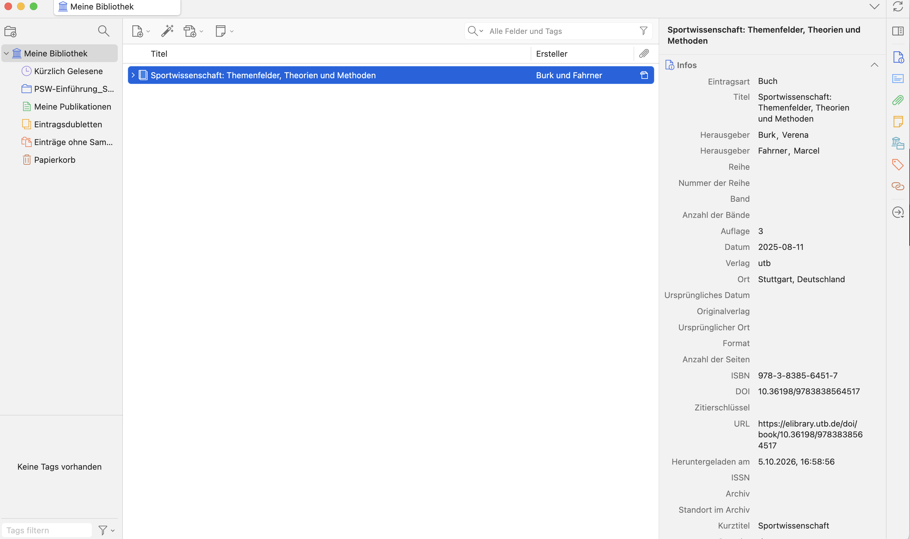
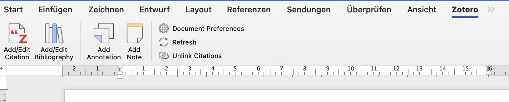
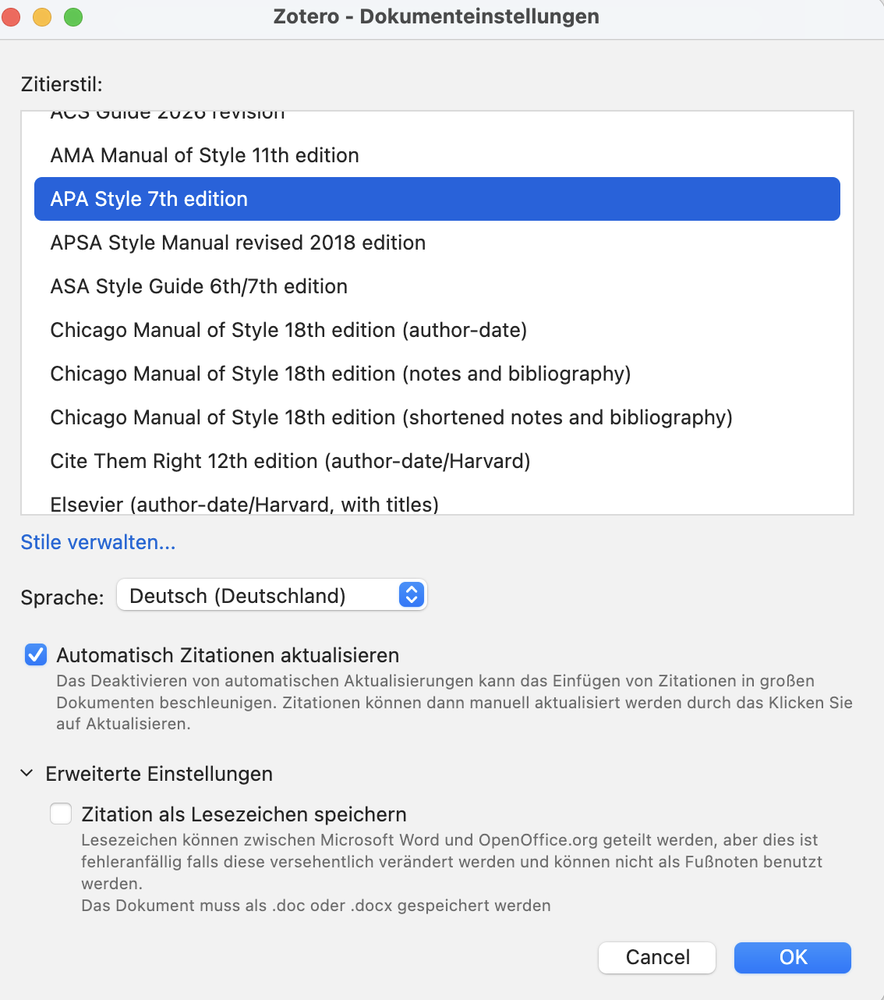
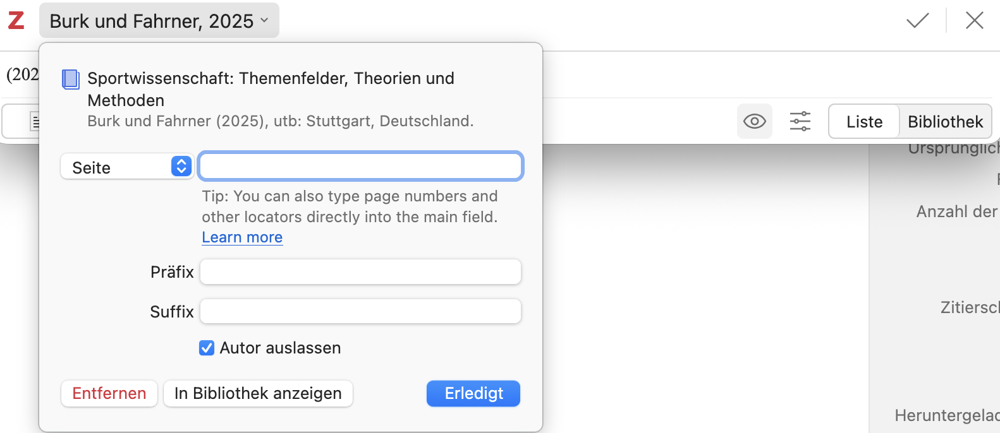
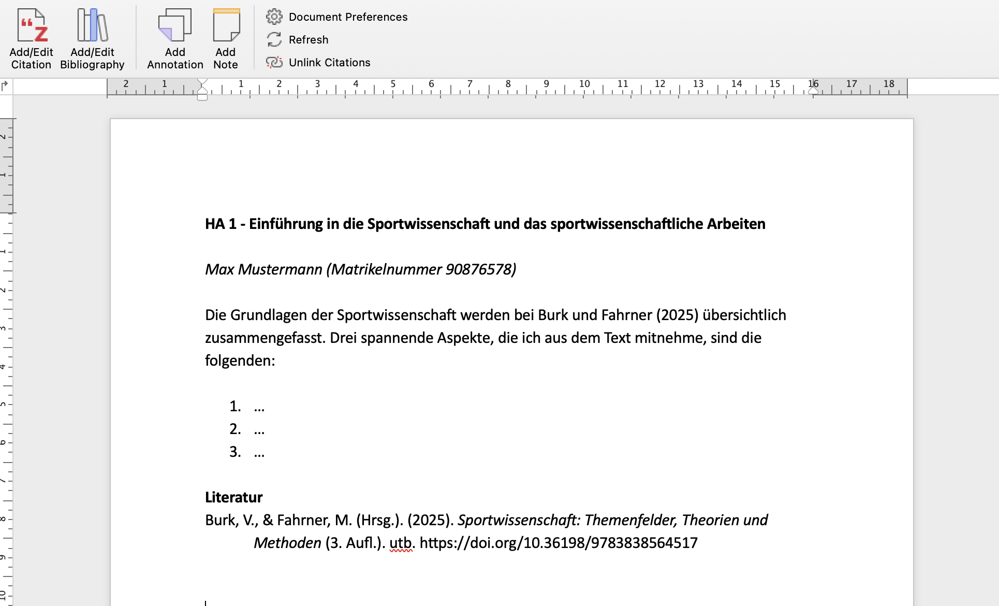

<!--
author: Tim Heemsoth
email: tim.heemsoth@uni-flensburg.de
version: 1.0.0
language: de
narrator: Deutsch Female

import:  https://raw.githubusercontent.com/EUF-SpoWis/BA_PSW_Einfuehrung_Sportwissenschaft/refs/heads/main/config.md
import: https://raw.githubusercontent.com/LiaTemplates/Wikimedia/main/README.md

@onload
window.citationStyle = "apa"
window.bibliographyLoad("https://raw.githubusercontent.com/Just-Jannis/Barrierefreie-Lernmaterialien/refs/heads/main/BarrierefreiLit.bib")
@end

-->

# Literatur zitieren 

| Parameter                | Kursinformationen                                                                                       |
| ------------------------ | ------------------------------------------------------------------------------------------------------- |
| **Veranstaltung:**       | @config.lecture                                                                                         |
| **Semester:**            | @config.semester                                                                                        |
| **Hochschule:**          | `Europa-Universität Flensburg`                                                                          |
| **Inhalte:**             | `Hinweise zum Umgang mit und Zitieren von Literatur`                                                    |
| **Link auf GitHub:**     | https://github.com/EUF-SpoWis/BA_PSW_Einfuehrung_Sportwissenschaft/blob/main/06_Literatur_zitieren.md   |
| **Autoren:**             | @author                                                                                                 |

> (c) Alle Rechte vorbehalten. 

--{{0}}--
Wissenschaftliches Arbeiten bedeutet nicht nur, eigene Gedanken verständlich darzustellen. Ebenso wichtig ist es, die Ideen, Erkenntnisse und Formulierungen anderer Personen eindeutig zu kennzeichnen. Wer Quellen korrekt angibt, macht nachvollziehbar, worauf die eigenen Aussagen beruhen, und ermöglicht es den Leser:innen, die verwendete Literatur selbst zu überprüfen.

--{{0}}--
Richtiges Zitieren erfüllt dabei mehrere wichtige Funktionen: Es schützt vor Plagiaten, würdigt die Arbeit anderer Autor:innen und erhöht die Glaubwürdigkeit der eigenen wissenschaftlichen Arbeit. Gleichzeitig kann das Zitieren zunächst kompliziert wirken. Wann muss eine Quelle angegeben werden? Was ist der Unterschied zwischen einem direkten und einem indirekten Zitat? Wie werden Bücher, Zeitschriftenartikel oder Internetquellen im Literaturverzeichnis aufgeführt?

--{{0}}--
In diesem Kurs lernst du die grundlegenden Regeln des Zitierens nach den Richtlinien der American Psychological Association, kurz APA, kennen. Du erfährst, wie Quellen im Text angegeben werden, wie ein Literaturverzeichnis aufgebaut ist und welche Besonderheiten bei unterschiedlichen Quellenarten beachtet werden müssen. Anhand von Beispielen und Übungen kannst du das Gelernte direkt anwenden und typische Fehler erkennen.

--{{0}}--
Ziel des Kurses ist es, dir mehr Sicherheit beim wissenschaftlichen Schreiben zu geben. Am Ende sollst du Quellen selbstständig korrekt in deine Texte einbinden und ein vollständiges Literaturverzeichnis nach APA erstellen können.

## Motivierung

{{0-1}}
**************
>[!CAUTION]**Betrachte die folgende Einleitung eines Textes. Was fällt dir auf?**
>"Ein wesentliches Element des erziehenden Sportunterrichtes ist das selbstständige Arbeiten der Lernenden, welches etwa dadurch gefördert wird, dass Lernende selbst Unterricht anleiten. Der schülereigenen Lehrtätigkeit wird besonderes Lernpotenzial zugesprochen: Schülerinnen und Schüler, die einen Inhalt erfolgreich vermitteln wollen, müssen inhaltlich Experte sein, gleichzeitig müssen sie aber auch kommunikative und methodische Kompetenzen aufweisen. Dieser Ansatz lässt sich auf die von Jean Paul Martin begründete konstruktivistische Unterrichtsmethode „Lernen durch Lehren“ zurückführen. ..."
**************

{{1-2}}
**************
>[!NOTE]**Der (fast) gleiche Text...**
>"Ein wesentliches Element des erziehenden Sportunterrichtes ist das selbstständige Arbeiten der Lernenden (Achtergarde, 2007), welches etwa dadurch gefördert wird, dass Lernende selbst Unterricht anleiten. Der schülereigenen Lehrtätigkeit wird besonderes Lernpotenzial zugesprochen: Schülerinnen und Schüler, die einen Inhalt erfolgreich vermitteln wollen, müssen inhaltlich Experte sein, gleichzeitig müssen sie aber auch kommunikative und methodische Kompetenzen aufweisen (Renkl, 2013). Dieser Ansatz lässt sich auf die von Jean Paul Martin begründete konstruktivistische Unterrichtsmethode „Lernen durch Lehren“ zurückführen (Martin, 1996). ..."

>Achtergarde, F. (2007). *Selbstständiges Arbeiten im Sportunterricht*. Aachen: Meyer & Meyer.
>
>Martin, J.-P. (1996). Das Projekt "Lernen durch Lehren" - eine vorläufige Bilanz. *Fremdsprachen lehren und lernen, 25*, 70-86.
>
>Renkl, A. (2013). *Lernen durch Lehren. Zentrale Wirkmechanismen beim kooperativen Lernen* (4. Aufl.). Wiesbaden: Springer.

**************

## Funktionen des Zitierens
1. Eigene Leistung sichtbar machen – fremde Ideen und eigenen Beitrag unterscheiden
2. Aussagen überzeugend belegen – fundiert argumentieren statt nur behaupten
3. Nachprüfbarkeit ermöglichen – Quellen und Gedankengänge nachvollziehbar machen
4. Geistige Leistung anerkennen – fair mit der Arbeit anderer umgehen
5. Glaubwürdigkeit sichern – transparent arbeiten und Plagiate vermeiden

## APA als Richtlinie
Beim Zitieren orientiert sich das Fach Sport an den Rahmenrichtlinien der American Psychological Association [APA] in seiner neuesten Version. 

American Psychological Association. (2020). Publication manual of the American Psychological Association (7th ed.). https://doi.org/10.1037/0000165-000

## Grundsätze

### Übernommene Gedanken kenntlich machen
> **Allgemein**  
> Fremde Gedanken, Formulierungen, Daten und Ergebnisse müssen als Übernahmen erkennbar sein. Das gilt sowohl für wörtliche als auch für sinngemäße Übernahmen.
>
> **Beispiel**  
> Wer einen Forschungsbefund in eigenen Worten zusammenfasst, benötigt ebenso einen Quellenbeleg wie jemand, der einen Satz wörtlich übernimmt.

<strong>Hinweise</strong>

- Quellenbelege zeigen, woher eine Aussage stammt, und machen den eigenen Beitrag von übernommenen Inhalten unterscheidbar.
- Allgemeinwissen muss nicht grundsätzlich belegt werden. Fachspezifische Befunde, Definitionen und theoretische Positionen benötigen dagegen einen nachvollziehbaren Nachweis.
- Auch eigene bereits veröffentlichte Texte müssen bei einer erneuten Verwendung angemessen nachgewiesen werden.
- Quellenbelege im Text und vollständige Einträge im Literaturverzeichnis ergänzen sich.

### Direktes Zitat: wortgenaue Übernahme
> **Allgemein**  
> Ein direktes Zitat übernimmt den Wortlaut einer Quelle. Bei weniger als 40 Wörtern wird es in den eigenen Text integriert und in doppelte Anführungszeichen gesetzt.
>
> **Formatmuster**  
> „Wörtlich übernommener Text“ (Nachname, Jahr, S. xx).
>
> Alternativ: Nachname (Jahr) formuliert: „Wörtlich übernommener Text“ (S. xx).

<strong>Hinweise</strong>

- Direkte Zitate eignen sich insbesondere für Definitionen, besonders prägnante Formulierungen oder die genaue Auseinandersetzung mit einem Wortlaut.
- Insgesamt sollten direkte Zitate gezielt und eher sparsam eingesetzt werden.
- Der Wortlaut wird grundsätzlich einschließlich vorhandener Schreibweisen und Fehler übernommen.
- Ein möglicherweise irritierender Fehler im Original kann unmittelbar danach mit „[sic]“ kenntlich gemacht werden.
- Autor:innen, Erscheinungsjahr und genaue Fundstelle müssen angegeben werden.
- „xx“ ist ein Platzhalter und muss durch die tatsächliche Seitenzahl ersetzt werden.
- Bei kurzen direkten Zitaten steht der abschließende Satzpunkt normalerweise nach dem Quellenbeleg.

### Langes direktes Zitat: Blockzitat
> **Allgemein**  
> Direkte Zitate mit 40 oder mehr Wörtern werden als eigener, links eingerückter Absatz ohne Anführungszeichen dargestellt.
>
> **Formatmuster**  
> Der vollständig übernommene Text steht als eigener eingerückter Absatz. Wird der Quellenbeleg am Ende ergänzt, steht er nach dem abschließenden Satzzeichen. (Nachname, Jahr, S. xx)

<strong>Hinweise</strong>

- Entscheidend ist die Wortzahl, nicht die Anzahl der Zeilen.
- Das gesamte Blockzitat wird etwa 1,27 cm vom linken Rand eingerückt.
- Das Blockzitat wird nicht zentriert.
- Bei einem vollständig nachgestellten Quellenbeleg steht das letzte Satzzeichen des Zitats vor dem Beleg.
- Nach der schließenden Klammer des nachgestellten Belegs folgt kein weiterer Punkt.
- Sind Autor:innen und Jahr bereits im einleitenden Satz genannt, genügt nach dem Zitat die Fundstellenangabe.
- Das Formatmuster oben veranschaulicht die Position des Quellenbelegs. Die tatsächliche Einrückung muss im verwendeten Schreibprogramm eingestellt werden.

### Direkte Zitate: Auslassungen und Ergänzungen
> **Allgemein**  
> Auslassungen innerhalb eines Zitats werden mit Auslassungspunkten gekennzeichnet. Eigene Ergänzungen oder Erläuterungen stehen in eckigen Klammern.
>
> **Formatmuster**  
> Auslassung: „Beginn der übernommenen Passage … Fortsetzung der übernommenen Passage“.
>
> Ergänzung: „Sie [die befragten Sportlehrkräfte] beschrieben …“.

<strong>Hinweise</strong>

- APA verwendet für Auslassungen „…“ oder drei durch Leerzeichen getrennte Punkte „. . .“.
- Eckige Klammern um die Auslassungspunkte – also „[…]“ – sind nach APA nicht die Standardform.
- Am Anfang und Ende eines Zitats werden normalerweise keine zusätzlichen Auslassungspunkte gesetzt.
- Eine Auslassung darf den Sinn der Originalaussage nicht verändern.
- Eigene Ergänzungen müssen als solche erkennbar bleiben und dürfen der Quelle keine zusätzliche Aussage unterschieben.
- Wird über eine Satzgrenze hinweg ausgelassen, sind der Satzpunkt und die Auslassungspunkte entsprechend zu berücksichtigen.
- Die Formatmuster ersetzen nicht den erforderlichen Quellenbeleg mit genauer Fundstelle.

### Indirektes Zitat: sinngemäße Übernahme
> **Allgemein**  
> Bei einem indirekten Zitat bzw. einer Paraphrase wird ein fremder Gedanke in eigenen Worten und mit eigenständigem Satzbau wiedergegeben. Anführungszeichen werden nicht verwendet.
>
> **Beispiel für die Form des Quellenbelegs**  
> (Spengler & Woll, 2013)
>
> Alternativ: Spengler und Woll (2013) …

<strong>Hinweise</strong>

- Paraphrasen sind beim wissenschaftlichen Schreiben die übliche Form, fremde Erkenntnisse in die eigene Argumentation einzubinden.
- Es reicht nicht aus, lediglich einzelne Wörter durch Synonyme zu ersetzen.
- Die Aussage der Quelle muss inhaltlich korrekt erhalten bleiben.
- Nach APA sind bei Paraphrasen Autor:innen und Erscheinungsjahr erforderlich.
- Eine Seitenangabe ist nach APA nicht grundsätzlich vorgeschrieben, kann aber das Auffinden der Passage erleichtern.
- Für deine Haus- und Abschlussarbeiten gilt zusätzlich die unten genannte fachinterne Vorgabe zu Seitenangaben.
- Ein Quellenbeleg am Absatzende bezieht sich nicht automatisch eindeutig auf alle vorhergehenden Sätze. Der Umfang der Übernahme muss erkennbar sein.

### Besonderheit für Haus- und Abschlussarbeiten: Seitenangaben
> **Allgemein**  
> Bei Haus- und Abschlussarbeiten im Fach Sport werden auch bei indirekten Zitaten Seitenangaben ergänzt.
>
> **Beispiel für die Form des Quellenbelegs**  
> (Spengler & Woll, 2013, S. xx)
>
> „xx“ muss durch die Seite bzw. den Seitenbereich ersetzt werden, auf den sich die konkrete Aussage bezieht.

<strong>Hinweise</strong>

- Maßgeblich sind die Anforderungen der jeweiligen Lehrveranstaltung, des Fachbereichs oder der betreuenden Person.
- Eine einzelne Seite wird beispielsweise als „S. 15“ angegeben, ein zusammenhängender Seitenbereich als „S. 15–17“.
- Gib möglichst die genaue Fundstelle an, nicht pauschal den gesamten Seitenumfang eines Artikels.

### Quellenbelege im Text: eine Person
> **Allgemein**  
> In Klammern: (Nachname, Jahr, S. xx)
>
> Im Satz: Nachname (Jahr, S. xx)
>
> **Beispiel für die Form des Quellenbelegs**  
> (Gissel, 2014, S. xx)
>
> Alternativ: Gissel (2014, S. xx) …

<strong>Hinweise</strong>

- Genannt wird der Nachname, nicht der Vorname oder ein akademischer Titel.
- Die Seitenangabe ist bei direkten Zitaten erforderlich und wird hier bei indirekten Zitaten entsprechend der fachinternen Vorgabe ebenfalls berücksichtigt.
- „xx“ muss vor der Verwendung durch die tatsächliche Fundstelle ersetzt werden.

### Quellenbelege im Text: zwei Personen
> **Allgemein**  
> In Klammern: (Nachname & Nachname, Jahr, S. xx)
>
> Im Satz: Nachname und Nachname (Jahr, S. xx)
>
> **Beispiel für die Form des Quellenbelegs**  
> (Spengler & Woll, 2013, S. xx)
>
> Alternativ: Spengler und Woll (2013, S. xx) …

<strong>Hinweise</strong>

- Bei zwei Autor:innen werden bei jeder Nennung beide Nachnamen angegeben.
- Innerhalb von Klammern steht ein „&“.
- Im deutschsprachigen Fließtext wird „und“ verwendet.
- Die Reihenfolge der Namen entspricht der Reihenfolge in der Veröffentlichung.
- Die tatsächliche Fundstelle muss anstelle von „xx“ eingesetzt werden.

### Quellenbelege im Text: drei oder mehr Personen
> **Allgemein**  
> In Klammern: (Nachname et al., Jahr, S. xx)
>
> Im Satz: Nachname et al. (Jahr, S. xx)
>
> **Beispiel für die Form des Quellenbelegs**  
> (Moeijes et al., 2019, S. xx)
>
> Alternativ: Moeijes et al. (2019, S. xx) …

<strong>Hinweise</strong>

- Ab drei Autor:innen wird grundsätzlich bereits bei der ersten Nennung nur der erste Nachname mit „et al.“ angegeben.
- „Et al.“ bedeutet „und andere“.
- Der Ausdruck wird nicht kursiv gesetzt.
- Der Punkt steht nach „al.“, nicht nach „et“.
- Falls verschiedene Quellen durch die Verkürzung nicht mehr unterscheidbar wären, werden so viele zusätzliche Namen genannt, wie für die Unterscheidung erforderlich sind.
- Im Literaturverzeichnis gelten andere Regeln: Dort werden bei bis zu 20 Autor:innen alle Namen aufgeführt.
- Die tatsächliche Fundstelle muss anstelle von „xx“ eingesetzt werden.

### Quellenbelege im Text: Organisation
> **Allgemein**  
> Erste Nennung in Klammern: (Name der Organisation [Abkürzung], Jahr, S. xx)
>
> Weitere Nennungen: (Abkürzung, Jahr, S. xx)
>
> **Beispiel für die Form des Quellenbelegs**  
> Erste Nennung: (World Health Organization [WHO], 2020, S. xx)
>
> Weitere Nennungen: (WHO, 2020, S. xx)

<strong>Hinweise</strong>

- Eine Abkürzung muss nicht eingeführt werden.
- Sie ist vor allem sinnvoll, wenn die Organisation mehrfach genannt wird und die Abkürzung verständlich ist.
- Bei einer ersten Nennung im Satz lautet die Form: World Health Organization (WHO, 2020, S. xx) …
- Im Literaturverzeichnis steht der ausgeschriebene Organisationsname.
- Die tatsächliche Fundstelle muss anstelle von „xx“ eingesetzt werden.

### Quellen ohne Seitenzahlen
> **Allgemein**  
> Fehlen Seitenzahlen, wird bei einem direkten Zitat eine andere nachvollziehbare Fundstelle angegeben, beispielsweise eine Absatznummer, eine Abschnittsüberschrift oder eine Zeitmarke.
>
> **Formatmuster**  
> Webseite: (Nachname bzw. Organisation, Jahr, Abs. 3)
>
> Video: (Name des Accounts, Jahr, 2:15)

<strong>Hinweise</strong>

- Verwende vorhandene Abschnittsüberschriften oder zähle die Absätze bei Bedarf selbst.
- Eine Abschnittsüberschrift kann mit einer Absatznummer kombiniert werden.
- Bei audiovisuellen Quellen bezeichnet die Zeitmarke den Beginn der zitierten Passage.
- Die Seitenzahl eines Ausdrucks einer Webseite ist nicht automatisch eine stabile Seitenzahl der Quelle.
- Für indirekte Zitate ohne Seitenzahlen beachte zusätzlich die Anforderungen deiner Lehrveranstaltung.

### Fremdsprachige Quellen und eigene Übersetzungen
> **Allgemein**  
> Ein direktes Zitat aus einer fremdsprachigen Quelle wird im Originalwortlaut wiedergegeben. Eine selbst angefertigte Übersetzung wird nach APA dagegen als Paraphrase, also indirektes Zitat, behandelt.
>
> **Formatmuster für eine eigene Übersetzung**  
> Sinngemäße Wiedergabe auf Deutsch (Nachname, Jahr, S. xx).
>
> Um die eigene Übersetzungsleistung transparent zu machen, kann ergänzend „eigene Übersetzung“ angegeben werden.

<strong>Hinweise</strong>

- Die eigene Übersetzung wird nach APA nicht als wortgetreues Originalzitat in Anführungszeichen gesetzt.
- Die Originalquelle muss trotzdem nachgewiesen werden.
- APA empfiehlt bei selbst übersetzten Passagen eine genaue Fundstelle.
- Eine allgemeine APA-Pflicht, jedes nicht englischsprachige Zitat zusätzlich in einer Fußnote zu übersetzen, besteht nicht.
- Ob eine Übersetzung des Originalzitats ergänzt werden soll, richtet sich nach der Verständlichkeit für die Lesenden und den jeweiligen Hochschulvorgaben.
- Wird eine veröffentlichte Übersetzung verwendet, muss die tatsächlich verwendete übersetzte Ausgabe nachgewiesen werden.

### Mehrere Quellen für eine Aussage
> **Allgemein**  
> Werden mehrere Veröffentlichungen gemeinsam als Belege genannt, stehen sie innerhalb einer Klammer in alphabetischer Reihenfolge und werden durch Semikola getrennt.
>
> **Beispiel für die Form des Quellenbelegs**  
> (Moeijes et al., 2019, S. xx; Spengler & Woll, 2013, S. xx)

<strong>Hinweise</strong>

- Jede Quelle muss die Aussage tatsächlich stützen.
- Die alphabetische Reihenfolge richtet sich nach den Nachnamen der Erstautor:innen bzw. den Organisationsnamen.
- Die Fundstellen werden für jede Quelle gesondert angegeben.
- Die tatsächlichen Fundstellen müssen anstelle von „xx“ eingesetzt werden.

### Online verfügbar bedeutet nicht automatisch „Webseite“
> **Allgemein**  
> Für das Literaturverzeichnis ist die Art der Veröffentlichung entscheidend, nicht der Zugangsweg.
>
> **Beispiele**  
> Ein online gelesener Zeitschriftenartikel bleibt ein Zeitschriftenartikel. Ein E-Book bleibt ein Buch. Eine institutionelle Leitlinie als PDF bleibt eine Leitlinie.

<strong>Hinweise</strong>

- Eine PDF-Datei ist kein eigener Quellentyp.
- Ein online bereitgestellter Sammelwerksbeitrag wird weiterhin als Sammelwerksbeitrag nachgewiesen.
- Das Muster für Webseiten wird verwendet, wenn kein spezifischerer Quellentyp zutrifft.
- Prüfe vor der Formatierung daher zuerst, welche Art von Veröffentlichung tatsächlich vorliegt.

## Literaturverzeichnis erstellen

### Allgemeine Hinweise
>[!CAUTION] Grundsatz
> Am Ende eines akademischen Textes müssen unter "Literatur" genau die Quellen alphabetisch aufgeführt werden, die wörtlich oder sinngemäß in die Arbeit eingegangen sind. Dabei gilt die folgende Sortierregel: 
> - Ordne die Quellen alphabetisch nach Nachnamen
> - Ordne mehrere Veröffentlichungen des gleichen Verfassers chronologisch nach Jahr (mit dem ältesten Titel beginnend)
> - Mehrere Veröffentlichungen eines Autors (oder einer Autorengruppe) aus **demselben Jahr** werden mit a, b, c gekennzeichnet (z. B. Müller, 1997a; Müller, 1997b)

>[!CAUTION] Hinweise
> Die folgenden Muster orientieren sich an APA 7 in einer deutschsprachigen Anpassung mit „Hrsg.“, „Aufl.“ und „S.“. Bei englischsprachigen Veröffentlichungen können die entsprechenden Angaben „Eds.“, „ed.“ und „pp.“ beibehalten werden.
>
> „Name, V.“ steht für den Nachnamen und die Initiale bzw. Initialen der Vornamen. Angaben wie „DOI oder URL“ sind Platzhalter innerhalb der allgemeinen Muster.

### Buch
> **Allgemein**  
> Name, V., & Name, V. (Jahr). *Titel: Untertitel* (Auflage, sofern nicht die erste). Verlag. DOI, falls vorhanden
>
> **Beispiel**  
> Döring, N., & Bortz, J. (2016). *Forschungsmethoden und Evaluation in den Sozial- und Humanwissenschaften* (5. Aufl.). Springer. https://doi.org/10.1007/978-3-642-41089-5

<strong>Hinweise</strong>

- Der Buchtitel einschließlich Untertitel wird kursiv gesetzt. Die Auflagenangabe steht nicht kursiv in Klammern.
- Die erste Auflage wird nicht angegeben.
- Ein Verlagsort wird nicht genannt.
- Wenn eine DOI vorhanden ist, wird sie ergänzt – unabhängig davon, ob die gedruckte oder die elektronische Ausgabe verwendet wurde.

### Herausgegebenes Buch als Gesamtwerk
> **Allgemein**  
> Name, V., & Name, V. (Hrsg.). (Jahr). *Titel: Untertitel* (Auflage, sofern nicht die erste). Verlag. DOI, falls vorhanden
>
> **Beispiel**  
> Tenenbaum, G., & Eklund, R. C. (Eds.). (2020). *Handbook of sport psychology* (4th ed.). Wiley. https://doi.org/10.1002/9781119568124

<strong>Hinweise</strong>

- Dieses Muster wird verwendet, wenn das gesamte Sammelwerk gemeint ist.
- Die Herausgeber:innen stehen an der Position, an der bei einem verfassten Buch die Autor:innen stehen.

### Beitrag in einem Sammelwerk
> **Allgemein**  
> Name, V. (Jahr). Titel des Beitrags. In V. Name & V. Name (Hrsg.), *Titel des Sammelwerks* (Auflage, sofern nicht die erste, S. xx–xx). Verlag. DOI des Beitrags, falls vorhanden
>
> **Beispiel**  
> Gissel, N. (2014). Welche Kompetenzen wollen wir vermitteln? Der „Kompetenzwürfel“ und Konsequenzen für die Praxis. In M. Pfitzner (Hrsg.), *Aufgabenkultur im Sportunterricht: Konzepte und Befunde zur Methodendiskussion für eine neue Lernkultur* (S. 67–91). Springer VS. https://doi.org/10.1007/978-3-658-03837-3_4

<strong>Hinweise</strong>

- Der Beitragstitel wird nicht kursiv gesetzt. Kursiv steht der Titel des Sammelwerks.
- Bei den Herausgeber:innen stehen die Initialen vor dem Nachnamen. Bei den Autor:innen des Beitrags ist die Reihenfolge umgekehrt.
- Auflage und Seiten werden gegebenenfalls in einer gemeinsamen Klammer angegeben, beispielsweise: (2. Aufl., S. 67–91).
- Wenn für den Beitrag eine eigene DOI existiert, wird diese verwendet.

### Zeitschriftenartikel allgemein
> **Allgemein**  
> Name, V., & Name, V. (Jahr). Titel des Artikels. *Name der Zeitschrift, Band*(Heftnummer), xx–xx. DOI, falls vorhanden
>
> **Beispiel**  
> Spengler, S., & Woll, A. (2013). The more physically active, the healthier? The relationship between physical activity and health-related quality of life in adolescents: The MoMo study. *Journal of Physical Activity and Health, 10*(5), 708–715. https://doi.org/10.1123/jpah.10.5.708

<strong>Hinweise</strong>

- Der Artikelname wird nicht kursiv gesetzt. Zeitschriftenname und Bandnummer stehen kursiv.
- Die Heftnummer steht unmittelbar nach der Bandnummer in nicht kursiven Klammern.
- Zwischen Bandnummer und öffnender Klammer steht kein Leerzeichen.
- Vor dem Seitenbereich steht kein „S.“.
- Für Seitenbereiche wird ein Gedankenstrich verwendet, beispielsweise 708–715.

### Zeitschriftenartikel mit mehreren Autor:innen
> **Allgemein**  
> Name, V., Name, V., Name, V., & Name, V. (Jahr). Titel des Artikels. *Name der Zeitschrift, Band*(Heftnummer), xx–xx. DOI, falls vorhanden
>
> **Beispiel**  
> Moeijes, J., van Busschbach, J. T., Bosscher, R. J., & Twisk, J. W. R. (2019). Sports participation and health-related quality of life: A longitudinal observational study in children. *Quality of Life Research, 28*(9), 2453–2469. https://doi.org/10.1007/s11136-019-02219-4

<strong>Hinweise</strong>

- Im Literaturverzeichnis werden bei bis zu 20 Autor:innen alle Namen aufgeführt.
- Vor dem letzten Namen steht ein „&“.
- Im Quellenbeleg im Text wird bei drei oder mehr Autor:innen grundsätzlich bereits ab der ersten Nennung „et al.“ verwendet: (Moeijes et al., 2019).

### Zeitschriftenartikel mit Artikelnummer
> **Allgemein**  
> Name, V., Name, V., & Name, V. (Jahr). Titel des Artikels. *Name der Zeitschrift, Band*(Heftnummer, falls vorhanden), Artikel Artikelnummer. DOI
>
> **Beispiel**  
> Jaitner, D., Körner, S., & Serwe-Pandrick, E. (2021). “Claim vs. reality”—A German case study on modes and functions of sports-pedagogical communication. *Frontiers in Sports and Active Living, 3*, Artikel 775322. https://doi.org/10.3389/fspor.2021.775322

<strong>Hinweise</strong>

- Die Artikelnummer ersetzt den Seitenbereich.
- Im englischsprachigen APA-Stil steht „Article“ statt „Artikel“.
- Wenn die Zeitschrift keine Heftnummer angibt, entfällt dieser Bestandteil.

### Institutionelle Leitlinie oder Bericht
> **Allgemein**  
> Name der Organisation. (Jahr). *Titel der Leitlinie oder des Berichts* (Berichtnummer, falls vorhanden). Verlag bzw. herausgebende Stelle, sofern nicht mit der Organisation identisch. DOI oder URL
>
> **Beispiel**  
> World Health Organization. (2020). *WHO guidelines on physical activity and sedentary behaviour*. https://www.who.int/publications/i/item/9789240015128

<strong>Hinweise</strong>

- Die Organisation wird als Autorin angegeben, wenn sie die institutionelle Verantwortung für die Veröffentlichung trägt.
- Wenn Autorin und Verlag bzw. herausgebende Stelle identisch sind, wird der Organisationsname nicht wiederholt.
- Eine ISBN wird im APA-Literaturverzeichniseintrag nicht angegeben.

### Webseite mit einer Organisation als Autorin
> **Allgemein**  
> Name der Organisation. (Jahr, Tag. Monat). *Titel der Webseite*. Name der Website, sofern nicht mit der Organisation identisch. URL
>
> **Beispiel**  
> World Health Organization. (2026, 4. November). *Physical activity*. https://www.who.int/news-room/fact-sheets/detail/physical-activity

<strong>Hinweise</strong>

- Das Beispiel bezieht sich auf die am 4. November 2026 datierte Fassung des WHO-Faktenblatts.
- Maßgeblich ist das Veröffentlichungsdatum oder ein inhaltlich relevantes Aktualisierungsdatum der konkreten Seite.
- Ein allgemeines Copyright-Jahr im Seitenfuß wird nicht automatisch als Veröffentlichungsdatum verwendet.
- Wenn Organisation und Websitename identisch sind, entfällt die Wiederholung des Websitenamens.
- Bei einer gewöhnlichen datierten Webseite wird kein Abrufdatum ergänzt.

## Literatur mit Software verwalten
>[!Tip] Literatur in Zotero verwalten
> 1. Installiere Zotero und registriere einen Account. Installiere den Zotero Connector (ein Plug-In für den Browser) und das Plug-in für Word.
> 2. Speicher einen Buchbeitrag, z. B.  "Fahrner, 2025" in Zotero ab und editiere die Informationen so, dass folgende Informationen enthalten sind: Fahrner, M. (2025) Sportwissenschaft als Fachdisziplin. In V. Burk & M. Fahrner (Hrsg.), *Sportwissenschaft*, S. 19-56. utb https://doi.org/10.36198/9783838564517 (s. Abbildung 1)
> 3. Lege eine neue Sammlung an und ordne relevante Quellen dieser Sammlung zu. 
> 4. Speicher im Verlauf des Studiums jede relevante Quelle sofort in Zotero – nicht erst bei Beginn einer Hausarbeit. Ergänze  aussagekräftige Schlagwörter und kurze Notizen dazu, wofür eine Quelle später nützlich sein könnte.

### Mini-Übung 
>[!TIP] Durchlaufe die folgenden Schritte
> 1. Schreibe einen Satz in ein Worddokument und füge das Jahr der Quelle über den Zotero-Plug-in ein. Dabei wähle den Zitationsstyle "APA Style 7th edition" (klicke auf  Abbildungen 2, 3 und 4). Der Satz soll lauten: 
> "Die Grundlagen der Sportwissenschaft werden bei Burk und Fahrner (2025) übersichtlich zusammengefasst.".
> 2. Ergänze über das Zotero-Plug in die Literatur(-liste), die in diesem Fall aus genau einer Quelle besteht (klicke auf Abbildung 5).

## Übung

> [!NOTE] Hinweis
> In den folgenden 24 Aufgaben wendest du die Regeln zum Zitieren an. Alle Zitate stammen aus realen sportswissenschaftlichen bzw. benachbarten Publikationen.

### 1: Muss hier eine Quelle stehen?

**Für welche Aussagen in einer Hausarbeit benötigst du einen Quellenbeleg?** (mehrere Antworten möglich)

1. Die Olympischen Spiele der Neuzeit fanden 1896 erstmals in Athen statt.
2. Du gibst einen Forschungsbefund von Spengler und Woll (2013) in eigenen Worten wie folgt wieder: Körperliche Aktivität hängt mit der gesundheitsbezogenen Lebensqualität von Jugendlichen zusammen.
3. Du übernimmst das Kompetenzmodell des „Kompetenzwürfels“ von Gissel (2014) in deine Argumentation.
4. Du verwendest eine Passage aus deiner eigenen, bereits bewerteten Hausarbeit aus dem letzten Semester erneut.

<strong>Lösung prüfen</strong>

**2, 3 und 4** benötigen einen Beleg.

**Zu 1:** gilt in der Regel als Allgemeinwissen. Im Zweifel – etwa bei genauen Zahlen oder umstrittenen Angaben – ist ein Beleg trotzdem sinnvoll.

**Zu 2:** Auch sinngemäße Übernahmen müssen belegt werden – etwa (Spengler & Woll, 2013, S. 708).

**Zu 3:** Fachspezifische Modelle und theoretische Positionen benötigen immer einen Nachweis.

**Zu 4:** Auch eigene Texte dürfen nicht ohne Kennzeichnung wiederverwendet werden. Bereits bewertete Arbeiten erneut einzureichen ist zudem häufig prüfungsrechtlich unzulässig.

### 2: Was fehlt bei diesem Zitat?

**Finde den Fehler in folgendem Zitat.**

> „Being physically active especially in sports clubs is positively linked to higher HRQOL of adolescents“ (Spengler & Woll, 2013).

<strong>Lösung prüfen</strong>

**Die Seitenangabe fehlt.**

Bei direkten Zitaten muss die genaue Fundstelle angegeben werden. 

„… of adolescents“ (Spengler & Woll, 2013, S. 708).

### 3: Welcher Beleg ist korrekt?

**Folgende Angaben sind bekannt: Der Text wurde von Quin Wang und Yanping Li im Jahr 2023 veröffentlicht, das Zitat steht auf Seite 1276. Du möchtest folgenden Satz direkt zitieren: „Virtual reality (VR), augmented reality (AR) and mixed reality (MR) have
sparked recently in improving the effectiveness of teacher education“ Welche Quellenangabe ist korrekt?**

1. „… in improving the effectiveness of teacher education“ (Wang et al., 2023, S. 1276).
2. „… in improving the effectiveness of teacher education“ (Wang & Li, 2023, S. 1276).
3. „… in improving the effectiveness of teacher education“ (Wang & Li, S. 1276).
4. „… in improving the effectiveness of teacher education“ (Wang & Li, 2023).

<strong>Lösung prüfen</strong>

**Lösung 2** ist korrekt.

**Zu 1:** „et al.“ wird erst ab drei Autor*innen verwendet. Hier gibt es genau zwei.

**Zu 2:** Autorinnen, Jahr und Seitenangabe sind vollständig und korrekt.

**Zu 3:** Das Erscheinungsjahr fehlt.

**Zu 4:** Bei einem direkten Zitat fehlt die Seitenangabe.

### 4: Eine Passage auslassen

**Zitiere den folgenden Satz vollständig mit Quellenbeleg und lasse dabei die Aufzählung „(1) hierarchical demarcation, (2) unsystematic approach, (3) direct synthesis“ aus.**

Originalsatz der Autor:innen Jaitner, Koerner und Serwe-Pandrick (2021, S. 1):

> „While analyzing 212 scientific texts of sports-pedagogical provenance, three central variations of the distinction could be identified, which persist until today and are present in the discipline's central discussion lines: (1) hierarchical demarcation, (2) unsystematic approach, (3) direct synthesis.“

<strong>Lösung prüfen</strong>

**So sieht das korrekte Zitat aus:**

„While analyzing 212 scientific texts of sports-pedagogical provenance, three central variations of the distinction could be identified, which persist until today and are present in the discipline's central discussion lines …“ (Jaitner et al., 2021, S. 1).

- Die Auslassung wird nach APA mit Auslassungspunkten **ohne eckige Klammern** gekennzeichnet.
- Bei drei Autor:innen steht bereits bei der ersten Nennung „et al.“.
- Der Satzpunkt steht nach der Klammer.

### 5: Ist das ein korrektes Zitat?

**Prüfe den Text einer Studentin auf Fehler.** (mehrere Fehler)

Originalsatz aus dem Abstract von Moeijes, van Busschbach, Bosscher und Twisk (2019, S. 2453):

> „As frequency is more relevant than the form of sports participation, children should be encouraged to perform any kind of sports activity on a very regular base.“

Text der Studentin:

> „Da die Häufigkeit bedeutsamer ist als die Form der Sportbeteiligung, sollten Kinder dazu ermutigt werden, irgendeine Form sportlicher Aktivität sehr regelmäßig auszuüben.“

<strong>Lösung prüfen</strong>

**Es gibt zwei Probleme:**

**Problem 1:** Die Studentin hat den Satz selbst übersetzt. Eine selbst angefertigte Übersetzung gilt nach APA als Paraphrase und wird nicht in Anführungszeichen gesetzt. Ein wörtliches Zitat müsste den englischen Originalwortlaut wiedergeben.

**Problem 2:** Der Quellenbeleg fehlt. Auch die übersetzte sinngemäße Übernahme muss belegt werden, hier nach der fachinternen Vorgabe mit Seitenangabe: (Moeijes et al., 2019, S. 2453).

### 6: Drei oder mehr Personen

**Finde den Fehler in folgendem Beleg.**

Erste Nennung im Text:

> Sportbeteiligung hängt mit der gesundheitsbezogenen Lebensqualität von Kindern zusammen (Moeijes, van Busschbach, Bosscher & Twisk, 2019, S. 2453).

<strong>Lösung prüfen</strong>

**Bei drei oder mehr Autor*innen wird bereits bei der ersten Nennung abgekürzt.**

Nach APA 7 wird nur der erste Nachname mit „et al.“ angegeben:

(Moeijes et al., 2019, S. 2453)

Die vollständige Namensliste gehört ins Literaturverzeichnis.

### 7: „&“ oder „und“?

**Finde den Fehler in folgendem Satz.** (eine Antwort)

> Spengler & Woll (2013, S. 708) zeigen, dass ein höheres Aktivitätsniveau nicht automatisch mit höherer Lebensqualität einhergeht.

<strong>Lösung prüfen</strong>

**Im Fließtext steht falscherweise „&“.**

Im Fließtext wird „und“ verwendet, „&“ nur innerhalb der Klammer:

Spengler und Woll (2013, S. 708) zeigen …

oder: … einhergeht (Spengler & Woll, 2013, S. 708).

### 8: Kleine Zeichen, großer Unterschied

**Welche Schreibweise ist korrekt?**

1. (Moeijes et. al, 2019, S. 2453)
2. (Moeijes *et al.*, 2019, S. 2453)
3. (Moeijes et al., 2019, S. 2453)
4. (Moeijes u. a., 2019, S. 2453)

<strong>Lösung prüfen</strong>

**Lösung 3** ist korrekt.

**Zu 1:** Der Punkt steht nach „al.“, nicht nach „et“ („et“ ist ein vollständiges Wort).

**Zu 2:** „et al.“ wird nicht kursiv gesetzt.

**Zu 3:** Korrekt – der Punkt steht nach „al.“, der Ausdruck ist nicht kursiv.

**Zu 4:** In dieser APA-Anpassung wird einheitlich „et al.“ verwendet, nicht „u. a.“.

### 9: Organisationen als Autorin

**Finde die Fehler.** (mehrere Fehler)

In einer Hausarbeit wird die WHO zum ersten Mal genannt:

> Regelmäßige körperliche Aktivität ist definiert als „any bodily movement produced by skeletal muscles that requires energy expenditure“ (WHO, 2026).

Im Literaturverzeichnis steht:

> WHO. (2026, 4. November). *Physical activity*. https://www.who.int/news-room/fact-sheets/detail/physical-activity

<strong>Lösung prüfen</strong>

**Es gibt zwei Fehler:**

**Fehler 1:** Die Abkürzung wird ohne Einführung verwendet. Bei der ersten Nennung gehört: (World Health Organization [WHO], 2026); danach (WHO, 2026).

**Fehler 2:** Im Literaturverzeichnis steht der ausgeschriebene Name:

World Health Organization. (2026, 4. November). *Physical activity*. https://www.who.int/news-room/fact-sheets/detail/physical-activity

Die Abkürzung muss nicht eingeführt werden. Wird sie verwendet, muss sie aber verständlich eingeführt sein.

### 10: Kurz oder lang?

**Du willst die folgende Passage aus Jaitner, Koerner und Serwe-Pandrick (2021, S. 1) wörtlich übernehmen. Sie umfasst 58 Wörter, in deinem Dokument aber nur drei Zeilen. Wie stellst du sie dar?**

> „Academic sports pedagogy continuously assures itself of its disciplinary foundations and determines its position in the structure of modern sciences. While communication is based on differences, the distinction between claim and reality plays a crucial role in sports pedagogy. However, the forms and functions in which the distinction appears have not been more closely investigated in sports pedagogic.“

1. In doppelten Anführungszeichen im Fließtext, da sie weniger als vier Zeilen umfasst.
2. Als eingerückter Absatz ohne Anführungszeichen.
3. Als zentrierter, kursiver Absatz in Anführungszeichen.
4. Als eingerückter Absatz in Anführungszeichen.

<strong>Lösung prüfen</strong>

**Lösung 2** ist korrekt.

Entscheidend ist die **Wortzahl (ab 40 Wörtern)**, nicht die Zeilenzahl. Das Blockzitat wird links eingerückt, nicht zentriert, nicht kursiv und ohne Anführungszeichen dargestellt.

### 11: Wohin gehört der Punkt? (Blockzitat)

**Finde den Fehler am Ende dieses Blockzitats.**

Ende eines Blockzitats aus Jaitner et al. (2021, S. 1):

> … have not been more closely investigated in sports pedagogic. (Jaitner et al., 2021, S. 1).

<strong>Lösung prüfen</strong>

**Nach der schließenden Klammer steht ein überflüssiger Punkt.**

Das Satzzeichen steht beim Blockzitat zwar vor dem Beleg – aber nach der schließenden Klammer folgt kein weiterer Punkt:

> … have not been more closely investigated in sports pedagogic. (Jaitner et al., 2021, Abs. 1)

### 12: Wohin gehört der Punkt? (kurzes Zitat)

**Finde die Fehler in folgendem Satz.**

> Risch-Kerst und Rath (2025) betonen: „Mit dem Inkrafttreten der neuen europäischen Datenschutzgrundverordnung werden alle Unternehmen, die personenbezogene Daten verarbeiten, vor weitreichende Herausforderungen gestellt.“ (S. 29).

<strong>Lösung prüfen</strong>

**Es gibt zwei Fehler:**

**Fehler 1:** Der Satzpunkt steht im Zitat – er gehört aber nach den Beleg.

**Fehler 2:** Nach der Klammer steht ein zusätzlicher Punkt.

Korrekt:

Risch-Kerst und Rath (2025) betonen: „… vor weitreichende Herausforderungen gestellt“ (S. 29).

### 13: Mehrere Quellen in einer Klammer

**Finde die Fehler in folgendem Beleg.** (mehrere Fehler)

> Sportliche Aktivität hängt mit der gesundheitsbezogenen Lebensqualität zusammen (Spengler & Woll, 2013, S. 708, Moeijes et al., 2019, S. 2453).

<strong>Lösung prüfen</strong>

**Es gibt zwei Fehler:**

**Fehler 1:** Die Quellen müssen alphabetisch geordnet sein: Moeijes vor Spengler.

**Fehler 2:** Sie werden durch Semikola getrennt, nicht durch Kommas.

Korrekt: (Moeijes et al., 2019, S. 2453; Spengler & Woll, 2013, S. 708)

### 14: Eigene Ergänzung im Zitat

**Im Abstract von Spengler und Woll (2013, S. 708) wird die Abkürzung „HRQOL“ verwendet. Du möchtest beim Zitieren kenntlich machen, dass dahinter „health-related quality of life“ steht. Welche Variante ist korrekt?** (eine Antwort)

1. „… positively linked to higher HRQOL (health-related quality of life) of adolescents …“
2. „… positively linked to higher HRQOL [health-related quality of life] of adolescents …“
3. „… positively linked to higher health-related quality of life of adolescents …“
4. „… positively linked to higher HRQOL {health-related quality of life} of adolescents …“

<strong>Lösung prüfen</strong>

**Lösung 2** ist korrekt.

**Zu 1:** Runde Klammern sehen aus, als stammten sie aus dem Original.

**Zu 2:** Korrekt – eigene Ergänzungen stehen in eckigen Klammern.

**Zu 3:** Der Wortlaut wurde ohne Kennzeichnung verändert – das ist kein korrektes direktes Zitat mehr.

**Zu 4:** Geschweifte Klammern sind keine Kennzeichnungsform.

### 15: Eine englische Quelle übersetzen

**Eine Studentin schreibt in ihrer deutschsprachigen Hausarbeit: Spengler und Woll (2013, S. 708) stellen die Frage: „Je körperlich aktiver, desto gesünder?“ Was gilt für diese Passage?** (eine Antwort)

1. Korrekt – der Titel des Artikels darf übersetzt zitiert werden.
2. Falsch – eine eigene Übersetzung gilt als Paraphrase und darf nicht in Anführungszeichen gesetzt werden.
3. Korrekt – Übersetzungen dürfen immer wie Originalzitate behandelt werden.
4. Falsch – fremdsprachige Quellen dürfen in einer deutschsprachigen Arbeit nicht verwendet werden.

<strong>Lösung prüfen</strong>

**Lösung 2** ist korrekt.

Eine selbst angefertigte Übersetzung gilt nach APA als Paraphrase und wird nicht als wörtliches Zitat in Anführungszeichen gesetzt.

Richtig wäre entweder das englische Original: „The more physically active, the healthier?“ (Spengler & Woll, 2013, S. 708) – oder eine Paraphrase ohne Anführungszeichen. Die Ergänzung „eigene Übersetzung“ kann die Übersetzungsleistung transparent machen.

### 16: Eine Webseite ohne Seitenzahlen

**Du zitierst wörtlich aus dem WHO-Faktenblatt „Physical activity“ (Aktualisierung vom 4. November 2026): „WHO defines physical activity as any bodily movement produced by skeletal muscles that requires energy expenditure.“ Welcher Beleg ist korrekt?**

1. (WHO, 2026, S. 1)
2. (WHO, 2026, Abschnitt „Overview“)
3. (WHO, 2026)
4. (WHO, o. D., Abschnitt „Overview“)

<strong>Lösung prüfen</strong>

**Lösung 2** ist korrekt.

**Zu 1:** Die Seitenzahl eines Ausdrucks ist keine Seitenzahl der Quelle; Seitenzahlen dürfen nicht erfunden werden.

**Zu 2:** Korrekt – ohne Seitenzahlen wird eine andere nachvollziehbare Fundstelle angegeben, hier die Abschnittsüberschrift, in der der Satz steht.

**Zu 3:** Bei einem direkten Zitat fehlt die Fundstelle.

**Zu 4:** Das Faktenblatt ist datiert (4. November 2026); „o. D.“ wäre falsch.

### 17: Wer wird genannt?

**Du zitierst aus dem Beitrag „Welche Kompetenzen wollen wir vermitteln? Der ‚Kompetenzwürfel‘ und Konsequenzen für die Praxis“. Der Beitrag stammt von Norbert Gissel und erschien im von Michael Pfitzner herausgegebenen Sammelwerk *Aufgabenkultur im Sportunterricht* (2014). Finde den Fehler.** (eine Antwort)

> Kompetenzen im Sportunterricht lassen sich mehrdimensional beschreiben (Pfitzner, 2014, S. 67).

<strong>Lösung prüfen</strong>

**Es wird die falsche Person genannt.**

Genannt wird die Person, die den Beitrag verfasst hat, nicht die herausgebende Person des Sammelwerks:

(Gissel, 2014, S. 67)

### 18: Ein Bucheintrag mit Fehlern

**Finde alle Fehler in folgendem Literaturverzeichnis-Eintrag.** (mehrere Fehler)

> Döring, N. & Bortz, J. (2016): *Forschungsmethoden und Evaluation in den Sozial- und Humanwissenschaften*, 5. Auflage. Berlin: Springer.

<strong>Lösung prüfen</strong>

**Es gibt fünf Fehler:**

**Fehler 1:** Vor „&“ fehlt das Komma: Döring, N., & Bortz, J.

**Fehler 2:** Nach der Jahresklammer steht ein Doppelpunkt – dort gehört ein Punkt.

**Fehler 3:** Die Auflage steht nicht in Klammern und ist nicht abgekürzt: (5. Aufl.)

**Fehler 4:** Es wird ein Verlagsort angegeben – der entfällt nach APA 7.

**Fehler 5:** Die vorhandene DOI fehlt.

Korrekt:

Döring, N., & Bortz, J. (2016). *Forschungsmethoden und Evaluation in den Sozial- und Humanwissenschaften* (5. Aufl.). Springer. https://doi.org/10.1007/978-3-642-41089-5

### 19: Ein Zeitschriftenartikel mit Fehlern

**Finde alle Fehler in folgendem Literaturverzeichnis-Eintrag.** (mehrere Fehler)

> Spengler, S., & Woll, A. (2013). *The more physically active, the healthier? The relationship between physical activity and health-related quality of life in adolescents: The MoMo study.* Journal of Physical Activity and Health, 10 (5), S. 708-715. https://doi.org/10.1123/jpah.10.5.708.

<strong>Lösung prüfen</strong>

**Es gibt fünf Fehler:**

**Fehler 1:** Der Artikeltitel wird nicht kursiv gesetzt – kursiv sind Zeitschriftenname und Band.

**Fehler 2:** Zwischen Band und Heftklammer steht ein Leerzeichen – korrekt ist *10*(5).

**Fehler 3:** Vor dem Seitenbereich steht „S.“ – das entfällt bei Zeitschriftenartikeln.

**Fehler 4:** Für den Seitenbereich wird ein Gedankenstrich verwendet: 708–715.

**Fehler 5:** Nach der DOI steht ein Punkt – der entfällt.

Korrekt:

Spengler, S., & Woll, A. (2013). The more physically active, the healthier? The relationship between physical activity and health-related quality of life in adolescents: The MoMo study. *Journal of Physical Activity and Health, 10*(5), 708–715. https://doi.org/10.1123/jpah.10.5.708

### 20: Ein Sammelwerksbeitrag mit Fehlern

**Finde alle Fehler in folgendem Literaturverzeichnis-Eintrag.** (mehrere Fehler)

> Gissel, N. (2014). *Welche Kompetenzen wollen wir vermitteln? Der „Kompetenzwürfel“ und Konsequenzen für die Praxis.* In Pfitzner, M. (Hrsg.), Aufgabenkultur im Sportunterricht: Konzepte und Befunde zur Methodendiskussion für eine neue Lernkultur. Springer VS, 67–91.

<strong>Lösung prüfen</strong>

**Es gibt vier Fehler:**

**Fehler 1:** Der Beitragstitel wird nicht kursiv gesetzt – dafür aber der Titel des Sammelwerks.

**Fehler 2:** Bei Herausgeber:innen stehen die Initialen vor dem Nachnamen: In M. Pfitzner (Hrsg.)

**Fehler 3:** Die Seiten stehen nicht in Klammern mit „S.“ direkt nach dem Sammelwerkstitel: (S. 67–91)

**Fehler 4:** Die vorhandene DOI des Beitrags fehlt.

Korrekt:

Gissel, N. (2014). Welche Kompetenzen wollen wir vermitteln? Der „Kompetenzwürfel“ und Konsequenzen für die Praxis. In M. Pfitzner (Hrsg.), *Aufgabenkultur im Sportunterricht: Konzepte und Befunde zur Methodendiskussion für eine neue Lernkultur* (S. 67–91). Springer VS. https://doi.org/10.1007/978-3-658-03837-3_4

### 21: Keine Seitenzahlen im Artikel

**Der Artikel von Jaitner, Koerner und Serwe-Pandrick (2021) in *Frontiers in Sports and Active Living* hat keinen Seitenbereich, sondern die Artikelnummer 775322. Was steht im Literaturverzeichnis anstelle des Seitenbereichs?** (eine Antwort)

1. S. 1–12
2. Artikel 775322
3. Nichts – die Angabe entfällt ersatzlos.
4. Die URL der Zeitschrift

<strong>Lösung prüfen</strong>

**Lösung 2** ist korrekt.

**Zu 1:** Die Seitenzählung eines PDFs ist keine Angabe der Quelle selbst.

**Zu 2:** Korrekt – die Artikelnummer ersetzt den Seitenbereich: *Frontiers in Sports and Active Living, 3*, Artikel 775322. (Im Englischen: „Article“.)

**Zu 3:** Die Angabe entfällt nicht – sie wird durch die Artikelnummer ersetzt.

**Zu 4:** Die URL gehört nicht an diese Stelle; der Beitrag wird über seine DOI nachgewiesen.

### 22: Online gelesen – also eine Webseite?

**Du hast den Artikel von Spengler und Woll (2013) als PDF über die Website der Zeitschrift gelesen. Welchen Quellentyp verwendest du im Literaturverzeichnis?** (eine Antwort)

1. Webseite mit URL und Abrufdatum
2. Zeitschriftenartikel mit DOI
3. PDF-Dokument
4. Graue Literatur

<strong>Lösung prüfen</strong>

**Lösung 2** ist korrekt.

Entscheidend ist die **Art der Veröffentlichung**, nicht der Zugangsweg. Ein online gelesener Zeitschriftenartikel bleibt ein Zeitschriftenartikel. Eine PDF-Datei ist kein eigener Quellentyp.

### 23: Literaturverzeichnis sortieren

**Bringe die folgenden Einträge in die richtige Reihenfolge für ein Literaturverzeichnis.**  
**Zusatzfrage: Wie würdest du vorgehen, wenn du zwei Arbeiten derselben Autorin aus demselben Jahr im Verzeichnis hast?**

1. Döring, N., & Bortz, J. (2016). *Forschungsmethoden und Evaluation* (5. Aufl.). Springer.
2. Gissel, N. (2014). Welche Kompetenzen wollen wir vermitteln? … In M. Pfitzner (Hrsg.), *Aufgabenkultur im Sportunterricht* …
3. Güllich, A., & Krüger, M. (Hrsg.). (2022). *Sport: Das Lehrbuch für das Sportstudium* (2. Aufl.). Springer Spektrum.
4. Martin, J.-P. (1996). Das Projekt „Lernen durch Lehren“ – eine vorläufige Bilanz. *Fremdsprachen Lehren und Lernen, 25*, 70–86.
5. Moeijes, J., van Busschbach, J. T., Bosscher, R. J., & Twisk, J. W. R. (2019). Sports participation and health-related quality of life … *Quality of Life Research, 28*(9), 2453–2469.
6. Renkl, A. (1997). *Lernen durch Lehren: Zentrale Wirkmechanismen beim kooperativen Lernen*. Deutscher Universitätsverlag.
7. Risch-Kerst, M., & Rath, T. (2025). Datenflow in der Arena … In A. Schneider & T. Wendeborn (Hrsg.), *Gesellschaftsphänomen E-Sport* …
8. Schneider, A., Wendeborn, T., & Schmalfuß, A. (2025). It´s Match Time! … In A. Schneider & T. Wendeborn (Hrsg.), *Gesellschaftsphänomen E-Sport* …
9. Spengler, S., & Woll, A. (2013). The more physically active, the healthier? … *Journal of Physical Activity and Health, 10*(5), 708–715.
10. Tenenbaum, G., & Eklund, R. C. (Hrsg.). (2020). *Handbook of sport psychology* (4. Aufl.). Wiley.

<strong>Lösung prüfen</strong>

**Die Einträge sind bereits in der richtigen alphabetischen Reihenfolge nummeriert:**

**Döring – Gissel – Güllich – Martin – Moeijes – Renkl – Risch-Kerst – Schneider – Spengler – Tenenbaum**

- Sortiert wird nach dem Nachnamen der Erstautor*innen bzw. dem Organisationsnamen.
- Umlaute werden beim Sortieren wie ihre Grundvokale behandelt (ü wie u, ö wie o): „Gissel“ (Gi) steht daher vor „Güllich“ (Gu).
- „Martin“ (Ma) steht vor „Moeijes“ (Moe), und „Renkl“ (Ren) vor „Risch-Kerst“ (Ris).

**Zur Zusatzfrage:** Mehrere Veröffentlichungen derselben Person (oder Autorengruppe) aus demselben Jahr werden mit a, b, c gekennzeichnet – z. B. (Renkl, 1997a) und (Renkl, 1997b) – und im Verzeichnis alphabetisch nach Titel sortiert.

### 24: Einen Eintrag selbst erstellen

**Formuliere aus den folgenden Angaben einen Eintrag für das Literaturverzeichnis. Sage dabei auch, welche Teile kursiv gesetzt werden und welche Angaben nicht hineingehören.**

- Herausgeber: Gershon Tenenbaum und Robert C. Eklund
- Titel: Handbook of sport psychology
- Auflage: 4.
- Jahr: 2020
- Verlag: Wiley, Hoboken (New Jersey)
- DOI: 10.1002/9781119568124
- ISBN: 978-1-119-56807-0

<strong>Lösung prüfen</strong>

**So sieht der korrekte Eintrag aus:**

Tenenbaum, G., & Eklund, R. C. (Hrsg.). (2020). *Handbook of sport psychology* (4. Aufl.). Wiley. https://doi.org/10.1002/9781119568124

- Nur der **Buchtitel** ist kursiv.
- **Kein Verlagsort**, **keine ISBN**.
- Die DOI wird als vollständiger Link ohne abschließenden Punkt angegeben.
- Bei englischsprachigen Werken ist alternativ „(Eds.)“ und „(4th ed.)“ möglich – entscheidend ist, einheitlich vorzugehen.

